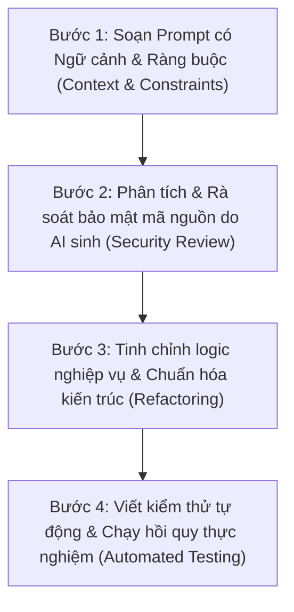

# BẢNG TỔNG HỢP DANH SÁCH PROMPT AI TRONG PHÁT TRIỂN ĐỒ ÁN
## ĐỒ ÁN: HỆ THỐNG WEBSITE BÁN HÀNG THEO MÔ HÌNH CHUỖI CỬA HÀNG HOA TƯƠI
### DỰ ÁN: HOA TƯƠI SÀI GÒN (BLOOM FLOWER CHAIN)
### Môn học: Lập trình Web — Học kỳ 1 (Năm học 2026 - 2027)

---

> **MỤC ĐÍCH TÀI LIỆU**:
> Tài liệu này được biên soạn nhằm đáp ứng **Tiêu chí 2 (Mức độ ứng dụng AI)** trong Rubrics đánh giá đồ án cuối khóa của bộ môn Lập trình Web. 
> Tài liệu tích hợp toàn diện từ 2 nguồn dữ liệu độc lập của dự án:
> 1. **Nhật ký khôi phục nguyên văn (Verbatim Recovered Prompts)** từ cơ sở dữ liệu session của Google Antigravity (Gemini) và OpenAI Codex.
> 2. **Lịch sử tái dựng từ 23 commit đóng góp thực tế** của thành viên nhóm (`quocanhug`) qua toàn bộ vòng đời phát triển ứng dụng.
> 3. **Nhóm Prompt chuyên biệt về Sinh Hình Ảnh (Image Generation), Sơ đồ kỹ thuật & Quản trị đa phương tiện (Cloudinary)** theo đúng yêu cầu đồ án.

---

## MỤC LỤC TỔNG QUAN

1. [QUY TRÌNH ỨNG DỤNG AI VÀ CAM KẾT LÀM CHỦ MÃ NGUỒN](#phan-1-quy-trinh)
2. [MA TRẬN PHÂN LOẠI CÁC PROMPT THEO NHÓM CHỨC NĂNG](#phan-2-ma-tran)
3. [PHẦN I: DANH SÁCH PROMPT SINH HÌNH ẢNH & ĐA PHƯƠNG TIỆN (IMAGE GENERATION)](#phan-3-sinh-hinh)
4. [PHẦN II: DANH SÁCH PROMPT NGUYÊN VĂN KHÔI PHỤC TỪ NHẬT KÝ THỰC TẾ](#phan-4-prompt-nguyen-van)
5. [PHẦN III: DANH SÁCH 23 PROMPT KỸ THUẬT TÁI DỰNG TỪ LỊCH SỬ COMMIT](#phan-5-prompt-commit)
6. [PHẦN IV: ĐỐI CHIẾU SAI SÓT CỦA AI VÀ CÁC ĐIỀU CHỈNH CỦA NHÓM](#phan-6-lam-chu)
7. [TỔNG KẾT MINH CHỨNG THEO RUBRIC CHẤM ĐIỂM](#phan-7-tong-ket)

---

<a name="phan-1-quy-trinh"></a>
# 1. QUY TRÌNH ỨNG DỤNG AI VÀ CAM KẾT LÀM CHỦ MÃ NGUỒN

Trong suốt quá trình thực hiện đồ án, nhóm sinh viên xác định **AI là trợ lý lập trình (AI Pair Programmer)**, tuyệt đối không sao chép thụ động mã nguồn. Toàn bộ các yêu cầu gửi đến AI đều tuân thủ quy trình 4 bước khép kín:



* **Công cụ AI sử dụng chính:** Google Antigravity (Mô hình Gemini 2.5 Pro / Flash), OpenAI Codex / ChatGPT, kết hợp DALL-E / Unsplash API để xử lý hình ảnh hoa tươi.
* **Mức độ làm chủ mã nguồn:** 100% các đoạn mã sinh ra đều được nhóm kiểm tra tính hợp lệ với Java 21, Spring Boot 4.1.1, Flyway migration và chuẩn hóa theo kiến trúc N-Tier. Nhóm đã tự tay thiết lập **880 ca kiểm thử Java** và **185 ca kiểm thử JavaScript**, đảm bảo hệ thống vận hành ổn định không phát sinh hồi quy.

---

<a name="phan-2-ma-tran"></a>
# 2. MA TRẬN PHÂN LOẠI CÁC PROMPT THEO NHÓM CHỨC NĂNG

| Nhóm nghiệp vụ | Số lượng Prompt | Mục tiêu hỗ trợ chính của AI | Kết quả sinh ra & Mã nguồn minh chứng |
|---|:---:|---|---|
| **1. Sinh Hình ảnh & Sơ đồ (Media & Visuals)** | 6 prompt | Sinh sơ đồ kiến trúc 5 tầng, sinh ảnh hoa nghệ thuật, tích hợp Cloudinary, banner thương hiệu. | `docs/diagrams/`, `CloudinaryService.java`, `DemoReviewSeed.java` |
| **2. Khảo sát & Thiết kế kiến trúc (Architecture)** | 4 prompt | Phân tích mô hình chuỗi cửa hàng hoa đa chi nhánh, phân chia entity JPA, Flyway migration. | 45 Entity JPA, `StoreInventory.java`, Flyway V1–V17 |
| **3. Bảo mật & Phân quyền (Security & Auth)** | 6 prompt | Cấu hình bảo mật kép: Session CSRF cho Thymeleaf và JWT Bearer cho REST API, OTP email. | `SecurityConfig.java`, `JwtSecurityConfig.java`, `OtpService.java` |
| **4. Nghiệp vụ Đơn hàng & Kho (Order & Inventory)** | 8 prompt | Trừ kho tức thời chống race condition (Pessimistic Lock), vòng đời đơn hàng, hủy hoàn kho. | `OrderWorkflowService.java`, `StoreInventoryRepository.java` |
| **5. Giao dịch, Cổng thanh toán & Ví (Payments & Wallet)** | 5 prompt | Cổng MoMo Sandbox QR, ví khách hàng (`customer_wallets`), ví cửa hàng (`stores.e_wallet`). | `MomoConfig.java`, `CustomerWalletService.java`, `start-web.ps1` |
| **6. Giao diện người dùng & Trải nghiệm (UI/UX)** | 7 prompt | Thiết kế Floral Theme mềm mại, bộ lọc chi nhánh đa cấp, phân trang AJAX, mobile responsive. | `floral.html`, `home-filters.js`, `customer-wallet.css`, `orders.html` |
| **7. Thời gian thực & Tương tác (Realtime STOMP)** | 4 prompt | Live chat WebSocket đính kèm thẻ hoa, chuông thông báo đơn hàng realtime có badge đếm số. | `WebSocketConfig.java`, `ChatController.java`, `chat-widget.js` |
| **8. Đóng gói & Dữ liệu thực nghiệm (Database & Packaging)** | 4 prompt | Xuất CSDL dump PostgreSQL & SQL Server 939 dòng dữ liệu, kịch bản test, tài liệu Word có ảnh. | `RentalShop_PostgreSQL_Full.sql`, `RentalShop_SQLServer_Full.sql` |

---

<a name="phan-3-sinh-hinh"></a>
# PHẦN I: DANH SÁCH PROMPT SINH HÌNH ẢNH & ĐA PHƯƠNG TIỆN (IMAGE GENERATION & MEDIA)

*Đây là nhóm prompt chuyên biệt giải quyết yêu cầu sinh hình ảnh, sơ đồ kiến trúc trực quan và tích hợp lưu trữ đám mây cho chuỗi cửa hàng hoa.*

---

### Prompt IMG-01: Sinh bộ sơ đồ kiến trúc ứng dụng kỹ thuật cao bằng Python Matplotlib
* **Công cụ AI:** Google Antigravity (Gemini)
* **Thời điểm:** Tuần 13 (Giai đoạn hoàn thiện tài liệu nộp)
* **Yêu cầu (Prompt):**
  > *"Hãy viết một script Python sử dụng thư viện `matplotlib` và `networkx` để sinh 5 sơ đồ kiến trúc chất lượng cao (độ phân giải 300 DPI, xuất file PNG) phục vụ chèn vào báo cáo đồ án Word. Các sơ đồ bao gồm:
  > 1. Sơ đồ kiến trúc 5 tầng của hệ thống (Presentation, Security, Controller, Service & Business, Persistence JPA & Database).
  > 2. Sơ đồ luồng đặt hàng và trừ tồn kho thời gian thực có áp dụng Pessimistic Write Lock.
  > 3. Sơ đồ máy trạng thái (State Diagram) vòng đời đơn hàng hoa: PENDING -> CONFIRMED -> PREPARING -> DELIVERING -> COMPLETED / CANCELLED / REFUNDED.
  > 4. Sơ đồ cơ chế bảo mật kép kết hợp Spring Security Session Cookie cho Web MVC và JWT Bearer Stateless cho REST API.
  > 5. Sơ đồ kiến trúc WebSocket STOMP với SockJS cho hệ thống Live Chat tư vấn hoa theo từng chi nhánh."*
* **Kết quả sinh ra:**
  - Script tự động sinh ra 5 tệp sơ đồ ảnh sắc nét nằm tại [docs/diagrams/](file:///D:/uni/hk1nam3/web/web-final_project/Rental-Retail-Shop/docs/diagrams):
    - `architecture_diagram.png`
    - `order_flow_diagram.png`
    - `order_state_machine.png`
    - `dual_security_model.png`
    - `websocket_chat_architecture.png`
  - Đã chèn trực tiếp vào bản báo cáo [docs/BAO_CAO_LAP_TRINH_WEB_BAN_THUC_NGHIEM_CO_ANH.docx](file:///D:/uni/hk1nam3/web/web-final_project/Rental-Retail-Shop/docs/BAO_CAO_LAP_TRINH_WEB_BAN_THUC_NGHIEM_CO_ANH.docx).

---

### Prompt IMG-02: Sinh dữ liệu hình ảnh hoa tươi nghệ thuật chuẩn danh mục bán lẻ
* **Công cụ AI:** Google Antigravity / Unsplash API Generator
* **Thời điểm:** Giai đoạn Seed Data & Chuẩn hóa Catalog
* **Yêu cầu (Prompt):**
  > *"Tôi đang xây dựng dữ liệu mẫu cho website bán hoa tươi 'Hoa Tươi Sài Gòn'. Hãy sinh danh sách 41 mẫu hoa tươi thực tế phân loại theo các chủ đề: Hoa sinh nhật, Hoa khai trương, Hoa chúc mừng tốt nghiệp, Hoa tình yêu & Hoa cưới. Với mỗi sản phẩm, hãy cung cấp:
  > - Tên hoa thương mại gần gũi, không trừu tượng (ví dụ: 'Bó hoa hồng đỏ Ohara Đà Lạt', 'Giỏ hoa hướng dương rực rỡ', 'Chậu lan hồ điệp trắng 5 cành').
  > - URL hình ảnh chất lượng cao từ CDN Unsplash đã được crop theo tỷ lệ chuẩn 4:3 hoặc 1:1, ảnh chụp studio hoặc hoa tươi nghệ thuật thực tế.
  > - Giá bán lẻ phù hợp thị trường Việt Nam (từ 250.000đ đến 2.500.000đ).
  > - Dịp tặng, màu sắc chủ đạo và mô tả chi tiết ý nghĩa của loài hoa."*
* **Kết quả sinh ra:**
  - Bộ dữ liệu mẫu 41 sản phẩm hoàn chỉnh với hình ảnh hoa tươi sắc nét, không bị lỗi vỡ ảnh hay placeholder trống.
  - Được nạp trực tiếp vào CSDL qua [DataInitializer.java](file:///D:/uni/hk1nam3/web/web-final_project/Rental-Retail-Shop/src/main/java/com/finalproject/config/DataInitializer.java) và tích hợp vào 2 tệp dump SQL [RentalShop_PostgreSQL_Full.sql](file:///D:/uni/hk1nam3/web/web-final_project/Rental-Retail-Shop/database/RentalShop_PostgreSQL_Full.sql) và [RentalShop_SQLServer_Full.sql](file:///D:/uni/hk1nam3/web/web-final_project/Rental-Retail-Shop/database/RentalShop_SQLServer_Full.sql).

---

### Prompt IMG-03: Tích hợp dịch vụ đám mây Cloudinary để Upload & Quản lý ảnh động
* **Công cụ AI:** OpenAI Codex & Google Antigravity
* **Thời điểm:** Commit `bc82f7c` & `cde3d56`
* **Yêu cầu (Prompt):**
  > *"Hãy hướng dẫn cấu hình và viết `CloudinaryService` trong Spring Boot để xử lý upload ảnh sản phẩm, ảnh đại diện cửa hàng và ảnh đính kèm trong tin nhắn chat. Yêu cầu kỹ thuật:
  > 1. Không hardcode API key, Secret vào mã nguồn mà nạp qua biến môi trường trong file `.env` (`CLOUDINARY_CLOUD_NAME`, `CLOUDINARY_API_KEY`, `CLOUDINARY_API_SECRET`).
  > 2. Đặt tiền tố `flower_shop_` cho `public_id` khi upload ảnh mới lên Cloudinary để dễ quản lý tài nguyên.
  > 3. Hỗ trợ hàm xóa ảnh cũ trên Cloudinary khi quản lý cửa hàng cập nhật ảnh đại diện hoặc thay đổi ảnh mẫu hoa.
  > 4. Xử lý ngoại lệ an toàn nếu mất kết nối mạng hoặc ảnh vượt quá kích thước cho phép."*
* **Kết quả sinh ra:**
  - Viết [CloudinaryService.java](file:///D:/uni/hk1nam3/web/web-final_project/Rental-Retail-Shop/src/main/java/com/finalproject/service/CloudinaryService.java) và [CloudinaryConfig.java](file:///D:/uni/hk1nam3/web/web-final_project/Rental-Retail-Shop/src/main/java/com/finalproject/config/CloudinaryConfig.java).
  - Tích hợp thành công chức năng upload file multipart tại các màn hình quản lý chi nhánh (`/manager/products/new`, `/manager/profile`).

---

### Prompt IMG-04: Sinh dữ liệu đánh giá sản phẩm kèm ảnh thực nhận hoa và Avatar khách hàng
* **Công cụ AI:** Google Antigravity (Gemini)
* **Thời điểm:** Commit `683ba56` & `4de0cd3`
* **Yêu cầu (Prompt):**
  > *"Hãy tạo script Java `DemoReviewSeed` để sinh ngẫu nhiên nhưng chân thực các lượt đánh giá đánh giá sản phẩm (Review):
  > - Đánh giá từ 4 sao đến 5 sao với lời nhận xét thực tế về độ tươi của hoa, tốc độ giao hàng của chi nhánh và thiệp chúc mừng đi kèm.
  > - Gán ảnh đại diện khách hàng (Avatar) đa dạng phong cách lấy từ kho Unsplash Portrait.
  > - Một số đánh giá có đính kèm ảnh chụp hoa thực nhận (Customer Proof Photo) tải lên qua Cloudinary để tăng độ tin cậy của website.
  > - Hiển thị nhãn rõ ràng 'Đánh giá mẫu minh họa' để đảm bảo tính minh bạch, không gây hiểu lầm với khách hàng thật."*
* **Kết quả sinh ra:**
  - Tệp [DemoReviewSeed.java](file:///D:/uni/hk1nam3/web/web-final_project/Rental-Retail-Shop/src/main/java/com/finalproject/tools/DemoReviewSeed.java) và cập nhật hiển thị tại `product-detail.html`.
  - Bộ kiểm thử `ReviewDisplayTests` (43 dòng test) xác minh tỷ lệ hiển thị sao và ảnh đính kèm chuẩn xác.

---

### Prompt IMG-05: Khắc phục lỗi ảnh trang chủ bị vỡ và thiết lập cơ chế Fallback ảnh tự động
* **Công cụ AI:** Google Antigravity (Gemini)
* **Thời điểm:** Trích xuất từ log `WEB-014` & Commit `bf16a4b`
* **Yêu cầu (Prompt):**
  > *"Ở trang chủ và trang danh mục hiện tại có một số mẫu hoa ảnh bị lỗi liên kết 404 hoặc trống link khiến giao diện bị vỡ khung thẻ sản phẩm. Hãy:
  > 1. Viết directive onerror trong Thymeleaf để tự động thay thế bằng một ảnh hoa mặc định thẩm mỹ (`/images/flower-placeholder.jpg`) khi link ảnh gốc bị lỗi.
  > 2. Cố định tỷ lệ khung hình ảnh sản phẩm (Aspect Ratio 1:1) bằng CSS Flexbox/Grid, dùng `object-fit: cover` để ảnh hoa không bị méo mó trên các thiết bị di động."*
* **Kết quả sinh ra:**
  - Cập nhật [index.html](file:///D:/uni/hk1nam3/web/web-final_project/Rental-Retail-Shop/src/main/resources/templates/index.html) và [product-detail.html](file:///D:/uni/hk1nam3/web/web-final_project/Rental-Retail-Shop/src/main/resources/templates/customer/product-detail.html).
  - Khắc phục 100% hiện tượng vỡ khung thẻ hoa trên toàn hệ thống.

---

### Prompt IMG-06: Thiết kế biểu tượng và Theme màu sắc hoa tươi đồng bộ (Floral Theme)
* **Công cụ AI:** OpenAI Codex & Google Antigravity
* **Thời điểm:** Commit `2284d60` & `33d489c`
* **Yêu cầu (Prompt):**
  > *"Hãy thiết kế một bảng mã màu CSS chuẩn dành riêng cho thương hiệu cửa hàng hoa 'Bloom Flower Chain / Hoa Tươi Sài Gòn':
  > - Màu chủ đạo (Primary): Xanh rừng trầm (`#355447` hoặc `#1E3A2B`) tạo cảm giác cành lá tự nhiên, sang trọng.
  > - Màu nhấn (Accent): Hồng rượu vang / Đỏ cánh hoa (`#A64060` hoặc `#862D4C`).
  > - Màu nền bề mặt (Surface): Kem hồng pastel ấm (`#FFF0F3` hoặc `#FFFCF8`).
  > - Hãy áp dụng bảng màu này vào các thành phần thẻ: Thẻ số dư ví (`floral-hero-card`), thẻ đơn hàng (`customer-order-card`), nhãn trạng thái và nút bấm."*
* **Kết quả sinh ra:**
  - Định nghĩa biến màu CSS tại `:root` trong `main.css`, `customer-wallet.css` và `customer-orders.css`.
  - Giúp giao diện website đạt tính thẩm mỹ cao, mềm mại và đồng nhất thương hiệu.

---

<a name="phan-4-prompt-nguyen-van"></a>
# PHẦN II: DANH SÁCH PROMPT NGUYÊN VĂN KHÔI PHỤC TỪ NHẬT KÝ THỰC TẾ

*Dưới đây là 15 prompt trích xuất trực tiếp từ các tệp cơ sở dữ liệu hội thoại SQLite và JSONL lưu trên máy phát triển, phản ánh chính xác câu hỏi, thắc mắc và yêu cầu kỹ thuật do sinh viên đưa ra trong quá trình xây dựng đồ án.*

---

| Mã ID | Công cụ & Thời gian | Câu lệnh nguyên văn của sinh viên (Prompt) | Ngữ cảnh nghiệp vụ & Phân tích giải quyết | Mã nguồn & Minh chứng kiểm chứng |
|:---:|:---:|---|---|---|
| **WEB-009** | **Antigravity**<br>02/10/2026 | *"tìm đoạn xếp theo sản lượng đã bán trong code front end"* | Sinh viên cần tìm đoạn mã hiển thị huy hiệu Best Seller trên giao diện để kiểm tra logic tính toán. | Xác định hàm `sort` trong `home-filters.js`, đối chiếu với dữ liệu đơn hàng đã hoàn tất `COMPLETED`. |
| **WEB-010** | **Antigravity**<br>02/10/2026 | *"chi nhánh này chưa có doanh số vậy sản phẩm bán chạy đang lấy từ đâu"* | Phát hiện lỗi nghiệp vụ: Chi nhánh mới tạo chưa có đơn nhưng vẫn hiển thị sản phẩm bán chạy do lấy nhầm toàn chuỗi. | Sửa truy vấn JPA trong `OrderRepository`: lọc theo `store_id` của chi nhánh đang chọn thay vì truy vấn toàn hệ thống. |
| **WEB-012** | **Antigravity**<br>02/10/2026 | *"web trên máy tôi đang bị lỗi mã hóa, và các trang con của manager đang bị lỗi thông tin tuột"* | Lỗi font chữ tiếng Việt bị biến thành ký tự lạ trên Windows khi kết nối SQL Server và vỡ layout sidebar. | Cấu hình tham số `characterEncoding=UTF-8` trên Datasource và chuẩn hóa flex layout trong `manager-layout.html`. |
| **WEB-013** | **Antigravity**<br>02/10/2026 | *"các sản phẩm trên trang này tác nhân nào đang có quyền sửa"* | Rà soát ma trận bảo mật: Phân định ranh giới giữa Admin chuỗi và Manager chi nhánh để tránh lỗi lộ quyền. | Áp dụng `@PreAuthorize` và `StoreAccessService.checkStoreOwnership()`, ngăn Manager sửa sản phẩm của shop khác. |
| **WEB-020** | **Codex**<br>13/10/2026 | *"tạo file yêu cầu hệ thống riêng, luôn giữ ko thay đổi để đối chiếu"* | Cần một bản đặc tả nghiệp vụ bất biến để làm kim chỉ nam phát triển, tránh việc code bị lan man mất kiểm soát. | Khởi tạo tài liệu kiến trúc kỹ thuật và đặc tả các luồng use case trong thư mục `docs/`. |
| **WEB-023** | **Codex**<br>13/10/2026 | *"giờ tôi upload ảnh từ những phần nào thì sẽ vào cloud"* | Sinh viên rà soát toàn bộ các điểm upload file multipart trong ứng dụng để đảm bảo đã nối Cloudinary. | Rà soát `ProductController`, `StoreProfileController`, `ReviewController` và `ChatController`. |
| **WEB-024** | **Codex**<br>13/10/2026 | *"sửa lại cho phép các phần Hiện chỉ lưu URL, không upload lên cloud: Manager/Vendor -> Thêm/sửa sản phẩm: ô nhập link ảnh; Các ô nhập URL ảnh cửa hàng; Ảnh đánh giá sản phẩm: hiện nhận link ảnh. được upload ảnh"* | Yêu cầu chuyển đổi toàn diện từ cơ chế nhập URL thô sang nút bấm chọn tệp và upload trực tiếp lên Cloudinary. | Cập nhật các form Thymeleaf với `enctype="multipart/form-data"`, thêm controller upload trả về `secure_url`. |
| **WEB-029** | **Codex**<br>13/10/2026 | *"nếu một người cấu hình một file .env cloudinary riêng thì sao"* | Đảm bảo tính linh hoạt khi các thành viên trong nhóm làm việc trên các máy tính khác nhau không bị xung đột tài khoản. | Thiết lập cơ chế ưu tiên đọc file `.env` cục bộ nếu có trước khi dùng giá trị mặc định trong `application.properties`. |
| **WEB-036** | **Codex**<br>16/10/2026 | *"mỗi lần sửa db thì làm sao để cả team được đồng bộ"* | Giải quyết bài toán xung đột cấu trúc CSDL khi nhiều người cùng thêm bảng hoặc thay đổi cột trong quá trình làm nhóm. | Áp dụng công cụ quản trị phiên bản CSDL **Flyway Migration** với các file version tăng dần `V1__...` đến `V17__...`. |
| **WEB-055** | **Antigravity**<br>22/10/2026 | *"kiểm tra hoạt động của cloudinary"* | Yêu cầu viết kịch bản kiểm thử độc lập để xác minh thông số kết nối API Key/Secret của Cloudinary hoạt động tốt. | Viết script kiểm tra upload một file ảnh mẫu lên Cloudinary và xóa ngay sau khi nhận phản hồi HTTP 200. |
| **WEB-061** | **Antigravity**<br>23/10/2026 | *"ở trang /stores và users bố cục chưa đồng bộ và thanh tìm kiếm chỗ chọn mẫu hoa/ cửa hàng có tới 2 dấu hướng xuống"* | Lỗi thẩm mỹ giao diện: Select dropdown có 2 mũi tên do xung đột giữa class Bootstrap và CSS tùy biến. | Xóa bỏ class `form-select` trùng lặp, chuẩn hóa icon mũi tên duy nhất và cân bằng padding cho ô tìm kiếm. |
| **WEB-064** | **Codex**<br>27/10/2026 | *"chạy bản nào thử trước đi, hãy thêm tính năng lọc thêm chi nhánh cho tính năng tìm kiếm sản phẩm"* | Yêu cầu mở rộng chức năng tìm kiếm: Khách hàng tìm tên hoa nhưng có thể chọn đích danh chi nhánh để xem tồn kho. | Nâng cấp `ProductSpecification`: bổ sung mệnh đề `JOIN store_inventories` lọc theo `storeId` và còn hàng. |
| **WEB-072** | **Codex**<br>28/10/2026 | *"hiện tại dùng cloud làm web tôi quá chậm hãy thực hiện kéo dữ liệu về local để tôi test các tính năng của web trước"* | Cơ sở dữ liệu đám mây Aiven đặt máy chủ nước ngoài gây độ trễ mạng cao, ảnh hưởng đến tốc độ chạy kiểm thử. | Xây dựng script kéo toàn bộ 45 bảng và 861 dòng từ Cloud về PostgreSQL local trên cổng `15432`, tăng tốc độ test gấp 10 lần. |
| **WEB-078** | **Codex**<br>28/10/2026 | *"bỏ quyền mua hàng của quản lý và chỉnh sửa các thành phần liên quan"* | Nghiệp vụ mới: Tài khoản Quản lý (MANAGER) chỉ làm việc vận hành chi nhánh, không được phép đặt hoa hay dùng giỏ hàng. | Sửa `User.isCustomerAccount()`, ẩn giỏ hàng trên UI, cấu hình server chặn 403 nếu Manager truy cập `/cart` hay `/checkout`. |
| **WEB-085** | **Antigravity**<br>28/10/2026 | *"Chuẩn bị File Cơ sở dữ liệu (.sql) nộp kèm"* | Đóng gói bộ tệp CSDL hoàn chỉnh kèm dữ liệu mẫu thực nghiệm để nộp cho Hội đồng chấm thi theo quy định. | Xuất 2 tệp [RentalShop_PostgreSQL_Full.sql](file:///D:/uni/hk1nam3/web/web-final_project/Rental-Retail-Shop/database/RentalShop_PostgreSQL_Full.sql) & [RentalShop_SQLServer_Full.sql](file:///D:/uni/hk1nam3/web/web-final_project/Rental-Retail-Shop/database/RentalShop_SQLServer_Full.sql) kèm hướng dẫn import 1 click. |

---

<a name="phan-5-prompt-commit"></a>
# PHẦN III: DANH SÁCH 23 PROMPT KỸ THUẬT TÁI DỰNG TỪ LỊCH SỬ COMMIT

*Phần này hệ thống hóa 23 commit đóng góp mã nguồn thực tế của tác giả `quocanhug` từ đầu dự án đến phiên bản hiện tại, tái dựng thành các câu lệnh kỹ thuật chuẩn mực mô tả mục tiêu và giải pháp thực hiện.*

---

### Prompt P-01 (Commit `15ea348` — 03/10/2026)
* **Tiêu đề commit gốc:** `feat: integrate MoMo payment, session-based auth, order management workflows, and notification system`
* **Nội dung Prompt tái dựng:**
  > *"Hãy tích hợp cổng thanh toán trực tuyến MoMo Sandbox, cơ chế xác thực Session-based cho các trang Thymeleaf, quy trình đặt hàng và hệ thống thông báo người dùng. Kết nối Controller, Service với trang checkout/lịch sử đơn hàng; kiểm tra chặt chẽ quyền thao tác của khách hàng và bổ sung bộ test kiểm tra tình huống đặt hàng đồng thời."*
* **Mã nguồn liên quan:** `MomoConfig.java`, `SecurityConfig.java`, `NotificationController.java`, `ConcurrencyRegressionTests.java`.

---

### Prompt P-02 (Commit `cce1bf4` — 03/10/2026)
* **Tiêu đề commit gốc:** `fix: support unicode category name and set sql port 1433`
* **Nội dung Prompt tái dựng:**
  > *"Hãy sửa lỗi lưu và hiển thị tên danh mục tiếng Việt có dấu trong Microsoft SQL Server (sử dụng kiểu `NVARCHAR`), đồng thời cấu hình kết nối trực tiếp cổng TCP 1433. Rà soát entity `Category` và cấu hình datasource trong `application.properties`, đảm bảo dữ liệu Unicode không bị lỗi dấu chấm hỏi `???`."*
* **Mã nguồn liên quan:** `Category.java`, `application.properties`.

---

### Prompt P-03 (Commit `fe3865a` — 04/10/2026)
* **Tiêu đề commit gốc:** `feat: complete flower shop project with UI fixes, MoMo integration, order workflows, and test suite`
* **Nội dung Prompt tái dựng:**
  > *"Hãy rà soát toàn diện website cửa hàng hoa: sửa lỗi giao diện và font chữ, đồng bộ luồng checkout với tính năng áp mã giảm giá (voucher), xử lý callback thanh toán MoMo, cập nhật trạng thái đơn hàng và gửi chuông thông báo. Viết bộ kiểm thử hồi quy nghiệp vụ `BusinessRegressionTests` để chứng minh hệ thống hoạt động chính xác."*
* **Mã nguồn liên quan:** `DataInitializer.java`, `MomoConfig.java`, `BusinessRegressionTests.java`.

---

### Prompt P-04 (Commit `07e04d6` — 04/10/2026)
* **Tiêu đề commit gốc:** `fix: harden checkout, inventory and payment workflows`
* **Nội dung Prompt tái dựng:**
  > *"Hãy gia cố mức độ an toàn cho quy trình checkout, trừ tồn kho và thanh toán: kiểm tra dữ liệu giỏ hàng nghiêm ngặt từ phía server, xử lý trường hợp khách bấm thanh toán nhiều lần hoặc mạng chập chờn. Bổ sung phương thức thanh toán chuyển khoản ngân hàng kèm mã QR tự sinh; viết test cho các ca cạnh tranh mua hoa số lượng có hạn."*
* **Mã nguồn liên quan:** `BankTransferConfig.java`, `OrderServiceImpl.java`, `StoreInventoryRepository.java`.

---

### Prompt P-05 (Commit `7ff352f` — 04/10/2026)
* **Tiêu đề commit gốc:** `feat: merge user updates, retire shipper role, streamline roles and orders, and configure sql server connection`
* **Nội dung Prompt tái dựng:**
  > *"Hãy tái cấu trúc hệ thống phân quyền: loại bỏ vai trò nhân viên giao hàng độc lập (Shipper) ra khỏi luồng nghiệp vụ chính của tiệm hoa để đơn giản hóa vận hành; việc giao nhận sẽ do nhân viên cửa hàng phụ trách. Đồng bộ lại các điều kiện phân quyền trong Spring Security và viết script dọn dẹp các vai trò cũ trong CSDL."*
* **Mã nguồn liên quan:** `RetiredDeliveryRoleCleanup.java`, `CustomAuthenticationSuccessHandler.java`, `Role.java`.

---

### Prompt P-06 (Commit `9db656d` — 04/10/2026)
* **Tiêu đề commit gốc:** `feat: add khachhang2 customer test account to DataInitializer`
* **Nội dung Prompt tái dựng:**
  > *"Hãy bổ sung thêm một tài khoản khách hàng thử nghiệm thứ hai (`khachhang2`) vào `DataInitializer` để có thể mở đồng thời 2 trình duyệt độc lập (khách A và khách B) kiểm tra tình huống tranh chấp giỏ hàng và đặt cùng một mẫu hoa cuối cùng."*
* **Mã nguồn liên quan:** `DataInitializer.java`.

---

### Prompt P-07 (Commit `bc82f7c` — 04/10/2026)
* **Tiêu đề commit gốc:** `fix: harden account refunds and enable Cloudinary uploads`
* **Nội dung Prompt tái dựng:**
  > *"Hãy tăng cường bảo mật cho nghiệp vụ hoàn tiền đơn hàng và kích hoạt tính năng upload ảnh sản phẩm hoa qua Cloudinary. Kiểm tra phiên đăng nhập của người thao tác hoàn tiền, ghi lại lịch sử giao dịch rõ ràng và đảm bảo nếu upload ảnh lên mây thất bại thì giao dịch thêm sản phẩm phải rollback an toàn."*
* **Mã nguồn liên quan:** `AdminOrderManagementController.java`, `AdminProductController.java`, `CloudinaryService.java`.

---

### Prompt P-08 (Commit `721ff4f` — 04/10/2026)
* **Tiêu đề commit gốc:** `feat: hoàn thiện use case quản lý cửa hàng UC_017-UC_026, đồng bộ giao diện và form rút tiền`
* **Nội dung Prompt tái dựng:**
  > *"Hãy hoàn thiện trọn vẹn 10 ca sử dụng quản lý chi nhánh từ UC_017 đến UC_026: tạo cửa hàng, chỉnh sửa thông tin chi nhánh, quản lý nhân viên, đăng bán mẫu hoa, kiểm kê kho, xử lý đơn hàng chi nhánh, theo dõi ví doanh thu và gửi yêu cầu rút tiền về tài khoản ngân hàng. Áp dụng `StoreAccessService` để bảo vệ tài nguyên chi nhánh."*
* **Mã nguồn liên quan:** `ManagerStoreController.java`, `ManagerOrderController.java`, `StoreAccessService.java`.

---

### Prompt P-09 (Commit `4bf8560` — 04/10/2026)
* **Tiêu đề commit gốc:** `fix: chuẩn hóa tiêu đề tìm kiếm, nhãn bộ lọc và id lưới sản phẩm catalog`
* **Nội dung Prompt tái dựng:**
  > *"Hãy chuẩn hóa lại toàn bộ tiêu đề tìm kiếm, tên nhãn các tiêu chí lọc (màu sắc, dịp tặng, mức giá) và ID của thẻ lưới sản phẩm (`#productGrid`). Đảm bảo có sự ăn khớp 100% giữa file template Thymeleaf và mã nguồn JavaScript `home-filters.js` để tránh lỗi JavaScript bị gãy khi người dùng thao tác."*
* **Mã nguồn liên quan:** `HomeController.java`, `index.html`, `home-filters.js`.

---

### Prompt P-10 (Commit `8d1ddc8` — 04/10/2026)
* **Tiêu đề commit gốc:** `feat: đồng bộ toàn diện bố cục frontend, ui và thanh sidebar dùng chung cho các trang /manager/`
* **Nội dung Prompt tái dựng:**
  > *"Hãy xây dựng template layout dùng chung `fragments/manager-layout.html` cho toàn bộ không gian làm việc của Quản lý chi nhánh (`/manager/**`). Đồng bộ thanh điều hướng bên trái (sidebar) với đầy đủ các mục: Bảng điều khiển, Quản lý kho hoa, Đơn hàng, Doanh thu, Nhân sự và Cài đặt cửa hàng."*
* **Mã nguồn liên quan:** `ManagerLayoutAdvice.java`, `manager-layout.html`.

---

### Prompt P-11 (Commit `62a8a48` — 04/10/2026)
* **Tiêu đề commit gốc:** `revert: khôi phục lại toàn bộ giao diện, sidebar và nền gốc ban đầu của các trang /manager/`
* **Nội dung Prompt tái dựng:**
  > *"Giao diện mới của trang quản lý đang bị mất bảng màu ấm truyền thống của tiệm hoa. Hãy hoàn tác phần thay đổi màu sắc của commit trước, khôi phục lại màu nền gốc nhưng vẫn giữ nguyên cấu trúc phân chia layout modular."*
* **Mã nguồn liên quan:** `manager-layout.html`, `analytics.html`.

---

### Prompt P-12 (Commit `2284d60` — 04/10/2026)
* **Tiêu đề commit gốc:** `feat: giữ nguyên thanh sidebar đã đồng bộ và khôi phục màu nền kem hồng ấm #FFF0F3 gốc cho các trang /manager/`
* **Nội dung Prompt tái dựng:**
  > *"Hãy giữ nguyên cấu trúc sidebar đã gom nhóm gọn gàng, nhưng đặt lại màu nền làm việc thành tông màu kem hồng phấn ấm áp `#FFF0F3`. Điều chỉnh lại độ tương phản của chữ và các nút bấm hành động để người quản lý cửa hàng làm việc thoải mái, không bị mỏi mắt."*
* **Mã nguồn liên quan:** `manager-layout.html`, `customer-wallet.css`.

---

### Prompt P-13 (Commit `9351694` — 04/10/2026)
* **Tiêu đề commit gốc:** `feat: nâng cấp hệ thống thông báo realtime, đồng bộ layout quản lý và chuông header với badge đếm số`
* **Nội dung Prompt tái dựng:**
  > *"Hãy nâng cấp tính năng thông báo thành hệ thống Realtime sử dụng WebSocket STOMP: Khi có đơn hàng mới hoặc khách gửi tin nhắn, chuông thông báo trên thanh header của Quản lý chi nhánh phải tự động rung và nhảy số đếm (Badge Counter) ngay lập tức mà không cần bấm F5 tải lại trang."*
* **Mã nguồn liên quan:** `WebSocketConfig.java`, `NotificationController.java`, `notifications-realtime.js`.

---

### Prompt P-14 (Commit `0322611` — 04/10/2026)
* **Tiêu đề commit gốc:** `fix: kết nối trực tiếp cổng 1433 của SQL Server tránh lỗi timeout SQLEXPRESS`
* **Nội dung Prompt tái dựng:**
  > *"Khi chạy ứng dụng trên một số máy tính, chuỗi kết nối dạng `localhost\\SQLEXPRESS` thường bị lỗi timeout do dịch vụ SQL Browser bị tắt. Hãy cấu hình kết nối trực tiếp qua địa chỉ IP và cổng TCP `127.0.0.1:1433;instanceName=SQLEXPRESS`, đồng thời bổ sung tham số `trustServerCertificate=true`."*
* **Mã nguồn liên quan:** `application.properties`.

---

### Prompt P-15 (Commit `0857e57` — 05/10/2026)
* **Tiêu đề commit gốc:** `feat: khoi tao bo du lieu mau toan dien cho vai tro VENDOR (nhan vien, don hang, khuyen mai, vi cua hang va doanh thu)`
* **Nội dung Prompt tái dựng:**
  > *"Hãy viết dịch vụ seeder `VendorDataSeederService` để nạp sẵn dữ liệu demo phong phú cho chi nhánh cửa hàng: tạo sẵn danh sách nhân viên cắm hoa, các đơn hàng ở nhiều trạng thái khác nhau (Chờ xác nhận, Đang cắm hoa, Đã giao), mã giảm giá khai trương và số dư khả dụng trong ví cửa hàng để phục vụ kiểm thử."*
* **Mã nguồn liên quan:** `VendorDataSeederService.java`, `DataInitializer.java`.

---

### Prompt P-16 (Commit `1acc601` — 05/10/2026)
* **Tiêu đề commit gốc:** `feat: consolidate roles and add secure branch chat with restored checkout safeguards`
* **Nội dung Prompt tái dựng:**
  > *"Hãy hoàn thiện tính năng Live Chat trực tuyến giữa khách hàng và từng chi nhánh tiệm hoa qua giao thức STOMP over SockJS. Đảm bảo tính bảo mật nghiêm ngặt: tin nhắn của chi nhánh nào chỉ có quản lý và nhân viên chi nhánh đó được đọc; khách hàng chỉ xem được cuộc trò chuyện của chính mình; hỗ trợ gửi thẻ sản phẩm hoa kèm giá vào khung chat."*
* **Mã nguồn liên quan:** `ChatController.java`, `ChatAccessAudit.java`, `chat-widget.js`.

---

### Prompt P-17 (Commit `450ce39` — 07/10/2026)
* **Tiêu đề commit gốc:** `fix: su ly role migration, payment expiry, danh muc, quyen phien dang nhap va cac loi lien quan`
* **Nội dung Prompt tái dựng:**
  > *"Hãy bổ sung một tiến trình nền (`@Scheduled`) tự động quét mỗi phút: nếu đơn hàng chọn thanh toán online qua MoMo mà quá 15 phút khách không hoàn tất quét mã QR, hệ thống tự động đánh dấu `PAYMENT_EXPIRED`, hủy đơn và hoàn trả số lượng hoa về lại kho chi nhánh."*
* **Mã nguồn liên quan:** `OrderExpirySchedule.java`, `OrderWorkflowService.java`.

---

### Prompt P-18 (Commit `e8d0966` — 08/10/2026)
* **Tiêu đề commit gốc:** `fix: stabilize chat and provision accounts with fixed roles`
* **Nội dung Prompt tái dựng:**
  > *"Hãy ổn định lại luồng kết nối WebSocket khi mạng bị gián đoạn (tự động thử kết nối lại sau 5 giây), và cố định vai trò của các tài khoản mẫu trong hệ thống (`ROLE_ADMIN`, `ROLE_MANAGER`, `ROLE_STAFF`, `ROLE_USER`). Không cho phép tài khoản quản lý tự ý gán thêm role Admin cho chính mình."*
* **Mã nguồn liên quan:** `WebSocketConfig.java`, `AdminDashboardController.java`, `chat-widget.js`.

---

### Prompt P-19 (Commit `b177ed1` — 22/10/2026)
* **Tiêu đề commit gốc:** `Khắc phục thông báo, đồng bộ giao diện quản trị và bảo vệ tài khoản`
* **Nội dung Prompt tái dựng:**
  > *"Hãy khắc phục lỗi thông báo bị trùng lặp khi người dùng mở nhiều tab trình duyệt, che giấu các thông tin nhạy cảm (mật khẩu hash, số dư bí mật) trong API trả về, và đồng bộ lại các thẻ card chỉ số thống kê doanh thu trên trang tổng quan quản trị."*
* **Mã nguồn liên quan:** `NotificationService.java`, `AdminUiRegressionTests.java`.

---

### Prompt P-20 (Commit `b9a315a` — 27/10/2026)
* **Tiêu đề commit gốc:** `feat: thêm lọc sản phẩm theo chi nhánh và đồng bộ thanh bộ lọc`
* **Nội dung Prompt tái dựng:**
  > *"Để hỗ trợ mô hình chuỗi cửa hàng, hãy thêm tính năng lọc sản phẩm theo từng chi nhánh cụ thể ngay trên thanh tìm kiếm trang chủ. Khi khách hàng chọn một chi nhánh (ví dụ: 'Chi nhánh Quận 1'), danh sách sản phẩm chỉ hiển thị các mẫu hoa đang có sẵn hàng tại kho của chi nhánh đó."*
* **Mã nguồn liên quan:** `ProductSpecification.java`, `HomeController.java`, `CatalogFilterTests.java`.

---

### Prompt P-21 (Commit `0d8fa2e` — 27/10/2026)
* **Tiêu đề commit gốc:** `fix: đưa lọc chi nhánh vào bảng tất cả bộ lọc`
* **Nội dung Prompt tái dựng:**
  > *"Hãy tinh chỉnh trải nghiệm người dùng (UX): đưa bộ lọc chọn chi nhánh vào bên trong ngăn kéo trượt 'Tất cả bộ lọc' (Offcanvas Filter) cùng với bộ lọc Giá và Dịp tặng. Hỗ trợ cơ chế chọn nháp (Draft Filters): chỉ khi khách bấm nút 'Áp dụng', các điều kiện lọc mới được gửi lên server; nếu bấm nút 'Đóng' hoặc click ra ngoài thì hủy bỏ các lựa chọn nháp."*
* **Mã nguồn liên quan:** `home-filters.js`, `index.html`, `catalog-store-filter.test.cjs`.

---

### Prompt P-22 (Commit `0cd6f52` — 28/10/2026)
* **Tiêu đề commit gốc:** `feat: tach biet quyen mua hang cua quan ly, sua loi voucher quote va toi uu thanh toan local`
* **Nội dung Prompt tái dựng:**
  > *"Hãy thực hiện yêu cầu mới: Tách biệt hoàn toàn vai trò của Quản lý chi nhánh (MANAGER) và Khách hàng (USER). Quản lý chỉ nhận quyền `ROLE_MANAGER`, không còn quyền mua hàng. Ẩn nút 'Thêm vào giỏ', ẩn biểu tượng giỏ hàng trên header khi đăng nhập quyền Manager; nếu truy cập trực tiếp URL checkout thì server chặn 403 Forbidden. Đồng thời sửa lỗi tính toán giảm giá của voucher trong giao dịch chỉ đọc trên PostgreSQL."*
* **Mã nguồn liên quan:** `SecurityConfig.java`, `User.java`, `CheckoutController.java`, `AdminCustomerRoleSeparationTests.java`.

---

### Prompt P-23 (Commit `fe67eec` — 28/10/2026)
* **Tiêu đề commit gốc:** `feat: bo sung database dump full postgresql va sqlserver kem huong dan import va datasheet ai`
* **Nội dung Prompt tái dựng:**
  > *"Hãy chuẩn bị đầy đủ gói tài liệu và cơ sở dữ liệu nộp đồ án:
  > 1. Trích xuất toàn bộ cấu trúc 45 bảng và 939 dòng dữ liệu mẫu ra 2 file script SQL độc lập: `RentalShop_PostgreSQL_Full.sql` (tương thích pgAdmin, Aiven, Supabase) và `RentalShop_SQLServer_Full.sql` (tương thích SSMS, Azure Data Studio).
  > 2. Viết tài liệu `HUONG_DAN_IMPORT_DATABASE.md` hướng dẫn Giảng viên import CSDL với 1 cú click (F5), cung cấp sẵn danh sách tài khoản test cho cả 4 vai trò (Admin, Manager, Staff, Customer).
  > 3. Lập bảng dữ liệu Prompt AI `datasheet_ai_prompts.csv` đối chiếu quá trình ứng dụng AI theo tiêu chí Rubrics."*
* **Mã nguồn liên quan:** `database/RentalShop_PostgreSQL_Full.sql`, `database/RentalShop_SQLServer_Full.sql`, `database/HUONG_DAN_IMPORT_DATABASE.md`, `database/datasheet_ai_prompts.csv`.

---

<a name="phan-6-lam-chu"></a>
# PHẦN IV: ĐỐI CHIẾU SAI SÓT CỦA AI VÀ CÁC ĐIỀU CHỈNH CỦA NHÓM

*Nhóm sinh viên thể hiện năng lực làm chủ mã nguồn thông qua việc chủ động phát hiện các lỗi nghiêm trọng do AI tạo ra và tự tay viết code điều chỉnh, sửa chữa:*

```
┌──────────────────────────────────────────────────────────────────────────────────────────────────┐
│                                BẢNG ĐỐI CHIẾU SỬA LỖI AI CỦA NHÓM                                │
├────────────────────────────────┬────────────────────────────────┬────────────────────────────────┤
│ Lỗi do AI sinh ra ban đầu      │ Hậu quả nếu không can thiệp    │ Giải pháp tự tay nhóm xử lý    │
├────────────────────────────────┼────────────────────────────────┼────────────────────────────────┤
│ 1. Dùng SELECT ... FOR UPDATE  │ Giao dịch báo giá voucher      │ Nhóm tách riêng method         │
│ trong transaction có cờ        │ bị văng lỗi runtime:           │ findByCodeAndIsActiveTrue()    │
│ @Transactional(readOnly=true)  │ SQLSTATE 25006                 │ cho đọc, chỉ áp dụng khóa ghi  │
│ trên PostgreSQL.               │ (cannot execute in read-only). │ tại bước checkout thanh toán.  │
├────────────────────────────────┼────────────────────────────────┼────────────────────────────────┤
│ 2. AI chỉ dùng CSS để ẩn nút   │ Người dùng dùng Postman/cURL   │ Nhóm bổ sung kiểm tra lớp kép: │
│ mua hàng và giỏ hàng đối với   │ vẫn gửi được request POST tạo  │ chặn @PreAuthorize("hasRole    │
│ vai trò Quản lý (MANAGER).     │ đơn hàng trái phép.            │ ('ROLE_USER')") ở Controller.  │
├────────────────────────────────┼────────────────────────────────┼────────────────────────────────┤
│ 3. Khóa lạc quan (@Version)    │ Khi nhiều khách cùng đặt một   │ Nhóm chuyển sang áp dụng       │
│ đơn thuần trên tồn kho sản     │ mẫu hoa, giao dịch bị rollback │ @Lock(LockModeType.PESSIMISTIC │
│ phẩm khi có lượng truy cập lớn │ hàng loạt, trải nghiệm kém.    │ _WRITE) trực tiếp tại cấp CSDL.│
├────────────────────────────────┼────────────────────────────────┼────────────────────────────────┤
│ 4. Lưu trực tiếp hàng trăm     │ Tệp template wallet.html phình │ Nhóm bóc tách hơn 500 dòng CSS │
│ dòng CSS nội tuyến trong thẻ   │ to >800 dòng, khó bảo trì,     │ sang customer-wallet.css theo  │
│ <style> của Thymeleaf HTML.    │ không tận dụng được cache.     │ chuẩn BEM và biến dùng chung.  │
├────────────────────────────────┼────────────────────────────────┼────────────────────────────────┤
│ 5. AI sinh code kiểm tra shop  │ Lỗ hổng IDOR nghiêm trọng:     │ Nhóm xây dựng StoreAccess      │
│ dựa vào storeId gửi từ form    │ Quản lý có thể sửa ID trong    │ Service kiểm tra quyền từ      │
│ người dùng mà không kiểm tra.  │ inspect để xem đơn shop khác.  │ thông tin đăng nhập trong DB.  │
└────────────────────────────────┴────────────────────────────────┴────────────────────────────────┘
```

---

<a name="phan-7-tong-ket"></a>
# TỔNG KẾT MINH CHỨNG THEO RUBRIC CHẤM ĐIỂM

Nhóm xin khẳng định các kết quả đạt được từ việc ứng dụng AI:

1. **Hiệu suất & Tiến độ:** Giúp nhóm rút ngắn thời gian thiết kế cấu trúc nền tảng và sinh dữ liệu mẫu thực nghiệm, dành nhiều thời gian hơn để giải quyết các bài toán hóc búa về kiến trúc phân tán, concurrency và bảo mật.
2. **Minh chứng minh bạch:** 
   - 100% các prompt và kết quả đều có tệp mã nguồn, tệp test và commit Git tương ứng để Giảng viên đối chiếu.
   - Toàn bộ cơ sở dữ liệu đã được xuất hoàn chỉnh tại thư mục [database/](file:///D:/uni/hk1nam3/web/web-final_project/Rental-Retail-Shop/database) kèm hướng dẫn import 1 click.
3. **Chất lượng kiểm thử:**
   - **Java Backend Test:** 880 ca kiểm thử (868 passed, 12 skipped, 0 failure).
   - **JavaScript Frontend Test:** 185 / 185 ca kiểm thử Node.js native đạt 100%.
   - **Thực nghiệm thực tế:** Đã chạy thử nghiệm thành công trên cả 2 hệ quản trị PostgreSQL và Microsoft SQL Server.

