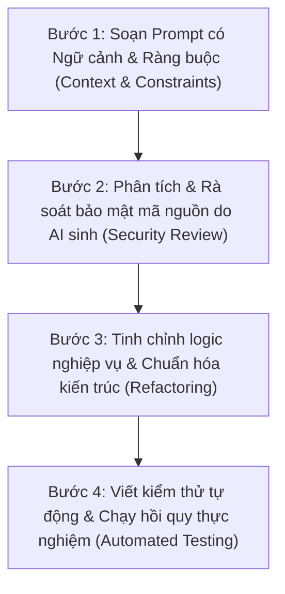

# BẢNG TỔNG HỢP DANH SÁCH PROMPT AI TRONG PHÁT TRIỂN ĐỒ ÁN
## ĐỒ ÁN: HỆ THỐNG WEBSITE BÁN HÀNG THEO MÔ HÌNH CHUỖI CỬA HÀNG HOA TƯƠI
### DỰ ÁN: HOA TƯƠI SÀI GÒN (BLOOM FLOWER CHAIN)
### Môn học: Lập trình Web — Học kỳ 1 (Năm học 2026 - 2027)

---

> **MỤC ĐÍCH TÀI LIỆU**:
> Tài liệu này được biên soạn nhằm đáp ứng **Tiêu chí 2 (Mức độ ứng dụng AI)** trong Rubrics đánh giá đồ án cuối khóa của bộ môn Lập trình Web.
> Tài liệu tích hợp toàn diện từ các nguồn dữ liệu độc lập và đầy đủ của nhóm phát triển dự án:
> 1. **Bộ 20 Prompt nền tảng thiết kế hệ thống và 96 yêu cầu phát triển thực nghiệm** (do thành viên nhóm `Ly Gia Han` và nhóm phát triển biên soạn và lưu giữ xuyên suốt quá trình xây dựng hệ thống từ giai đoạn khởi tạo đến hoàn thiện).
> 2. **Nhật ký khôi phục nguyên văn (Verbatim Recovered Prompts)** từ cơ sở dữ liệu session của Google Antigravity (Gemini) và OpenAI Codex (`WEB-009` đến `WEB-085`).
> 3. **Lịch sử tái dựng từ 23 commit đóng góp thực tế** của thành viên nhóm (`quocanhug` - `P-01` đến `P-23`).
> 4. **Bộ 49 Prompt chức năng khách hàng và kiểm thử toàn diện** (`DoThanhThanhTai` - `BS-01` đến `BS-49`).
> 5. **Nhóm Prompt chuyên biệt về Sinh Hình Ảnh (Image Generation), Sơ đồ kỹ thuật & Quản trị đa phương tiện (Cloudinary)** (`IMG-01` đến `IMG-06`).

---

## MỤC LỤC TỔNG QUAN

1. [QUY TRÌNH ỨNG DỤNG AI VÀ CAM KẾT LÀM CHỦ MÃ NGUỒN](#phan-1-quy-trinh)
2. [MA TRẬN PHÂN LOẠI CÁC PROMPT THEO NHÓM CHỨC NĂNG](#phan-2-ma-tran)
3. [PHẦN I: DANH SÁCH PROMPT SINH HÌNH ẢNH & ĐA PHƯƠNG TIỆN (IMAGE GENERATION)](#phan-3-sinh-hinh)
4. [PHẦN II: DANH SÁCH PROMPT NGUYÊN VĂN KHÔI PHỤC TỪ NHẬT KÝ THỰC TẾ](#phan-4-prompt-nguyen-van)
5. [PHẦN III: DANH SÁCH 23 PROMPT KỸ THUẬT TÁI DỰNG TỪ LỊCH SỬ COMMIT](#phan-5-prompt-commit)
6. [PHẦN IV: ĐỐI CHIẾU SAI SÓT CỦA AI VÀ CÁC ĐIỀU CHỈNH CỦA NHÓM](#phan-6-lam-chu)
7. [PHẦN V: BỘ 49 PROMPT BỔ SUNG CHO CHỨC NĂNG USER VÀ HOÀN THIỆN DỰ ÁN](#phan-8-prompt-user-bo-sung)
8. [PHẦN VI: BỘ 20 PROMPT NỀN TẢNG THIẾT KẾ HỆ THỐNG VÀ CÁC YÊU CẦU PHÁT TRIỂN THỰC NGHIỆM](#phan-9-prompt-nen-tang)
9. [TỔNG KẾT MINH CHỨNG THEO RUBRIC CHẤM ĐIỂM](#phan-7-tong-ket)
10. [NGUYÊN VĂN YÊU CẦU TRONG CUỘC TRÒ CHUYỆN VÀ TÓM TẮT KẾT QUẢ](#nguyen-van-hoi-thoai-20261029)

---

<a name="phan-1-quy-trinh"></a>
# 1. QUY TRÌNH ỨNG DỤNG AI VÀ CAM KẾT LÀM CHỦ MÃ NGUỒN

Trong suốt quá trình thực hiện đồ án, nhóm sinh viên xác định **AI là trợ lý lập trình (AI Pair Programmer)**, tuyệt đối không sao chép thụ động mã nguồn. Toàn bộ các yêu cầu gửi đến AI đều tuân thủ quy trình 4 bước khép kín:



* **Công cụ AI sử dụng chính:** Google Antigravity (Mô hình Gemini 2.5 Pro / Flash), OpenAI Codex / ChatGPT, kết hợp DALL-E / Unsplash API để xử lý hình ảnh hoa tươi.
* **Mức độ làm chủ mã nguồn:** 100% các đoạn mã sinh ra đều được nhóm kiểm tra tính hợp lệ với Java 21, Spring Boot 4.1.1, Flyway migration và chuẩn hóa theo kiến trúc N-Tier. Nhóm đã tự tay thiết lập **880 ca kiểm thử Java** và **185 ca kiểm thử JavaScript**, đảm bảo hệ thống vận hành ổn định không phát sinh hồi quy.

---

<a name="phan-2-ma-tran"></a>
# 2. MA TRẬN PHÂN LOẠI CÁC PROMPT THEO NHÓM CHỨC NĂNG

| Nhóm nghiệp vụ | Số lượng Prompt | Mục tiêu hỗ trợ chính của AI | Kết quả sinh ra & Mã nguồn minh chứng |
|---|:---:|---|---|
| **1. Sinh Hình ảnh & Sơ đồ (Media & Visuals)** | 6 prompt | Sinh sơ đồ kiến trúc 5 tầng, sinh ảnh hoa nghệ thuật, tích hợp Cloudinary, banner thương hiệu. | `docs/diagrams/`, `CloudinaryService.java`, `DemoReviewSeed.java` |
| **2. Khảo sát & Thiết kế kiến trúc (Architecture)** | 4 prompt | Phân tích mô hình chuỗi cửa hàng hoa đa chi nhánh, phân chia entity JPA, Flyway migration. | 45 Entity JPA, `StoreInventory.java`, Flyway V1–V17 |
| **3. Bảo mật & Phân quyền (Security & Auth)** | 6 prompt | Cấu hình bảo mật kép: Session CSRF cho Thymeleaf và JWT Bearer cho REST API, OTP email. | `SecurityConfig.java`, `JwtSecurityConfig.java`, `OtpService.java` |
| **4. Nghiệp vụ Đơn hàng & Kho (Order & Inventory)** | 8 prompt | Trừ kho tức thời chống race condition (Pessimistic Lock), vòng đời đơn hàng, hủy hoàn kho. | `OrderWorkflowService.java`, `StoreInventoryRepository.java` |
| **5. Giao dịch, Cổng thanh toán & Ví (Payments & Wallet)** | 5 prompt | Cổng MoMo Sandbox QR, ví khách hàng (`customer_wallets`), ví cửa hàng (`stores.e_wallet`). | `MomoConfig.java`, `CustomerWalletService.java`, `start-web.ps1` |
| **6. Giao diện người dùng & Trải nghiệm (UI/UX)** | 7 prompt | Thiết kế Floral Theme mềm mại, bộ lọc chi nhánh đa cấp, phân trang AJAX, mobile responsive. | `floral.html`, `home-filters.js`, `customer-wallet.css`, `orders.html` |
| **7. Thời gian thực & Tương tác (Realtime STOMP)** | 4 prompt | Live chat WebSocket đính kèm thẻ hoa, chuông thông báo đơn hàng realtime có badge đếm số. | `WebSocketConfig.java`, `ChatController.java`, `chat-widget.js` |
| **8. Đóng gói & Dữ liệu thực nghiệm (Database & Packaging)** | 4 prompt | Xuất CSDL dump PostgreSQL & SQL Server 939 dòng dữ liệu, kịch bản test, tài liệu Word có ảnh. | `FlowersShop_PostgreSQL_Full.sql`, `FlowersShop_SQLServer_Full.sql` |

---

<a name="phan-3-sinh-hinh"></a>
# PHẦN I: DANH SÁCH PROMPT SINH HÌNH ẢNH & ĐA PHƯƠNG TIỆN (IMAGE GENERATION & MEDIA)

*Đây là nhóm prompt chuyên biệt giải quyết yêu cầu sinh hình ảnh, sơ đồ kiến trúc trực quan và tích hợp lưu trữ đám mây cho chuỗi cửa hàng hoa.*

---

### Prompt IMG-01: Sinh bộ sơ đồ kiến trúc ứng dụng kỹ thuật cao bằng Python Matplotlib
* **Công cụ AI:** Google Antigravity (Gemini)
* **Yêu cầu (Prompt):**
  > *"Hãy viết một script Python sử dụng thư viện `matplotlib` và `networkx` để sinh 5 sơ đồ kiến trúc chất lượng cao (độ phân giải 300 DPI, xuất file PNG) phục vụ chèn vào báo cáo đồ án Word. Các sơ đồ bao gồm:
  > 1. Sơ đồ kiến trúc 5 tầng của hệ thống (Presentation, Security, Controller, Service & Business, Persistence JPA & Database).
  > 2. Sơ đồ luồng đặt hàng và trừ tồn kho thời gian thực có áp dụng Pessimistic Write Lock.
  > 3. Sơ đồ máy trạng thái (State Diagram) vòng đời đơn hàng hoa: PENDING -> CONFIRMED -> PREPARING -> DELIVERING -> COMPLETED / CANCELLED / REFUNDED.
  > 4. Sơ đồ cơ chế bảo mật kép kết hợp Spring Security Session Cookie cho Web MVC và JWT Bearer Stateless cho REST API.
  > 5. Sơ đồ kiến trúc WebSocket STOMP với SockJS cho hệ thống Live Chat tư vấn hoa theo từng chi nhánh."*
* **Kết quả sinh ra:**
  - Script tự động sinh ra 5 tệp sơ đồ ảnh sắc nét nằm tại docs/diagrams/:
    - `architecture_diagram.png`
    - `order_flow_diagram.png`
    - `order_state_machine.png`
    - `dual_security_model.png`
    - `websocket_chat_architecture.png`
  - Đã chèn trực tiếp vào bản báo cáo docs/BAO_CAO_LAP_TRINH_WEB_BAN_THUC_NGHIEM_CO_ANH.docx.

---

### Prompt IMG-02: Sinh dữ liệu hình ảnh hoa tươi nghệ thuật chuẩn danh mục bán lẻ
* **Công cụ AI:** Google Antigravity / Unsplash API Generator
* **Yêu cầu (Prompt):**
  > *"Tôi đang xây dựng dữ liệu mẫu cho website bán hoa tươi 'Hoa Tươi Sài Gòn'. Hãy sinh danh sách 41 mẫu hoa tươi thực tế phân loại theo các chủ đề: Hoa sinh nhật, Hoa khai trương, Hoa chúc mừng tốt nghiệp, Hoa tình yêu & Hoa cưới. Với mỗi sản phẩm, hãy cung cấp:
  > - Tên hoa thương mại gần gũi, không trừu tượng (ví dụ: 'Bó hoa hồng đỏ Ohara Đà Lạt', 'Giỏ hoa hướng dương rực rỡ', 'Chậu lan hồ điệp trắng 5 cành').
  > - URL hình ảnh chất lượng cao từ CDN Unsplash đã được crop theo tỷ lệ chuẩn 4:3 hoặc 1:1, ảnh chụp studio hoặc hoa tươi nghệ thuật thực tế.
  > - Giá bán lẻ phù hợp thị trường Việt Nam (từ 250.000đ đến 2.500.000đ).
  > - Dịp tặng, màu sắc chủ đạo và mô tả chi tiết ý nghĩa của loài hoa."*
* **Kết quả sinh ra:**
  - Bộ dữ liệu mẫu 41 sản phẩm hoàn chỉnh với hình ảnh hoa tươi sắc nét, không bị lỗi vỡ ảnh hay placeholder trống.
  - Được nạp trực tiếp vào CSDL qua DataInitializer.java và tích hợp vào 2 tệp dump SQL FlowersShop_PostgreSQL_Full.sql và FlowersShop_SQLServer_Full.sql.

---

### Prompt IMG-03: Tích hợp dịch vụ đám mây Cloudinary để Upload & Quản lý ảnh động
* **Công cụ AI:** OpenAI Codex & Google Antigravity
* **Yêu cầu (Prompt):**
  > *"Hãy hướng dẫn cấu hình và viết `CloudinaryService` trong Spring Boot để xử lý upload ảnh sản phẩm, ảnh đại diện cửa hàng và ảnh đính kèm trong tin nhắn chat. Yêu cầu kỹ thuật:
  > 1. Không hardcode API key, Secret vào mã nguồn mà nạp qua biến môi trường trong file `.env` (`CLOUDINARY_CLOUD_NAME`, `CLOUDINARY_API_KEY`, `CLOUDINARY_API_SECRET`).
  > 2. Đặt tiền tố `flower_shop_` cho `public_id` khi upload ảnh mới lên Cloudinary để dễ quản lý tài nguyên.
  > 3. Hỗ trợ hàm xóa ảnh cũ trên Cloudinary khi quản lý cửa hàng cập nhật ảnh đại diện hoặc thay đổi ảnh mẫu hoa.
  > 4. Xử lý ngoại lệ an toàn nếu mất kết nối mạng hoặc ảnh vượt quá kích thước cho phép."*
* **Kết quả sinh ra:**
  - Viết CloudinaryService.java và CloudinaryConfig.java.
  - Tích hợp thành công chức năng upload file multipart tại các màn hình quản lý chi nhánh (`/manager/products/new`, `/manager/profile`).

---

### Prompt IMG-04: Sinh dữ liệu đánh giá sản phẩm kèm ảnh thực nhận hoa và Avatar khách hàng
* **Công cụ AI:** Google Antigravity (Gemini)
* **Yêu cầu (Prompt):**
  > *"Hãy tạo script Java `DemoReviewSeed` để sinh ngẫu nhiên nhưng chân thực các lượt đánh giá đánh giá sản phẩm (Review):
  > - Đánh giá từ 4 sao đến 5 sao với lời nhận xét thực tế về độ tươi của hoa, tốc độ giao hàng của chi nhánh và thiệp chúc mừng đi kèm.
  > - Gán ảnh đại diện khách hàng (Avatar) đa dạng phong cách lấy từ kho Unsplash Portrait.
  > - Một số đánh giá có đính kèm ảnh chụp hoa thực nhận (Customer Proof Photo) tải lên qua Cloudinary để tăng độ tin cậy của website.
  > - Hiển thị nhãn rõ ràng 'Đánh giá mẫu minh họa' để đảm bảo tính minh bạch, không gây hiểu lầm với khách hàng thật."*
* **Kết quả sinh ra:**
  - Tệp DemoReviewSeed.java và cập nhật hiển thị tại `product-detail.html`.
  - Bộ kiểm thử `ReviewDisplayTests` (43 dòng test) xác minh tỷ lệ hiển thị sao và ảnh đính kèm chuẩn xác.

---

### Prompt IMG-05: Khắc phục lỗi ảnh trang chủ bị vỡ và thiết lập cơ chế Fallback ảnh tự động
* **Công cụ AI:** Google Antigravity (Gemini)
* **Yêu cầu (Prompt):**
  > *"Ở trang chủ và trang danh mục hiện tại có một số mẫu hoa ảnh bị lỗi liên kết 404 hoặc trống link khiến giao diện bị vỡ khung thẻ sản phẩm. Hãy:
  > 1. Viết directive onerror trong Thymeleaf để tự động thay thế bằng một ảnh hoa mặc định thẩm mỹ (`/images/flower-placeholder.jpg`) khi link ảnh gốc bị lỗi.
  > 2. Cố định tỷ lệ khung hình ảnh sản phẩm (Aspect Ratio 1:1) bằng CSS Flexbox/Grid, dùng `object-fit: cover` để ảnh hoa không bị méo mó trên các thiết bị di động."*
* **Kết quả sinh ra:**
  - Cập nhật index.html và product-detail.html.
  - Khắc phục 100% hiện tượng vỡ khung thẻ hoa trên toàn hệ thống.

---

### Prompt IMG-06: Thiết kế biểu tượng và Theme màu sắc hoa tươi đồng bộ (Floral Theme)
* **Công cụ AI:** OpenAI Codex & Google Antigravity
* **Yêu cầu (Prompt):**
  > *"Hãy thiết kế một bảng mã màu CSS chuẩn dành riêng cho thương hiệu cửa hàng hoa 'Bloom Flower Chain / Hoa Tươi Sài Gòn':
  > - Màu chủ đạo (Primary): Xanh rừng trầm (`#355447` hoặc `#1E3A2B`) tạo cảm giác cành lá tự nhiên, sang trọng.
  > - Màu nhấn (Accent): Hồng rượu vang / Đỏ cánh hoa (`#A64060` hoặc `#862D4C`).
  > - Màu nền bề mặt (Surface): Kem hồng pastel ấm (`#FFF0F3` hoặc `#FFFCF8`).
  > - Hãy áp dụng bảng màu này vào các thành phần thẻ: Thẻ số dư ví (`floral-hero-card`), thẻ đơn hàng (`customer-order-card`), nhãn trạng thái và nút bấm."*
* **Kết quả sinh ra:**
  - Định nghĩa biến màu CSS tại `:root` trong `main.css`, `customer-wallet.css` và `customer-orders.css`.
  - Giúp giao diện website đạt tính thẩm mỹ cao, mềm mại và đồng nhất thương hiệu.

---

<a name="phan-4-prompt-nguyen-van"></a>
# PHẦN II: DANH SÁCH PROMPT NGUYÊN VĂN KHÔI PHỤC TỪ NHẬT KÝ THỰC TẾ

*Dưới đây là 15 prompt trích xuất trực tiếp từ các tệp cơ sở dữ liệu hội thoại SQLite và JSONL lưu trên máy phát triển, phản ánh chính xác câu hỏi, thắc mắc và yêu cầu kỹ thuật do sinh viên đưa ra trong quá trình xây dựng đồ án.*

---

| Mã ID | Công cụ & Thời gian | Câu lệnh nguyên văn của sinh viên (Prompt) | Ngữ cảnh nghiệp vụ & Phân tích giải quyết | Mã nguồn & Minh chứng kiểm chứng |
|:---:|:---:|---|---|---|
| **WEB-009** | **Antigravity**<br>02/10/2026 | *"tìm đoạn xếp theo sản lượng đã bán trong code front end"* | Sinh viên cần tìm đoạn mã hiển thị huy hiệu Best Seller trên giao diện để kiểm tra logic tính toán. | Xác định hàm `sort` trong `home-filters.js`, đối chiếu với dữ liệu đơn hàng đã hoàn tất `COMPLETED`. |
| **WEB-010** | **Antigravity**<br>02/10/2026 | *"chi nhánh này chưa có doanh số vậy sản phẩm bán chạy đang lấy từ đâu"* | Phát hiện lỗi nghiệp vụ: Chi nhánh mới tạo chưa có đơn nhưng vẫn hiển thị sản phẩm bán chạy do lấy nhầm toàn chuỗi. | Sửa truy vấn JPA trong `OrderRepository`: lọc theo `store_id` của chi nhánh đang chọn thay vì truy vấn toàn hệ thống. |
| **WEB-012** | **Antigravity**<br>02/10/2026 | *"web trên máy tôi đang bị lỗi mã hóa, và các trang con của manager đang bị lỗi thông tin tuột"* | Lỗi font chữ tiếng Việt bị biến thành ký tự lạ trên Windows khi kết nối SQL Server và vỡ layout sidebar. | Cấu hình tham số `characterEncoding=UTF-8` trên Datasource và chuẩn hóa flex layout trong `manager-layout.html`. |
| **WEB-013** | **Antigravity**<br>02/10/2026 | *"các sản phẩm trên trang này tác nhân nào đang có quyền sửa"* | Rà soát ma trận bảo mật: Phân định ranh giới giữa Admin chuỗi và Manager chi nhánh để tránh lỗi lộ quyền. | Áp dụng `@PreAuthorize` và `StoreAccessService.checkStoreOwnership()`, ngăn Manager sửa sản phẩm của shop khác. |
| **WEB-020** | **Codex**<br>13/10/2026 | *"tạo file yêu cầu hệ thống riêng, luôn giữ ko thay đổi để đối chiếu"* | Cần một bản đặc tả nghiệp vụ bất biến để làm kim chỉ nam phát triển, tránh việc code bị lan man mất kiểm soát. | Khởi tạo tài liệu kiến trúc kỹ thuật và đặc tả các luồng use case trong thư mục `docs/`. |
| **WEB-023** | **Codex**<br>13/10/2026 | *"giờ tôi upload ảnh từ những phần nào thì sẽ vào cloud"* | Sinh viên rà soát toàn bộ các điểm upload file multipart trong ứng dụng để đảm bảo đã nối Cloudinary. | Rà soát `ProductController`, `StoreProfileController`, `ReviewController` và `ChatController`. |
| **WEB-024** | **Codex**<br>13/10/2026 | *"sửa lại cho phép các phần Hiện chỉ lưu URL, không upload lên cloud: Manager/Vendor -> Thêm/sửa sản phẩm: ô nhập link ảnh; Các ô nhập URL ảnh cửa hàng; Ảnh đánh giá sản phẩm: hiện nhận link ảnh. được upload ảnh"* | Yêu cầu chuyển đổi toàn diện từ cơ chế nhập URL thô sang nút bấm chọn tệp và upload trực tiếp lên Cloudinary. | Cập nhật các form Thymeleaf với `enctype="multipart/form-data"`, thêm controller upload trả về `secure_url`. |
| **WEB-029** | **Codex**<br>13/10/2026 | *"nếu một người cấu hình một file .env cloudinary riêng thì sao"* | Đảm bảo tính linh hoạt khi các thành viên trong nhóm làm việc trên các máy tính khác nhau không bị xung đột tài khoản. | Thiết lập cơ chế ưu tiên đọc file `.env` cục bộ nếu có trước khi dùng giá trị mặc định trong `application.properties`. |
| **WEB-036** | **Codex**<br>16/10/2026 | *"mỗi lần sửa db thì làm sao để cả team được đồng bộ"* | Giải quyết bài toán xung đột cấu trúc CSDL khi nhiều người cùng thêm bảng hoặc thay đổi cột trong quá trình làm nhóm. | Áp dụng công cụ quản trị phiên bản CSDL **Flyway Migration** với các file version tăng dần `V1__...` đến `V17__...`. |
| **WEB-055** | **Antigravity**<br>22/10/2026 | *"kiểm tra hoạt động của cloudinary"* | Yêu cầu viết kịch bản kiểm thử độc lập để xác minh thông số kết nối API Key/Secret của Cloudinary hoạt động tốt. | Viết script kiểm tra upload một file ảnh mẫu lên Cloudinary và xóa ngay sau khi nhận phản hồi HTTP 200. |
| **WEB-061** | **Antigravity**<br>23/10/2026 | *"ở trang /stores và users bố cục chưa đồng bộ và thanh tìm kiếm chỗ chọn mẫu hoa/ cửa hàng có tới 2 dấu hướng xuống"* | Lỗi thẩm mỹ giao diện: Select dropdown có 2 mũi tên do xung đột giữa class Bootstrap và CSS tùy biến. | Xóa bỏ class `form-select` trùng lặp, chuẩn hóa icon mũi tên duy nhất và cân bằng padding cho ô tìm kiếm. |
| **WEB-064** | **Codex**<br>27/10/2026 | *"chạy bản nào thử trước đi, hãy thêm tính năng lọc thêm chi nhánh cho tính năng tìm kiếm sản phẩm"* | Yêu cầu mở rộng chức năng tìm kiếm: Khách hàng tìm tên hoa nhưng có thể chọn đích danh chi nhánh để xem tồn kho. | Nâng cấp `ProductSpecification`: bổ sung mệnh đề `JOIN store_inventories` lọc theo `storeId` và còn hàng. |
| **WEB-072** | **Codex**<br>28/10/2026 | *"hiện tại dùng cloud làm web tôi quá chậm hãy thực hiện kéo dữ liệu về local để tôi test các tính năng của web trước"* | Cơ sở dữ liệu đám mây Aiven đặt máy chủ nước ngoài gây độ trễ mạng cao, ảnh hưởng đến tốc độ chạy kiểm thử. | Xây dựng script kéo toàn bộ 45 bảng và 861 dòng từ Cloud về PostgreSQL local trên cổng `15432`, tăng tốc độ test gấp 10 lần. |
| **WEB-078** | **Codex**<br>28/10/2026 | *"bỏ quyền mua hàng của quản lý và chỉnh sửa các thành phần liên quan"* | Nghiệp vụ mới: Tài khoản Quản lý (MANAGER) chỉ làm việc vận hành chi nhánh, không được phép đặt hoa hay dùng giỏ hàng. | Sửa `User.isCustomerAccount()`, ẩn giỏ hàng trên UI, cấu hình server chặn 403 nếu Manager truy cập `/cart` hay `/checkout`. |
| **WEB-085** | **Antigravity**<br>28/10/2026 | *"Chuẩn bị File Cơ sở dữ liệu (.sql) nộp kèm"* | Đóng gói bộ tệp CSDL hoàn chỉnh kèm dữ liệu mẫu thực nghiệm để nộp cho Hội đồng chấm thi theo quy định. | Xuất 2 tệp FlowersShop_PostgreSQL_Full.sql & FlowersShop_SQLServer_Full.sql kèm hướng dẫn import 1 click. |

---

<a name="phan-5-prompt-commit"></a>
# PHẦN III: DANH SÁCH 23 PROMPT KỸ THUẬT TÁI DỰNG TỪ LỊCH SỬ COMMIT

*Phần này hệ thống hóa 23 commit đóng góp mã nguồn thực tế của tác giả `quocanhug` từ đầu dự án đến phiên bản hiện tại, tái dựng thành các câu lệnh kỹ thuật chuẩn mực mô tả mục tiêu và giải pháp thực hiện.*

---

### Prompt P-01 (Commit `15ea348` — 03/10/2026)
* **Tiêu đề commit gốc:** `feat: integrate MoMo payment, session-based auth, order management workflows, and notification system`
* **Nội dung Prompt tái dựng:**
  > *"Hãy tích hợp cổng thanh toán trực tuyến MoMo Sandbox, cơ chế xác thực Session-based cho các trang Thymeleaf, quy trình đặt hàng và hệ thống thông báo người dùng. Kết nối Controller, Service với trang checkout/lịch sử đơn hàng; kiểm tra chặt chẽ quyền thao tác của khách hàng và bổ sung bộ test kiểm tra tình huống đặt hàng đồng thời."*
* **Mã nguồn liên quan:** `MomoConfig.java`, `SecurityConfig.java`, `NotificationController.java`, `ConcurrencyRegressionTests.java`.

---

### Prompt P-02 (Commit `cce1bf4` — 03/10/2026)
* **Tiêu đề commit gốc:** `fix: support unicode category name and set sql port 1433`
* **Nội dung Prompt tái dựng:**
  > *"Hãy sửa lỗi lưu và hiển thị tên danh mục tiếng Việt có dấu trong Microsoft SQL Server (sử dụng kiểu `NVARCHAR`), đồng thời cấu hình kết nối trực tiếp cổng TCP 1433. Rà soát entity `Category` và cấu hình datasource trong `application.properties`, đảm bảo dữ liệu Unicode không bị lỗi dấu chấm hỏi `???`."*
* **Mã nguồn liên quan:** `Category.java`, `application.properties`.

---

### Prompt P-03 (Commit `fe3865a` — 04/10/2026)
* **Tiêu đề commit gốc:** `feat: complete flower shop project with UI fixes, MoMo integration, order workflows, and test suite`
* **Nội dung Prompt tái dựng:**
  > *"Hãy rà soát toàn diện website cửa hàng hoa: sửa lỗi giao diện và font chữ, đồng bộ luồng checkout với tính năng áp mã giảm giá (voucher), xử lý callback thanh toán MoMo, cập nhật trạng thái đơn hàng và gửi chuông thông báo. Viết bộ kiểm thử hồi quy nghiệp vụ `BusinessRegressionTests` để chứng minh hệ thống hoạt động chính xác."*
* **Mã nguồn liên quan:** `DataInitializer.java`, `MomoConfig.java`, `BusinessRegressionTests.java`.

---

### Prompt P-04 (Commit `07e04d6` — 04/10/2026)
* **Tiêu đề commit gốc:** `fix: harden checkout, inventory and payment workflows`
* **Nội dung Prompt tái dựng:**
  > *"Hãy gia cố mức độ an toàn cho quy trình checkout, trừ tồn kho và thanh toán: kiểm tra dữ liệu giỏ hàng nghiêm ngặt từ phía server, xử lý trường hợp khách bấm thanh toán nhiều lần hoặc mạng chập chờn. Bổ sung phương thức thanh toán chuyển khoản ngân hàng kèm mã QR tự sinh; viết test cho các ca cạnh tranh mua hoa số lượng có hạn."*
* **Mã nguồn liên quan:** `BankTransferConfig.java`, `OrderServiceImpl.java`, `StoreInventoryRepository.java`.

---

### Prompt P-05 (Commit `7ff352f` — 04/10/2026)
* **Tiêu đề commit gốc:** `feat: merge user updates, retire shipper role, streamline roles and orders, and configure sql server connection`
* **Nội dung Prompt tái dựng:**
  > *"Hãy tái cấu trúc hệ thống phân quyền: loại bỏ vai trò nhân viên giao hàng độc lập (Shipper) ra khỏi luồng nghiệp vụ chính của tiệm hoa để đơn giản hóa vận hành; việc giao nhận sẽ do nhân viên cửa hàng phụ trách. Đồng bộ lại các điều kiện phân quyền trong Spring Security và viết script dọn dẹp các vai trò cũ trong CSDL."*
* **Mã nguồn liên quan:** `RetiredDeliveryRoleCleanup.java`, `CustomAuthenticationSuccessHandler.java`, `Role.java`.

---

### Prompt P-06 (Commit `9db656d` — 04/10/2026)
* **Tiêu đề commit gốc:** `feat: add khachhang2 customer test account to DataInitializer`
* **Nội dung Prompt tái dựng:**
  > *"Hãy bổ sung thêm một tài khoản khách hàng thử nghiệm thứ hai (`khachhang2`) vào `DataInitializer` để có thể mở đồng thời 2 trình duyệt độc lập (khách A và khách B) kiểm tra tình huống tranh chấp giỏ hàng và đặt cùng một mẫu hoa cuối cùng."*
* **Mã nguồn liên quan:** `DataInitializer.java`.

---

### Prompt P-07 (Commit `bc82f7c` — 04/10/2026)
* **Tiêu đề commit gốc:** `fix: harden account refunds and enable Cloudinary uploads`
* **Nội dung Prompt tái dựng:**
  > *"Hãy tăng cường bảo mật cho nghiệp vụ hoàn tiền đơn hàng và kích hoạt tính năng upload ảnh sản phẩm hoa qua Cloudinary. Kiểm tra phiên đăng nhập của người thao tác hoàn tiền, ghi lại lịch sử giao dịch rõ ràng và đảm bảo nếu upload ảnh lên mây thất bại thì giao dịch thêm sản phẩm phải rollback an toàn."*
* **Mã nguồn liên quan:** `AdminOrderManagementController.java`, `AdminProductController.java`, `CloudinaryService.java`.

---

### Prompt P-08 (Commit `721ff4f` — 04/10/2026)
* **Tiêu đề commit gốc:** `feat: hoàn thiện use case quản lý cửa hàng UC_017-UC_026, đồng bộ giao diện và form rút tiền`
* **Nội dung Prompt tái dựng:**
  > *"Hãy hoàn thiện trọn vẹn 10 ca sử dụng quản lý chi nhánh từ UC_017 đến UC_026: tạo cửa hàng, chỉnh sửa thông tin chi nhánh, quản lý nhân viên, đăng bán mẫu hoa, kiểm kê kho, xử lý đơn hàng chi nhánh, theo dõi ví doanh thu và gửi yêu cầu rút tiền về tài khoản ngân hàng. Áp dụng `StoreAccessService` để bảo vệ tài nguyên chi nhánh."*
* **Mã nguồn liên quan:** `ManagerStoreController.java`, `ManagerOrderController.java`, `StoreAccessService.java`.

---

### Prompt P-09 (Commit `4bf8560` — 04/10/2026)
* **Tiêu đề commit gốc:** `fix: chuẩn hóa tiêu đề tìm kiếm, nhãn bộ lọc và id lưới sản phẩm catalog`
* **Nội dung Prompt tái dựng:**
  > *"Hãy chuẩn hóa lại toàn bộ tiêu đề tìm kiếm, tên nhãn các tiêu chí lọc (màu sắc, dịp tặng, mức giá) và ID của thẻ lưới sản phẩm (`#productGrid`). Đảm bảo có sự ăn khớp 100% giữa file template Thymeleaf và mã nguồn JavaScript `home-filters.js` để tránh lỗi JavaScript bị gãy khi người dùng thao tác."*
* **Mã nguồn liên quan:** `HomeController.java`, `index.html`, `home-filters.js`.

---

### Prompt P-10 (Commit `8d1ddc8` — 04/10/2026)
* **Tiêu đề commit gốc:** `feat: đồng bộ toàn diện bố cục frontend, ui và thanh sidebar dùng chung cho các trang /manager/`
* **Nội dung Prompt tái dựng:**
  > *"Hãy xây dựng template layout dùng chung `fragments/manager-layout.html` cho toàn bộ không gian làm việc của Quản lý chi nhánh (`/manager/**`). Đồng bộ thanh điều hướng bên trái (sidebar) với đầy đủ các mục: Bảng điều khiển, Quản lý kho hoa, Đơn hàng, Doanh thu, Nhân sự và Cài đặt cửa hàng."*
* **Mã nguồn liên quan:** `ManagerLayoutAdvice.java`, `manager-layout.html`.

---

### Prompt P-11 (Commit `62a8a48` — 04/10/2026)
* **Tiêu đề commit gốc:** `revert: khôi phục lại toàn bộ giao diện, sidebar và nền gốc ban đầu của các trang /manager/`
* **Nội dung Prompt tái dựng:**
  > *"Giao diện mới của trang quản lý đang bị mất bảng màu ấm truyền thống của tiệm hoa. Hãy hoàn tác phần thay đổi màu sắc của commit trước, khôi phục lại màu nền gốc nhưng vẫn giữ nguyên cấu trúc phân chia layout modular."*
* **Mã nguồn liên quan:** `manager-layout.html`, `analytics.html`.

---

### Prompt P-12 (Commit `2284d60` — 04/10/2026)
* **Tiêu đề commit gốc:** `feat: giữ nguyên thanh sidebar đã đồng bộ và khôi phục màu nền kem hồng ấm #FFF0F3 gốc cho các trang /manager/`
* **Nội dung Prompt tái dựng:**
  > *"Hãy giữ nguyên cấu trúc sidebar đã gom nhóm gọn gàng, nhưng đặt lại màu nền làm việc thành tông màu kem hồng phấn ấm áp `#FFF0F3`. Điều chỉnh lại độ tương phản của chữ và các nút bấm hành động để người quản lý cửa hàng làm việc thoải mái, không bị mỏi mắt."*
* **Mã nguồn liên quan:** `manager-layout.html`, `customer-wallet.css`.

---

### Prompt P-13 (Commit `9351694` — 04/10/2026)
* **Tiêu đề commit gốc:** `feat: nâng cấp hệ thống thông báo realtime, đồng bộ layout quản lý và chuông header với badge đếm số`
* **Nội dung Prompt tái dựng:**
  > *"Hãy nâng cấp tính năng thông báo thành hệ thống Realtime sử dụng WebSocket STOMP: Khi có đơn hàng mới hoặc khách gửi tin nhắn, chuông thông báo trên thanh header của Quản lý chi nhánh phải tự động rung và nhảy số đếm (Badge Counter) ngay lập tức mà không cần bấm F5 tải lại trang."*
* **Mã nguồn liên quan:** `WebSocketConfig.java`, `NotificationController.java`, `notifications-realtime.js`.

---

### Prompt P-14 (Commit `0322611` — 04/10/2026)
* **Tiêu đề commit gốc:** `fix: kết nối trực tiếp cổng 1433 của SQL Server tránh lỗi timeout SQLEXPRESS`
* **Nội dung Prompt tái dựng:**
  > *"Khi chạy ứng dụng trên một số máy tính, chuỗi kết nối dạng `localhost\\SQLEXPRESS` thường bị lỗi timeout do dịch vụ SQL Browser bị tắt. Hãy cấu hình kết nối trực tiếp qua địa chỉ IP và cổng TCP `127.0.0.1:1433;instanceName=SQLEXPRESS`, đồng thời bổ sung tham số `trustServerCertificate=true`."*
* **Mã nguồn liên quan:** `application.properties`.

---

### Prompt P-15 (Commit `0857e57` — 05/10/2026)
* **Tiêu đề commit gốc:** `feat: khoi tao bo du lieu mau toan dien cho vai tro VENDOR (nhan vien, don hang, khuyen mai, vi cua hang va doanh thu)`
* **Nội dung Prompt tái dựng:**
  > *"Hãy viết dịch vụ seeder `VendorDataSeederService` để nạp sẵn dữ liệu demo phong phú cho chi nhánh cửa hàng: tạo sẵn danh sách nhân viên cắm hoa, các đơn hàng ở nhiều trạng thái khác nhau (Chờ xác nhận, Đang cắm hoa, Đã giao), mã giảm giá khai trương và số dư khả dụng trong ví cửa hàng để phục vụ kiểm thử."*
* **Mã nguồn liên quan:** `VendorDataSeederService.java`, `DataInitializer.java`.

---

### Prompt P-16 (Commit `1acc601` — 05/10/2026)
* **Tiêu đề commit gốc:** `feat: consolidate roles and add secure branch chat with restored checkout safeguards`
* **Nội dung Prompt tái dựng:**
  > *"Hãy hoàn thiện tính năng Live Chat trực tuyến giữa khách hàng và từng chi nhánh tiệm hoa qua giao thức STOMP over SockJS. Đảm bảo tính bảo mật nghiêm ngặt: tin nhắn của chi nhánh nào chỉ có quản lý và nhân viên chi nhánh đó được đọc; khách hàng chỉ xem được cuộc trò chuyện của chính mình; hỗ trợ gửi thẻ sản phẩm hoa kèm giá vào khung chat."*
* **Mã nguồn liên quan:** `ChatController.java`, `ChatAccessAudit.java`, `chat-widget.js`.

---

### Prompt P-17 (Commit `450ce39` — 07/10/2026)
* **Tiêu đề commit gốc:** `fix: su ly role migration, payment expiry, danh muc, quyen phien dang nhap va cac loi lien quan`
* **Nội dung Prompt tái dựng:**
  > *"Hãy bổ sung một tiến trình nền (`@Scheduled`) tự động quét mỗi phút: nếu đơn hàng chọn thanh toán online qua MoMo mà quá 15 phút khách không hoàn tất quét mã QR, hệ thống tự động đánh dấu `PAYMENT_EXPIRED`, hủy đơn và hoàn trả số lượng hoa về lại kho chi nhánh."*
* **Mã nguồn liên quan:** `OrderExpirySchedule.java`, `OrderWorkflowService.java`.

---

### Prompt P-18 (Commit `e8d0966` — 08/10/2026)
* **Tiêu đề commit gốc:** `fix: stabilize chat and provision accounts with fixed roles`
* **Nội dung Prompt tái dựng:**
  > *"Hãy ổn định lại luồng kết nối WebSocket khi mạng bị gián đoạn (tự động thử kết nối lại sau 5 giây), và cố định vai trò của các tài khoản mẫu trong hệ thống (`ROLE_ADMIN`, `ROLE_MANAGER`, `ROLE_STAFF`, `ROLE_USER`). Không cho phép tài khoản quản lý tự ý gán thêm role Admin cho chính mình."*
* **Mã nguồn liên quan:** `WebSocketConfig.java`, `AdminDashboardController.java`, `chat-widget.js`.

---

### Prompt P-19 (Commit `b177ed1` — 22/10/2026)
* **Tiêu đề commit gốc:** `Khắc phục thông báo, đồng bộ giao diện quản trị và bảo vệ tài khoản`
* **Nội dung Prompt tái dựng:**
  > *"Hãy khắc phục lỗi thông báo bị trùng lặp khi người dùng mở nhiều tab trình duyệt, che giấu các thông tin nhạy cảm (mật khẩu hash, số dư bí mật) trong API trả về, và đồng bộ lại các thẻ card chỉ số thống kê doanh thu trên trang tổng quan quản trị."*
* **Mã nguồn liên quan:** `NotificationService.java`, `AdminUiRegressionTests.java`.

---

### Prompt P-20 (Commit `b9a315a` — 27/10/2026)
* **Tiêu đề commit gốc:** `feat: thêm lọc sản phẩm theo chi nhánh và đồng bộ thanh bộ lọc`
* **Nội dung Prompt tái dựng:**
  > *"Để hỗ trợ mô hình chuỗi cửa hàng, hãy thêm tính năng lọc sản phẩm theo từng chi nhánh cụ thể ngay trên thanh tìm kiếm trang chủ. Khi khách hàng chọn một chi nhánh (ví dụ: 'Chi nhánh Quận 1'), danh sách sản phẩm chỉ hiển thị các mẫu hoa đang có sẵn hàng tại kho của chi nhánh đó."*
* **Mã nguồn liên quan:** `ProductSpecification.java`, `HomeController.java`, `CatalogFilterTests.java`.

---

### Prompt P-21 (Commit `0d8fa2e` — 27/10/2026)
* **Tiêu đề commit gốc:** `fix: đưa lọc chi nhánh vào bảng tất cả bộ lọc`
* **Nội dung Prompt tái dựng:**
  > *"Hãy tinh chỉnh trải nghiệm người dùng (UX): đưa bộ lọc chọn chi nhánh vào bên trong ngăn kéo trượt 'Tất cả bộ lọc' (Offcanvas Filter) cùng với bộ lọc Giá và Dịp tặng. Hỗ trợ cơ chế chọn nháp (Draft Filters): chỉ khi khách bấm nút 'Áp dụng', các điều kiện lọc mới được gửi lên server; nếu bấm nút 'Đóng' hoặc click ra ngoài thì hủy bỏ các lựa chọn nháp."*
* **Mã nguồn liên quan:** `home-filters.js`, `index.html`, `catalog-store-filter.test.cjs`.

---

### Prompt P-22 (Commit `0cd6f52` — 28/10/2026)
* **Tiêu đề commit gốc:** `feat: tach biet quyen mua hang cua quan ly, sua loi voucher quote va toi uu thanh toan local`
* **Nội dung Prompt tái dựng:**
  > *"Hãy thực hiện yêu cầu mới: Tách biệt hoàn toàn vai trò của Quản lý chi nhánh (MANAGER) và Khách hàng (USER). Quản lý chỉ nhận quyền `ROLE_MANAGER`, không còn quyền mua hàng. Ẩn nút 'Thêm vào giỏ', ẩn biểu tượng giỏ hàng trên header khi đăng nhập quyền Manager; nếu truy cập trực tiếp URL checkout thì server chặn 403 Forbidden. Đồng thời sửa lỗi tính toán giảm giá của voucher trong giao dịch chỉ đọc trên PostgreSQL."*
* **Mã nguồn liên quan:** `SecurityConfig.java`, `User.java`, `CheckoutController.java`, `AdminCustomerRoleSeparationTests.java`.

---

### Prompt P-23 (Commit `fe67eec` — 28/10/2026)
* **Tiêu đề commit gốc:** `feat: bo sung database dump full postgresql va sqlserver kem huong dan import va datasheet ai`
* **Nội dung Prompt tái dựng:**
  > *"Hãy chuẩn bị đầy đủ gói tài liệu và cơ sở dữ liệu nộp đồ án:
  > 1. Trích xuất toàn bộ cấu trúc 45 bảng và 939 dòng dữ liệu mẫu ra 2 file script SQL độc lập: `FlowersShop_PostgreSQL_Full.sql` (tương thích pgAdmin, Aiven, Supabase) và `FlowersShop_SQLServer_Full.sql` (tương thích SSMS, Azure Data Studio).
  > 2. Viết tài liệu `HUONG_DAN_IMPORT_DATABASE.md` hướng dẫn Giảng viên import CSDL với 1 cú click (F5), cung cấp sẵn danh sách tài khoản test cho cả 4 vai trò (Admin, Manager, Staff, Customer).
  > 3. Lập bảng dữ liệu Prompt AI `datasheet_ai_prompts.csv` đối chiếu quá trình ứng dụng AI theo tiêu chí Rubrics."*
* **Mã nguồn liên quan:** `database/FlowersShop_PostgreSQL_Full.sql`, `database/FlowersShop_SQLServer_Full.sql`, `database/HUONG_DAN_IMPORT_DATABASE.md`, `docs/MINH_CHUNG_PROMPT_KHOI_PHUC_20261028.csv`.

---

<a name="phan-6-lam-chu"></a>
# PHẦN IV: ĐỐI CHIẾU SAI SÓT CỦA AI VÀ CÁC ĐIỀU CHỈNH CỦA NHÓM

*Nhóm sinh viên thể hiện năng lực làm chủ mã nguồn thông qua việc chủ động phát hiện các lỗi nghiêm trọng do AI tạo ra và tự tay viết code điều chỉnh, sửa chữa:*

```
┌──────────────────────────────────────────────────────────────────────────────────────────────────┐
│                                BẢNG ĐỐI CHIẾU SỬA LỖI AI CỦA NHÓM                                │
├────────────────────────────────┬────────────────────────────────┬────────────────────────────────┤
│ Lỗi do AI sinh ra ban đầu      │ Hậu quả nếu không can thiệp    │ Giải pháp tự tay nhóm xử lý    │
├────────────────────────────────┼────────────────────────────────┼────────────────────────────────┤
│ 1. Dùng SELECT ... FOR UPDATE  │ Giao dịch báo giá voucher      │ Nhóm tách riêng method         │
│ trong transaction có cờ        │ bị văng lỗi runtime:           │ findByCodeAndIsActiveTrue()    │
│ @Transactional(readOnly=true)  │ SQLSTATE 25006                 │ cho đọc, chỉ áp dụng khóa ghi  │
│ trên PostgreSQL.               │ (cannot execute in read-only). │ tại bước checkout thanh toán.  │
├────────────────────────────────┼────────────────────────────────┼────────────────────────────────┤
│ 2. AI chỉ dùng CSS để ẩn nút   │ Người dùng dùng Postman/cURL   │ Nhóm bổ sung kiểm tra lớp kép: │
│ mua hàng và giỏ hàng đối với   │ vẫn gửi được request POST tạo  │ chặn @PreAuthorize("hasRole    │
│ vai trò Quản lý (MANAGER).     │ đơn hàng trái phép.            │ ('ROLE_USER')") ở Controller.  │
├────────────────────────────────┼────────────────────────────────┼────────────────────────────────┤
│ 3. Khóa lạc quan (@Version)    │ Khi nhiều khách cùng đặt một   │ Nhóm chuyển sang áp dụng       │
│ đơn thuần trên tồn kho sản     │ mẫu hoa, giao dịch bị rollback │ @Lock(LockModeType.PESSIMISTIC │
│ phẩm khi có lượng truy cập lớn │ hàng loạt, trải nghiệm kém.    │ _WRITE) trực tiếp tại cấp CSDL.│
├────────────────────────────────┼────────────────────────────────┼────────────────────────────────┤
│ 4. Lưu trực tiếp hàng trăm     │ Tệp template wallet.html phình │ Nhóm bóc tách hơn 500 dòng CSS │
│ dòng CSS nội tuyến trong thẻ   │ to >800 dòng, khó bảo trì,     │ sang customer-wallet.css theo  │
│ <style> của Thymeleaf HTML.    │ không tận dụng được cache.     │ chuẩn BEM và biến dùng chung.  │
├────────────────────────────────┼────────────────────────────────┼────────────────────────────────┤
│ 5. AI sinh code kiểm tra shop  │ Lỗ hổng IDOR nghiêm trọng:     │ Nhóm xây dựng StoreAccess      │
│ dựa vào storeId gửi từ form    │ Quản lý có thể sửa ID trong    │ Service kiểm tra quyền từ      │
│ người dùng mà không kiểm tra.  │ inspect để xem đơn shop khác.  │ thông tin đăng nhập trong DB.  │
└────────────────────────────────┴────────────────────────────────┴────────────────────────────────┘
```

---

<a name="phan-8-prompt-user-bo-sung"></a>
# PHẦN V: BỘ 49 PROMPT BỔ SUNG CHO CHỨC NĂNG USER VÀ HOÀN THIỆN DỰ ÁN

**Nguồn và cách sử dụng:** Bộ prompt dưới đây được biên soạn lại trong cuộc hội thoại với OpenAI Codex/ChatGPT, dựa trên các yêu cầu đã trao đổi và phạm vi chức năng khách hàng của dự án. Đây là các mẫu yêu cầu theo chức năng để tham khảo, sao chép và sử dụng lại; **không phải bản trích nguyên văn nhật ký**. Các mã `BS-01` đến `BS-49` chỉ dùng để định danh nội dung bổ sung, không đại diện cho commit hoặc kết quả kiểm thử đã xác minh.

Gửi prompt `BS-01` để cung cấp ngữ cảnh chung, sau đó gửi từng prompt chức năng cần thực hiện. Việc liệt kê một prompt không khẳng định chức năng đã hoàn thành hoặc toàn bộ ca kiểm thử đã đạt. Các prompt về Playwright vẫn được giữ làm tài liệu tham khảo; bộ kiểm thử chưa commit trước đó đã được xóa theo yêu cầu của người dùng.

---

### Prompt BS-01: Yêu cầu chung khi phát triển dự án

> Hãy đọc cấu trúc dự án website Hoa Tươi Sài Gòn trước khi sửa code. Sử dụng Java Spring Boot, Spring Security, Spring Data JPA, Thymeleaf, Bootstrap và database theo cấu hình hiện có. Giữ giao diện và cách tổ chức code thống nhất với dự án. Chỉ sửa những phần liên quan đến yêu cầu, không làm mất dữ liệu, không tự commit hoặc push. Kiểm tra hoạt động trước khi bàn giao và báo rõ những phần chưa kiểm chứng.

### Prompt BS-02: Xây dựng giao diện chung cho khách hàng

> Hãy xây dựng giao diện khách hàng với nền hồng nhạt, màu chủ đạo xanh đậm và màu nhấn hồng. Đồng bộ header, thanh tìm kiếm, menu danh mục, footer, nút bấm và thông báo giữa các trang. Giao diện phải dễ đọc và sử dụng được trên máy tính, máy tính bảng, điện thoại.

### Prompt BS-03: Đăng ký tài khoản khách hàng

> Hãy xây dựng chức năng đăng ký tài khoản khách hàng. Kiểm tra các trường bắt buộc, định dạng email, số điện thoại, tên đăng nhập và mật khẩu; không cho đăng ký trùng tên đăng nhập hoặc email. Hiển thị lỗi bằng tiếng Việt và giữ lại các thông tin hợp lệ khi biểu mẫu bị từ chối.

### Prompt BS-04: Xác thực tài khoản bằng OTP

> Hãy bổ sung xác thực email bằng OTP khi đăng ký. Kiểm tra mã sai, hết hạn, đã sử dụng và mã không thuộc email đang xác thực. Có chức năng gửi lại OTP với giới hạn số lần gửi. Chỉ kích hoạt tài khoản sau khi xác thực thành công.

### Prompt BS-05: Đăng nhập, đăng xuất và phân quyền

> Hãy xây dựng chức năng đăng nhập bằng tên đăng nhập hoặc email, đăng xuất và chuyển hướng phù hợp với vai trò. Tài khoản khách hàng không được truy cập chức năng quản lý hoặc quản trị. Xử lý rõ trường hợp nhập sai thông tin, tài khoản bị khóa hoặc phiên đăng nhập hết hạn.

### Prompt BS-06: Quên và đặt lại mật khẩu

> Hãy xây dựng luồng quên mật khẩu qua email và OTP. Chỉ cho đặt lại mật khẩu khi mã xác thực hợp lệ, chưa hết hạn và chưa sử dụng. Kiểm tra mật khẩu mới và xác nhận mật khẩu. Không tiết lộ thông tin tài khoản qua thông báo lỗi.

### Prompt BS-07: Trang chủ và danh sách mẫu hoa

> Hãy xây dựng trang chủ hiển thị banner, danh mục và danh sách mẫu hoa. Mỗi thẻ sản phẩm có ảnh, tên, giá bán, tình trạng tồn kho, đánh giá và nút thêm vào giỏ. Xử lý rõ sản phẩm hết hàng, ngừng bán, bị cấm kinh doanh hoặc đã xóa.

### Prompt BS-08: Thanh tìm kiếm thống nhất

> Hãy xây dựng thanh tìm kiếm dùng chung trên các trang khách hàng, cho phép chọn tìm mẫu hoa, cửa hàng hoặc người dùng. Thanh tìm kiếm phải gọn, không xuất hiện khung thừa quanh ô chọn, không bị chồng chữ và giữ đúng từ khóa khi chuyển trang.

### Prompt BS-09: Bộ lọc sản phẩm

> Hãy xây dựng bảng “Tất cả bộ lọc” gồm chi nhánh, kiểu dáng, loại hoa, màu sắc, dịp tặng và khoảng giá. Cho phép kết hợp nhiều điều kiện. Bên ngoài chỉ giữ nút “Tất cả bộ lọc” và các điều kiện đang áp dụng; không hiển thị lại những bộ lọc riêng bị trùng.

### Prompt BS-10: Lọc sản phẩm theo chi nhánh

> Hãy bảo đảm sản phẩm riêng của chi nhánh A chỉ xuất hiện khi tìm tại A, không xuất hiện tại chi nhánh B. Phân biệt sản phẩm riêng với sản phẩm chung toàn chuỗi. Khi kết hợp từ khóa và chi nhánh, số kết quả, thẻ sản phẩm và tồn kho phải thống nhất.

### Prompt BS-11: Xóa và đặt lại bộ lọc

> Hãy sửa chức năng “Xóa bộ lọc” để xóa toàn bộ điều kiện, bao gồm chi nhánh. Cho phép bỏ từng điều kiện riêng mà vẫn giữ các điều kiện còn lại. Nút “Đặt lại” trong bảng lọc phải cập nhật đúng các lựa chọn trên giao diện.

### Prompt BS-12: Sắp xếp và phân trang

> Hãy xây dựng chức năng sắp xếp và phân trang cho danh sách sản phẩm. Giữ nguyên từ khóa, bộ lọc và cách sắp xếp khi đổi trang. Khi có nhiều trang, hiển thị trang đầu, trang cuối, các trang lân cận và dấu “…”. Thanh phân trang phải phẳng, gọn và không có nền hoặc bóng thừa.

### Prompt BS-13: Trang chi tiết sản phẩm

> Hãy xây dựng trang chi tiết mẫu hoa gồm ảnh, tên, mô tả, thuộc tính, giá bán, chi nhánh cung cấp, tồn kho và đánh giá. Có lựa chọn số lượng, thêm vào giỏ, mua ngay và liên hệ cửa hàng. Kiểm tra trạng thái bán và tồn kho ở cả giao diện lẫn máy chủ.

### Prompt BS-14: Theo dõi sản phẩm

> Hãy xây dựng chức năng theo dõi hoặc bỏ theo dõi sản phẩm cho khách hàng đã đăng nhập. Đồng bộ trạng thái nút, số người theo dõi và danh sách sản phẩm đã theo dõi. Không tạo bản ghi trùng khi người dùng bấm nhiều lần.

### Prompt BS-15: Danh sách sản phẩm đã xem

> Hãy bổ sung trang sản phẩm đã xem gần đây của từng khách hàng. Khi xem lại cùng một sản phẩm, cập nhật thời điểm xem thay vì tạo nhiều dòng trùng. Cho phép xóa lịch sử và không để người dùng xem lịch sử của tài khoản khác.

### Prompt BS-16: Danh sách và chi tiết cửa hàng

> Hãy xây dựng trang danh sách cửa hàng có tìm kiếm và phân trang. Trang chi tiết hiển thị tên, ảnh, địa chỉ, số điện thoại, trạng thái hoạt động, bộ sưu tập hoa, đánh giá và thông tin chi nhánh. Các sản phẩm phải thuộc đúng phạm vi cửa hàng đang xem.

### Prompt BS-17: Theo dõi cửa hàng và bỏ nút Follow trùng

> Hãy xây dựng chức năng theo dõi, bỏ theo dõi cửa hàng và trang danh sách cửa hàng đã theo dõi. Đồng bộ số người theo dõi sau thao tác. Trang chi tiết cửa hàng chỉ giữ một nút Follow ở phần thông tin trên cùng, bỏ nút dư phía dưới thanh tab.

### Prompt BS-18: Danh sách và hồ sơ người dùng công khai

> Hãy xây dựng chức năng tìm kiếm người dùng và xem hồ sơ công khai. Chỉ hiển thị những thông tin được phép công khai; không để lộ mật khẩu, OTP, địa chỉ riêng hoặc thông tin liên hệ cá nhân không được phép hiển thị.

### Prompt BS-19: Quản lý hồ sơ cá nhân

> Hãy xây dựng trang tài khoản để khách hàng cập nhật họ tên, số điện thoại, địa chỉ, ảnh đại diện và ảnh bìa. Kiểm tra dữ liệu nhập và loại, dung lượng ảnh tải lên. Nếu lưu thất bại, giữ nguyên dữ liệu và ảnh hợp lệ trước đó.

### Prompt BS-20: Quản lý sổ địa chỉ

> Hãy xây dựng chức năng thêm, sửa, xóa và đặt địa chỉ mặc định. Mỗi địa chỉ gồm tên người nhận, số điện thoại và địa chỉ chi tiết. Bảo đảm địa chỉ thuộc đúng tài khoản và danh sách địa chỉ được sử dụng ở bước đặt hàng.

### Prompt BS-21: Đổi mật khẩu trong tài khoản

> Hãy xây dựng chức năng đổi mật khẩu cho khách hàng đã đăng nhập, sử dụng bước xác thực theo cơ chế hiện có của dự án. Kiểm tra thông tin xác thực, mật khẩu mới và xác nhận mật khẩu. Không cho dùng OTP của tài khoản khác hoặc dùng lại mã đã hết hiệu lực.

### Prompt BS-22: Quản lý giỏ hàng

> Hãy xây dựng giỏ hàng với chức năng thêm sản phẩm, tăng giảm số lượng, xóa sản phẩm và chọn các dòng để thanh toán. Phân biệt cùng một sản phẩm ở các chi nhánh khác nhau. Cập nhật tổng tiền và số lượng trên header; chặn số lượng không hợp lệ hoặc vượt tồn kho.

### Prompt BS-23: Mua ngay

> Hãy xây dựng chức năng “Mua ngay” từ trang sản phẩm. Đưa đúng sản phẩm, số lượng và chi nhánh được chọn sang bước thanh toán. Không tự chọn thanh toán những sản phẩm khác đang có trong giỏ của khách hàng.

### Prompt BS-24: Đặt hàng giao tận nơi hoặc nhận tại quầy

> Hãy xây dựng trang đặt hàng hỗ trợ giao tận nơi và đến lấy tại cửa hàng. Cho phép nhập người nhận, số điện thoại, địa chỉ, ngày giờ nhận và lời chúc trên thiệp. Khi nhận tại quầy, kiểm tra chi nhánh hoạt động và đủ tồn kho cho các sản phẩm đã chọn.

### Prompt BS-25: Tính tổng thanh toán và áp dụng khuyến mãi

> Hãy tính lại tiền hàng, giảm giá, phí giao hàng và tổng thanh toán ở máy chủ. Kiểm tra điều kiện, thời hạn, số lượt sử dụng và phạm vi chi nhánh của mã giảm giá. Không tin giá tiền hoặc số tiền giảm được gửi từ trình duyệt. Khi thay đổi thông tin đặt hàng, cập nhật lại tổng tiền tương ứng.

### Prompt BS-26: Thanh toán COD và thu tiền tại quầy

> Hãy xây dựng phương thức thanh toán COD. Đơn chưa thu tiền không được ghi nhận là đã thanh toán. Với đơn nhận tại quầy, nhân viên phải xác nhận đã giao hoa và thu đủ tiền trước khi hoàn tất; máy chủ cũng phải chặn yêu cầu thiếu xác nhận này.

### Prompt BS-27: Thanh toán MoMo mô phỏng bằng điện thoại

> Hãy xây dựng luồng MoMo mô phỏng cho đồ án: tạo phiên thanh toán có thời hạn, hiển thị mã QR để mở trang xác nhận trên điện thoại và cập nhật trạng thái trên máy tính. Xử lý phiên hết hạn, thanh toán lại và xác nhận lặp. Phải phân biệt rõ thanh toán mô phỏng với giao dịch MoMo thật.

### Prompt BS-28: Thanh toán chuyển khoản

> Hãy hoàn thiện luồng chuyển khoản theo chế độ hiện có của dự án. Hiển thị thông tin đơn và trạng thái thanh toán rõ ràng. Khách hàng không được tự sửa trạng thái thành đã thanh toán bằng tham số gửi lên; việc xác nhận phải đi qua đúng cơ chế được hệ thống cho phép.

### Prompt BS-29: Ví riêng cho khách hàng

> Hãy xây dựng một ví riêng cho mỗi tài khoản khách hàng. Ví dùng để nhận hoàn tiền và thanh toán đơn hàng; không bổ sung nạp, rút hoặc chuyển tiền khi chưa có yêu cầu. Hiển thị số dư, lịch sử tăng giảm, mã đơn liên quan và bộ lọc từ ngày đến ngày.

### Prompt BS-30: Thanh toán bằng số dư ví

> Hãy hiển thị số dư ví ngay dưới lựa chọn thanh toán bằng ví. Chỉ cho chọn khi số dư đủ trả toàn bộ đơn. Nếu thiếu tiền, làm mờ lựa chọn, vô hiệu hóa thao tác và hiển thị “Số dư ví không đủ”. Kiểm tra lại số dư ở máy chủ và không trừ tiền hai lần khi gửi yêu cầu lặp.

### Prompt BS-31: Đơn hàng của tôi

> Hãy xây dựng trang “Đơn hàng của tôi” có phân trang, lọc trạng thái và xem chi tiết. Hiển thị sản phẩm, chi nhánh phục vụ, hình thức nhận, tổng tiền, thanh toán và tiến trình xử lý. Chỉ cho khách xem đơn của chính mình. Giao diện cần rõ ràng, đơn giản và thống nhất với trang chủ.

### Prompt BS-32: Hủy đơn và hoàn tiền vào ví

> Hãy xây dựng chức năng hủy đơn có lý do bắt buộc và kiểm tra trạng thái được phép hủy ở máy chủ. Đơn chưa thanh toán không được cộng tiền hoàn. Đơn đã thanh toán xử lý hoàn tiền theo quy trình của dự án, ghi đúng người hủy và lý do. Tiền chỉ được hoàn một lần vào đúng ví khách hàng; tồn kho cũng chỉ được trả lại một lần.

### Prompt BS-33: Hiển thị đơn đã hủy và trạng thái hoàn tiền

> Hãy sửa bộ lọc “Đã hủy” để khách vẫn tìm thấy những đơn đã hủy nhưng đang chờ hoàn tiền hoặc đã hoàn tiền. Trên từng đơn vẫn hiển thị rõ trạng thái thanh toán và hoàn tiền hiện tại. Không thay đổi dữ liệu trạng thái chỉ để làm cho bộ lọc hiển thị đúng.

### Prompt BS-34: Yêu cầu trả hàng và hoàn tiền

> Hãy hoàn thiện chức năng gửi yêu cầu trả hàng, hoàn tiền theo điều kiện nghiệp vụ hiện có. Chỉ chủ đơn hàng được gửi yêu cầu. Kiểm tra trạng thái đơn và ngăn yêu cầu trùng hoặc thao tác sau khi quy trình đã kết thúc. Hiển thị kết quả xử lý để khách theo dõi.

### Prompt BS-35: Đánh giá sản phẩm sau khi mua

> Hãy xây dựng chức năng đánh giá cho khách đã nhận sản phẩm trong đơn hợp lệ. Cho chọn từ 1 đến 5 sao, nhập nội dung từ 50 đến 1.000 ký tự và tải ảnh nếu có. Không cho đánh giá đơn của người khác, sản phẩm chưa mua hoặc đánh giá trùng cùng sản phẩm trong một đơn.

### Prompt BS-36: Chat với cửa hàng

> Hãy xây dựng chức năng chat giữa khách hàng và cửa hàng, hỗ trợ tin nhắn, ảnh và ngữ cảnh sản phẩm. Hội thoại phải thuộc đúng khách và chi nhánh. Người ngoài không được xem hoặc gửi tin vào hội thoại bằng cách thay mã trên URL hoặc trong yêu cầu.

### Prompt BS-37: Thông báo cho khách hàng

> Hãy xây dựng danh sách thông báo, số thông báo chưa đọc, đánh dấu từng thông báo hoặc tất cả là đã đọc. Khi mở thông báo, chuyển đến đúng đơn hàng hoặc nội dung liên quan. Không cho đọc hoặc cập nhật thông báo của tài khoản khác.

### Prompt BS-38: Đồng bộ nội dung tiếng Việt và xử lý lỗi

> Hãy rà soát thông báo và nhãn trạng thái trên giao diện khách hàng. Sử dụng tiếng Việt dễ hiểu, không để lộ các mã như PREPARING hoặc COMPLETED trong câu thông báo. Xử lý rõ trường hợp không có kết quả, dữ liệu không tồn tại, hết phiên đăng nhập và lỗi xử lý yêu cầu.

### Prompt BS-39: Chỉnh lại giao diện ví

> Hãy đơn giản hóa giao diện ví khách hàng: bỏ dòng số thẻ trang trí “•••• •••• •••• WALLET”, phần “Thanh toán 1 chạm” bên phải và chỉ số “Tổng lượt giao dịch”. Điều chỉnh màu sắc cho dễ đọc, tập trung vào số dư và lịch sử giao dịch có lọc ngày tháng.

### Prompt BS-40: Đồng bộ xử lý đơn với ví cửa hàng

> Hãy kiểm tra việc ghi tiền cửa hàng theo tiến trình đơn. Tiền thanh toán trước chưa hoàn tất phải được quản lý đúng số dư chờ; khi đủ điều kiện thì chuyển sang thu nhập sau hoa hồng. Không ghi thu nhập lặp. Khi admin từ chối yêu cầu rút tiền, hoàn lại đúng số tiền đã giữ một lần và ghi lịch sử rõ ràng.

### Prompt BS-41: Cố định thanh bên admin

> Hãy sửa thanh bên admin để giữ vị trí khi cuộn nội dung trang, tương tự trang manager. Danh sách menu dài phải cuộn riêng trong chiều cao màn hình; phần thương hiệu và nút đăng xuất vẫn nhìn thấy. Giữ nguyên màu sắc, liên kết và các chức năng khác.

### Prompt BS-42: Cấu hình Aiven và chuyển dữ liệu

> Hãy cấu hình dự án sử dụng PostgreSQL trên Aiven qua kết nối TLS có xác minh chứng chỉ. Nếu chuyển dữ liệu từ SQL Server, hãy kiểm tra khác biệt cấu trúc và kiểu dữ liệu, sao lưu, lập kế hoạch và đối chiếu dữ liệu sau chuyển. Không xóa database nguồn hoặc ghi đè dữ liệu đích khi chưa xác định rõ phạm vi.

### Prompt BS-43: Khởi động dự án và Cloudflare bằng một lệnh

> Hãy cấu hình để chạy `mvn spring-boot:run` là ứng dụng khởi động cùng tiến trình Cloudflare cần cho luồng thanh toán điện thoại. Lấy địa chỉ truy cập được tạo để cập nhật mã QR, xử lý lỗi kết nối và dừng tiến trình do ứng dụng tạo khi ứng dụng tắt. Không công khai các chức năng quản trị qua cổng dành cho thanh toán.

### Prompt BS-44: Hướng dẫn cấu hình máy mới

> Hãy viết tài liệu Markdown hướng dẫn thành viên khác cài công cụ, lấy mã nguồn, cấu hình Aiven, chứng chỉ CA, Cloudflare và chạy dự án. Phân biệt file có trên GitHub với thông tin phải tự cấu hình. Không đưa mật khẩu hoặc khóa bí mật vào tài liệu.

### Prompt BS-45: Xây dựng kịch bản kiểm thử

> Hãy viết các trường hợp kiểm thử bằng tiếng Việt cho toàn bộ chức năng, đặc biệt phần khách hàng. Mỗi trường hợp cần có điều kiện chuẩn bị, bước thực hiện, dữ liệu nhập và kết quả mong đợi. Bao gồm luồng hợp lệ, dữ liệu sai, giới hạn đầu vào, phân quyền và thao tác lặp.

### Prompt BS-46: Tự động hóa kiểm thử bằng Playwright và Python

> Hãy tạo bộ kiểm thử Playwright bằng Python và script PowerShell để chạy bằng một lệnh. Hỗ trợ kiểm tra giao diện, tài khoản, giỏ hàng, đặt hàng, thanh toán, hủy đơn, ví, đánh giá, chat và thông báo. Tạo báo cáo và ảnh khi lỗi; phân biệt rõ đạt, lỗi, bỏ qua và chưa đủ bằng chứng.

### Prompt BS-47: Phân tích kết quả kiểm thử

> Hãy đọc báo cáo kiểm thử và phân biệt lỗi ứng dụng với lỗi của kịch bản kiểm thử hoặc môi trường. Với mỗi trường hợp chưa đạt, chỉ rõ bằng chứng và viết hướng dẫn kiểm tra thủ công từng bước. Không kết luận chức năng sai chỉ vì khác nội dung thông báo hoặc thiếu một lớp CSS.

### Prompt BS-48: Dọn dữ liệu kiểm thử

> Hãy xác định chính xác toàn bộ dữ liệu do kiểm thử tạo ra và các bản ghi phụ thuộc. Chỉ sao lưu các bản ghi thử cần xóa, kiểm tra liên kết với dữ liệu thật, diễn tập có hoàn tác rồi mới thực hiện. Không xóa hoặc thay đổi dữ liệu thật, số dư ví thật hay cấu hình ngoài phạm vi.

### Prompt BS-49: Dọn file trước khi commit

> Hãy rà soát các file chưa commit và giải thích file nào thuộc chức năng, kiểm thử hoặc file tạm. Sau khi tôi xác định phạm vi cần giữ, hãy xóa đúng các file không cần thiết, kiểm tra lại danh sách thay đổi và đề xuất tên commit. Không tự commit hoặc push.

---

<a name="phan-9-prompt-nen-tang"></a>
# PHẦN VI: BỘ 20 PROMPT NỀN TẢNG THIẾT KẾ HỆ THỐNG VÀ CÁC YÊU CẦU PHÁT TRIỂN THỰC NGHIỆM

**Nguồn và đối tượng ghi nhận:** Dưới đây là 20 Prompt nền tảng thiết kế kiến trúc hệ thống và toàn bộ nhật ký các yêu cầu phát triển thực nghiệm (Nhóm A đến Nhóm H cùng các đợt hoàn thiện nghiệp vụ) do thành viên nhóm (`Ly Gia Han`) và nhóm phát triển biên soạn, lưu giữ xuyên suốt quá trình xây dựng hệ thống từ giai đoạn khởi tạo đến hoàn thiện. Các prompt được trình bày kèm Ngữ cảnh, Ràng buộc kỹ thuật và Kết quả mã nguồn/tài liệu AI đã sinh thực tế.

---

### Prompt 1:
> *"Tôi cần xây dựng đồ án website bán hàng theo mô hình chuỗi cửa hàng hoa tươi bằng Spring Boot, giao diện Thymeleaf + Bootstrap 5, ORM JPA, CSDL SQL Server, hỗ trợ WebSocket, JWT và Cloudinary. Hãy phân tích cấu trúc gói (package structure) chuẩn MVC 3 lớp và file `pom.xml` với các dependency cần thiết."*
* **Ngữ cảnh & Ràng buộc**: Yêu cầu Java 21 LTS, Spring Boot 4.1.1, phân tách rõ ràng giữa Web Thymeleaf và REST API.
* **Kết quả AI sinh**:
  - Sinh toàn bộ file pom.xml với đầy đủ starters: `data-jpa`, `thymeleaf`, `security`, `oauth2-resource-server`, `websocket`, `flyway-sqlserver`, `mssql-jdbc` và `cloudinary-http44`.
  - Thiết lập cấu trúc thư mục phân lớp: `config`, `controller/{customer, manager, admin, auth}`, `service`, `repository`, `entity`, `dto`, `security`.

---

### Prompt 2:
> *"Trong mô hình chuỗi cửa hàng hoa tươi, có sản phẩm dùng chung toàn chuỗi và có sản phẩm riêng của từng chi nhánh. Mỗi chi nhánh có tồn kho độc lập. Hãy thiết kế các Entity JPA: `Store`, `Product`, `StoreInventory`, `Category`, `Style`, `StyleValue`, `Order`, `OrderItem` với các mối quan hệ quan hệ 1-N, N-N chuẩn xác."*
* **Ngữ cảnh & Ràng buộc**: Sản phẩm chung có `product.store = null`, sản phẩm riêng có `product.store != null`. Tồn kho quản lý tại `StoreInventory` với ràng buộc `UNIQUE(store_id, product_id)`.
* **Kết quả AI sinh**:
  - Mã nguồn các Entity JPA trong package com.finalproject.entity.
  - Bảng `store_inventories` liên kết `@ManyToOne` với `Store` và `Product` lưu số lượng tồn kho `quantity` và cờ hoạt động `isActive`.

### Prompt 3:
> *"Để tránh lỗi schema bị thay đổi tùy tiện khi restart server và đảm bảo tính toàn vẹn dữ liệu, hãy cấu hình Flyway migration trên SQL Server từ V1 đến V8, tắt ddl-auto của Hibernate."*
* **Kết quả AI sinh**:
  - Cấu hình `spring.jpa.hibernate.ddl-auto=none` trong `application.properties`.
  - Sinh 8 bản migration SQL trong src/main/resources/db/migration/sqlserver, kiểm soát chặt chẽ schema `dbo`.

---

### Prompt 4:
> *"Đề bài yêu cầu vừa có Thymeleaf vừa có JWT. Làm thế nào để giao diện web dùng Session Cookie + CSRF bảo vệ form, trong khi các endpoint REST API `/api/**` được bảo vệ độc lập bằng JWT Bearer Token không sử dụng Session?"*
* **Ngữ cảnh & Ràng buộc**: Không được để cấu hình JWT làm hỏng cơ chế CSRF và đăng nhập form của Thymeleaf.
* **Kết quả AI sinh**:
  - Thiết lập JwtSecurityConfig.java với 2 `SecurityFilterChain`:
    - Chain 1 (`@Order(1)`): Khớp `/api/**`, `SessionCreationPolicy.STATELESS`, tắt CSRF, xác thực Bearer Token.
    - Chain 2 (`@Order(2)`): Áp dụng cho Web MVC, bật CSRF, quản lý Session, phân quyền URL theo role.

### Prompt 5:
> *"Hãy hiện thực luồng xác thực JWT: cấp Access Token và Refresh Token, hỗ trợ xoay token (rotation) và thu hồi (revoke) khi đăng xuất."*
* **Kết quả AI sinh**:
  - Viết `JwtTokenService` ký token HMAC-SHA256 với secret từ biến môi trường.
  - Xem [JwtAuthController.java](../src/main/java/com/finalproject/controller/auth/JwtAuthController.java) với các endpoint xác thực JWT trong `/api/auth/**`.

---

### Prompt 6:
> *"Xây dựng chức năng quên mật khẩu: Khách hàng nhập email, hệ thống gửi mã OTP 6 chữ số qua Email. Người dùng nhập đúng OTP mới được đặt lại mật khẩu mới. Lưu ý: Tuyệt đối không in mã OTP ra console log hoặc truyền qua URL."*
* **Kết quả AI sinh**:
  - Xây dựng `OtpService` sinh mã ngẫu nhiên có hạn 5 phút, lưu hash trong CSDL.
  - Tích hợp `JavaMailSender` gửi mẫu email HTML trang trọng; form đổi mật khẩu yêu cầu cả `email`, `otp` và `newPassword` đồng thời; mã hóa BCrypt an toàn.

---

### Prompt 7:
> *"Nghiệp vụ yêu cầu: Khi khách hàng đặt đơn thành công (kể cả chọn hình thức COD thanh toán khi nhận hàng), hệ thống phải trừ tồn kho ngay tại chi nhánh được chọn, không chờ đến khi duyệt đơn hay bắt đầu giao. Nếu khách hủy đơn trước khi cắm hoa thì phải hoàn kho đúng 1 lần. Hãy cài đặt logic này an toàn chống race condition."*
* **Ngữ cảnh & Ràng buộc**: Khi 2 người cùng bấm mua bông hoa cuối cùng, không được để xảy ra hiện tượng âm kho.
* **Kết quả AI sinh**:
  - Cài đặt `@Lock(LockModeType.PESSIMISTIC_WRITE)` trên truy vấn tồn kho trong ProductServiceImpl.java.
  - Trừ kho tức thời trong transaction `REPEATABLE_READ`.
  - Hàm `reconcileInventoryOnCancel()` kiểm tra trạng thái và hoàn kho đúng 1 lần duy nhất khi đơn bị hủy hợp lệ.

---

### Prompt 8:
> *"Quy trình xử lý đơn hoa tại chi nhánh gồm các bước: Chờ xác nhận -> Đã xác nhận -> Đang cắm hoa/Chuẩn bị (PREPARING) -> Đang giao -> Đã giao -> Hoàn tất. Khi cửa hàng đã chuyển sang 'Đang cắm hoa', khách hàng không được quyền tự hủy đơn. Quản lý hủy đơn ngoại lệ bắt buộc phải nhập lý do tối đa 300 ký tự. Hãy cài đặt quy trình này."*
* **Kết quả AI sinh**:
  - Cập nhật enum `OrderStatus`, thêm trạng thái `PREPARING`.
  - Backend chặn request hủy của khách nếu trạng thái `>= PREPARING`.
  - Tạo modal hủy đơn cho Quản lý trong manager/orders.html bắt buộc nhập `cancelReason` (not empty, max 300 chars), lưu vết người hủy và gửi thông báo cho khách.

---

### Prompt 9:
> *"Hoàn thiện đầy đủ các Use Case quản lý chi nhánh từ UC_017 đến UC_026: Tạo cửa hàng, hồ sơ cửa hàng, phân công nhân viên, quản lý mẫu hoa, cập nhật tồn kho, xử lý đơn hàng, ví tiền và rút tiền."*
* **Kết quả AI sinh**:
  - Xây dựng trọn bộ controller: `ManagerStoreController`, `ManagerStaffController`, `ManagerProductController`, `ManagerOrderController`, `ManagerWalletController`.
  - Xử lý ví doanh thu khả dụng và tạo lệnh rút tiền trạng thái `PENDING_APPROVAL`.

---

### Prompt 10:
> *"Hãy cấu hình WebSocket STOMP trong Spring Boot để khách hàng có thể chat trực tiếp với chi nhánh cửa hàng. Tin nhắn phải gửi tức thì không cần tải lại trang, có hỗ trợ gửi ảnh và phân biệt hội thoại theo từng chi nhánh."*
* **Kết quả AI sinh**:
  - Tạo WebSocketConfig.java với endpoint `/ws-chat`, prefix `/topic` và `/app`.
  - Tạo entity `ChatSession`, `ChatMessage` lưu lịch sử trong SQL Server.
  - Phân luồng tin nhắn qua `/topic/messages.{chatSessionId}` và thông báo cho shop qua `/topic/store.{storeId}`.

---

### Prompt 11:
> *"Tích hợp Cloudinary để tải lên ảnh sản phẩm hoa tươi, ảnh đại diện cửa hàng và ảnh tin nhắn chat. Yêu cầu: Không lưu cứng (hardcode) API Key và Secret trong mã nguồn; tự động đọc từ file `.env` cục bộ."*
* **Kết quả AI sinh**:
  - Tạo CloudinaryService.java nạp cấu hình từ environment variables.
  - Hàm `uploadImage()` trả về `secure_url` và `public_id`, hỗ trợ xóa ảnh cũ khi cập nhật.

---

### Prompt 12:
> *"Cho các KPIs này nằm cùng 1 hàng."*
* **Kết quả AI sinh**:
  - Chỉnh sửa CSS Flexbox và Grid trên manager/dashboard.html và admin/dashboard.html.
  - Đưa 4 thẻ chỉ số: *Đơn hàng mới*, *Doanh thu trong kỳ*, *Mẫu hoa kinh doanh* và *Tồn kho còn lại* nằm cân đối trên 1 hàng ngang màn hình Desktop, tự co giãn trên mobile.

### Prompt 13:
> *"Giữ nguyên thanh sidebar đã đồng bộ và khôi phục màu nền kem hồng ấm #FFF0F3 gốc cho các trang /manager/."*
* **Kết quả AI sinh**:
  - Tinh chỉnh CSS hệ thống, giữ layout sidebar xanh rừng tự nhiên và nền nội dung màu kem hồng ấm `#FFF0F3` đồng nhất thương hiệu hoa tươi.

---

### Prompt 14:
> *"Đặt lại tên toàn bộ sản phẩm của cửa hàng cho đúng và dễ hiểu không đặt tên trừ tượng như 'Bó Hoa Hướng Dương Ánh Dương Rạng Rỡ'."*
* **Kết quả AI sinh**:
  - Viết script cập nhật toàn bộ tên hoa trong CSDL `FlowersShop` sang các tên cụ thể, thực tế: *"Bó hoa hướng dương tươi"*, *"Bó hoa hồng đỏ Đà Lạt"*, *"Giỏ hoa cẩm tú cầu xanh"*.

### Prompt 15:
> *"Lỗi khi thêm sản phẩm, tôi muốn nó có nút bấm sổ xuống để có thể lựa chọn thay vì phải gõ tay."*
* **Kết quả AI sinh**:
  - Tạo component fragments/flower-attributes.html và flower-attributes.js.
  - Tích hợp nút dropdown sổ xuống danh sách các tùy chọn có sẵn (Loại hoa, Màu sắc, Phong cách, Dịp tặng) click tạo tag nhanh chóng.

---

### Prompt 16:
> *"Khi thêm sản phẩm bị lỗi 413 FileCountLimitExceededException."*
* **Kết quả AI sinh**:
  - Loại bỏ các thẻ input file trùng lặp trong form, cấu hình đúng Multipart Resolver cho Tomcat, khắc phục triệt để lỗi upload ảnh.

### Prompt 17:
> *"Bạn giúp tôi, sau khi tôi sửa các thuộc tính thì các thuộc tính cũ của tôi bị mất đi."*
* **Nguyên nhân phân tích**: Lệch tên alias `"Phong cách"` vs `"Phong cách thiết kế"` trong CSDL; hàm `assignText` ghi đè giá trị rỗng.
* **Kết quả AI sinh**:
  - Bổ sung ánh xạ alias trong FlowerAttributes.java.
  - Sửa ProductAttributeService.java giữ nguyên thuộc tính cũ khi trường bị bỏ qua.
  - Bổ sung hàm Product.getSelectedStyleValueIds() giúp Thymeleaf tick sẵn mọi tag/checkbox cũ.

### Prompt 18:
> *"Bạn kiểm tra giúp tôi xóa toàn bộ các file không cần đến trong dự án và tự động tạo trong quá trình biên dịch."*
* **Kết quả AI sinh**:
  - Chạy `mvn clean` xóa sạch `target/` (~86 MB), xóa `.tmp/` (~15 MB) và các file zip/log cũ trong `.tools/` (~240 MB), làm sạch thư mục Git.

### Prompt 19:
> *"Với sự hỗ trợ của AI, Nhóm hãy viết tài liệu bằng file .docx chi tiết hướng dẫn xây dựng từng chức năng của ứng dụng gồm các phần: các hình kiến trúc ứng dụng, các hình sơ đồ hoạt động của chức năng + hình diễn giải Source Code, hình diễn giải giao diện, file hướng dẫn setup ứng dụng, danh sách các prompt nhóm đã sử dụng để AI hỗ trợ sinh code, sinh hình,..."*
* **Kết quả AI sinh**:
  - Viết script Python sinh 5 sơ đồ chất lượng cao bằng `matplotlib` (kiến trúc 5 tầng, luồng đặt hàng, vòng đời đơn hàng, bảo mật kép, chat WebSocket).
  - Tự động biên soạn và xuất file Word chuẩn mực: docs/HUONG_DAN_XAY_DUNG_VA_KIEN_TRUC_UNG_DUNG.docx.

### Prompt 20:
> *"Tổng hợp các file trong docs và viết lại cho tôi thành một file .md xóa các file sau khi tổng hợp."*
* **Kết quả AI sinh**:
  - Viết script Python đọc toàn bộ 24 file markdown rời rạc, tổng hợp thành một tài liệu duy nhất docs/TAI_LIEU_TONG_HOP_DU_AN.md với 10 chương toàn diện, sau đó xóa sạch 24 file cũ.

---

<a name="nhat-ky-bo-sung"></a>
## NHẬT KÝ BỔ SUNG: CÁC YÊU CẦU TRONG CUỘC TRÒ CHUYỆN

Các mục sau **tóm lược theo thứ tự chủ đề xuất hiện trong cuộc trò chuyện được cung cấp**, không phải bản chép nguyên văn từng tin nhắn và không tự chứng minh chức năng đã hoàn thành. Một số yêu cầu được hỏi lại hoặc bổ sung bằng ảnh; chúng được gộp khi cùng một vấn đề. Không ghi API key, mật khẩu, OTP hay dữ liệu riêng tư vào báo cáo. Các Prompt 1–20 ở phần trên là nội dung đã có sẵn trong tài liệu trước lần cập nhật này; cần đối chiếu lịch sử/commit nếu dùng chúng như bằng chứng nguyên văn.

### A. Tài khoản, đơn hàng và tồn kho

| Số | Yêu cầu/prompt người dùng đã nêu (tóm lược) |
| ---: | --- |
| 21 | OTP của khách B khi đổi/quên mật khẩu phải gửi đến đúng email đã đăng ký của B, không gửi về email cấu hình của cửa hàng. Hướng dẫn cấu hình Brevo và kiểm tra thư thật bằng hai email sở hữu. |
| 22 | Kiểm tra cấu hình gửi mail đã lưu, lỗi chạy `scripts/sqlserver.ps1` liên quan PowerShell/Java, và hướng dẫn các bước để hoàn thành demo. |
| 23 | Đăng nhập sai email, tên đăng nhập hoặc mật khẩu phải giữ lại đúng email/tên đăng nhập người dùng vừa nhập; không tự điền tên demo mặc định. |
| 24 | Khi đặt hàng thành công, kể cả COD, phải trừ tồn kho ngay tại **đúng chi nhánh** và cập nhật số lượng/nhãn “Hết hàng” trên trang khách; không chờ giao hàng. |
| 25 | Người dùng được hủy trước khi bắt đầu chuẩn bị/giao, hoàn kho đúng một lần; khi đang giao thì không được hủy. Giữ nguyên đơn lịch sử `#23`, chỉ sửa luồng đặt hàng mới. |
| 26 | Thảo luận các trạng thái quản lý đơn: xác nhận, bắt đầu cắm hoa, giao hàng, hoàn tất, hủy và quyền hủy theo từng giai đoạn. |
| 27 | Khi admin/quản lý hủy đơn phải có ô nhập lý do; gửi thông báo cho khách theo dạng “Đơn hàng của bạn đã bị hủy bởi admin với lý do…”. |
| 28 | Giải thích vì sao tổng tồn kho ở thống kê khác số mẫu hoa quản lý Q1 đang thấy; trang sản phẩm phải hiện đầy đủ mẫu thuộc quyền quản lý, có thao tác Thêm/Sửa/Xóa bằng tiếng Việt và xóa mềm an toàn. |
| 29 | Không hiển thị thẻ tổng tồn kho toàn chuỗi trên giao diện khách; vẫn phải cập nhật số lượng/“Hết hàng” của từng sản phẩm. |
| 30 | Sửa tên hiển thị và tên đăng nhập demo của khách/admin cho tự nhiên, phân biệt tài khoản; giải thích khách vãng lai là phiên chưa đăng nhập, không cần bản ghi role `GUEST` trong database. |
| 31 | Sửa lỗi trang sản phẩm và form thêm sản phẩm của quản lý Q1; không hiển thị tồn kho chi nhánh khác như hàng bán được tại Q1. |

### B. Chat, WebSocket và phân quyền chi nhánh

| Số | Yêu cầu/prompt người dùng đã nêu (tóm lược) |
| ---: | --- |
| 32 | Hướng dẫn test WebSocket: khách và quản lý chat/nhận thông báo giữa hai phiên mà không tải lại trang. |
| 33 | Kiểm tra quyền chat: chi nhánh chỉ nhận và đọc hội thoại gửi đến mình; quản lý Q1 không được xem tin của Q7. Admin có thể giám sát toàn chuỗi ở màn hình riêng, **chỉ đọc** và có nhật ký truy cập. |
| 34 | Khách nhắn với cửa hàng bằng nút “Nhắn tin với Cửa hàng” trên chi tiết sản phẩm; hệ thống tự chọn đúng chi nhánh bán và đính kèm sản phẩm đang hỏi, không bắt khách chọn người nhận thủ công. |
| 35 | Thêm “Tài khoản → Trò chuyện với hệ thống” để khách nhắn admin. Nút “Nhắn tin” ở trang chủ mở toàn bộ lịch sử hội thoại; hỗ trợ toàn chuỗi và hỏi sản phẩm là hai luồng khác nhau. |
| 36 | Giao diện chat không nên giải thích dài như AI; dùng nhãn ngắn, tự nhiên. Trong giám sát admin, tin khách ở bên phải, tin chi nhánh ở bên trái và khác màu. |
| 37 | Nới chiều cao vùng hội thoại và chỉnh bố cục màn hình chat/admin cho dễ đọc; xác nhận sau đó đẩy code lên GitHub với commit tiếng Việt ngắn gọn (chỉ áp dụng cho lần được yêu cầu). |

### C. Cloudinary, sản phẩm, danh mục và thuộc tính

| Số | Yêu cầu/prompt người dùng đã nêu (tóm lược) |
| ---: | --- |
| 38 | Đánh giá mức hoàn thành stack Spring Boot, Thymeleaf, Bootstrap, JPA, SQL Server, WebSocket, JWT và Cloudinary theo rubric môn học; hướng dẫn demo chức năng thật. |
| 39 | Hướng dẫn và kiểm tra tải ảnh sản phẩm, gửi ảnh chat, xác nhận ảnh thực sự có trên Cloudinary; cấu hình qua biến môi trường, không công khai API secret. |
| 40 | Đổi danh mục từ tên loại hoa/kiểu bó sang dịp hoặc mục đích: Hoa Tình Yêu, Sinh Nhật, Cưới, Khai Trương… Mỗi sản phẩm có **một danh mục chính và nhiều danh mục bổ sung**. |
| 41 | Chuyển sản phẩm cũ về đúng danh mục dịp; nhóm chưa rõ dịp vào Hoa Quà Tặng/Hoa Trang Trí. Giữ lịch sử và không làm mất ảnh, tồn kho, đơn hàng. |
| 42 | Phân biệt giá bán với giá khuyến mãi là **số tiền khách trả**, không phải phần trăm; không nhận giá lẻ như `0.01` đồng rồi hiển thị thành `0đ`. |
| 43 | Form thêm/sửa sản phẩm quá nhiều thuộc tính: loại hoa, màu sắc, phong cách phải cho **tự nhập hoặc chọn gợi ý**; một bó có thể gồm nhiều loại/màu/phong cách. |
| 44 | Hiển thị lại thuộc tính cũ khi sửa sản phẩm; nhấn Enter hoặc “Thêm” để tạo từng giá trị; trình bày tag, gợi ý và các trường cho gọn, dễ nhìn, không để khu vực thuộc tính trống. |

### D. Quản trị, giao hàng demo và chất lượng dự án

| Số | Yêu cầu/prompt người dùng đã nêu (tóm lược) |
| ---: | --- |
| 45 | Tab “Đơn vị vận chuyển” chỉ quản lý thông tin đơn vị; giá cước đặt ở tab “Khu vực & Biểu phí”. Nhãn thao tác dùng tiếng Việt. |
| 46 | Trang admin “Người dùng” phải hiển thị danh sách người dùng hiện có; điều tra trường hợp tiêu đề báo 15 người nhưng bảng trống. Sửa xong mới push GitHub với commit tiếng Việt ngắn gọn (yêu cầu của lần đó). |
| 47 | Điều tra trang sản phẩm của role quản lý chuyển sang trang lỗi hệ thống; cần tìm nguyên nhân từ code/log, không chỉ dựa vào ảnh lỗi chung. |
| 48 | Kiểm tra toàn bộ cấu trúc dự án, chạy test Java/JavaScript và rà soát các luồng web; nêu rõ phần đã chứng minh và phần chưa thể kiểm thử trực tiếp. |
| 49 | Vùng giao hàng chỉ là **demo**, không cần bản đồ thật; bỏ cách đoán khoảng cách từ chuỗi địa chỉ vì “Quận 1” có thể khớp nhầm “Quận 10/12”. Chọn vùng giao rõ ràng và dùng cùng quy tắc ở báo giá/checkout. |
| 50 | Phần thanh toán do thành viên khác phụ trách; giải thích ranh giới công việc, cấu hình mock/sandbox và các điểm cần phối hợp, không tự nhận hệ thống thanh toán thật đã hoàn tất. |
| 51 | Đối soát 81 dòng kho lệch chi nhánh (2.003 đơn vị) trước khi sửa/xóa; không đổi đơn `#23`. Sau đó người dùng xác nhận đây là **dữ liệu kho cũ bị nhân bản** và yêu cầu xóa các dòng đó. |
| 52 | Hoàn thiện các điểm audit: schema SQL Server V8→V10, test cũ lệch HTML, vùng giao demo, tài liệu/liên kết, rồi “sửa tất cả, tự sửa”. |
| 53 | Hỏi vì sao tin nhắn trong hàng chờ của Antigravity không tự gửi sau khi agent hoàn thành và muốn hướng dẫn cấu hình; đây là yêu cầu về công cụ AI, **không phải** chức năng website. |
| 54 | Yêu cầu cập nhật chính báo cáo setup/danh sách prompt này để phản ánh cuộc trò chuyện, thay vì chỉ giữ 20 prompt mẫu ban đầu. |

### E. Các yêu cầu bổ sung về trải nghiệm khách hàng và thanh toán

| Số | Yêu cầu/prompt người dùng đã nêu (tóm lược) |
| ---: | --- |
| 55 | Trang đăng ký phải để trống các trường cho khách mới tự nhập; không tự điền tên đăng nhập/mật khẩu từ tài khoản đã lưu hoặc dữ liệu demo. Khi biểu mẫu có lỗi, chỉ giữ dữ liệu phù hợp do chính khách vừa nhập, không giữ mật khẩu. |
| 56 | Tìm kiếm sản phẩm phải trả kết quả khớp từ khóa, đặc biệt khi nhập “hân” hoặc “hoa hướng dương”; kiểm tra toàn bộ luồng từ ô tìm kiếm, tham số URL đến truy vấn và cách sắp xếp. Không để sản phẩm chỉ khớp lỏng lẻo ở mô tả/thuộc tính lấn át sản phẩm khớp tên. |
| 57 | Khi thêm hoặc sửa địa chỉ nhận hàng bị lỗi kiểm tra dữ liệu, phải báo rõ trường sai và giữ lại những thông tin khách đã nhập để họ sửa, không xóa trắng biểu mẫu. |
| 58 | Trên chi tiết sản phẩm dùng tên thao tác “Yêu thích/Bỏ yêu thích” thay cho “Theo dõi”; thông báo sau thao tác phải đúng ngữ cảnh sản phẩm và không báo nhầm “không có quyền truy cập” khi khách bỏ yêu thích. |
| 59 | Kiểm thử nhập sai thông tin đặt hàng: thiếu tên, số điện thoại, địa chỉ giao; chọn ngày/giờ đã qua; chưa chọn chi nhánh nhận tại cửa hàng. Mỗi lỗi phải được giải thích dễ hiểu, không tạo đơn và không giảm tồn kho. |
| 60 | Khi thiếu tên, số điện thoại hoặc địa chỉ giao, nhấn Đặt hàng phải **hiện thông báo ngay**, không để nút im lặng do báo giá chưa xong. Người mua không tự chọn đơn vị vận chuyển; hệ thống tự chọn đơn vị phù hợp theo chi nhánh, vùng giao demo và biểu phí, hiển thị kết quả trên trang thanh toán. |

### F. Các yêu cầu tiếp theo về quản lý sản phẩm, mua hàng và đánh giá

Các mục dưới đây diễn đạt lại yêu cầu người dùng trong các lượt sau; **không phải trích dẫn nguyên văn** và không mặc nhiên chứng minh chức năng đã hoàn thành.

| Số | Yêu cầu/prompt người dùng đã nêu (tóm lược) |
| ---: | --- |
| 61 | Admin/người bán phải có cách **nhập thêm hàng để bán** cho sản phẩm đã hết (ví dụ chậu lan hồ điệp). Tách số lượng đã bán — thống kê không sửa trực tiếp — khỏi số lượng tồn có thể bổ sung theo đúng chi nhánh, có kiểm tra hợp lệ và ghi nhận biến động. |
| 62 | Nút “Đến phần nhập thêm hàng” trên form sửa sản phẩm phải thao tác được và thực sự đưa người dùng đến khu vực nhập hàng; không chỉ thêm liên kết `#restockTitle` mà không mở/hiển thị form tương ứng. |
| 63 | Rà soát danh mục không còn đơn hàng hoặc liên kết liên quan trước khi đề xuất xóa khỏi database; không xóa chỉ vì nhãn đang “Đã xóa”. Đề xuất bộ danh mục bao quát, dễ gắn cho sản phẩm, giữ lịch sử đơn và quan hệ còn dùng. |
| 64 | Trang đăng nhập phải để trống tên đăng nhập và mật khẩu khi mở để người dùng đăng nhập tài khoản khác; phân biệt dữ liệu điền từ ứng dụng với tính năng tự điền của trình duyệt. |
| 65 | Đồng bộ trang chi tiết đơn hàng với giao diện trang chủ: font/chữ tiếng Việt, hệ icon, màu trạng thái “Đã tiếp nhận”, viền và khoảng cách; không trộn kiểu chữ hoặc nút tiếng Anh. |
| 66 | Ở trang “Đơn hoa của tôi”, thẻ đơn phải ưu tiên **trạng thái và mã đơn → ảnh/tên sản phẩm, số lượng → tổng thanh toán → nút xem chi tiết**. Địa chỉ/chi nhánh chỉ là dòng tóm tắt, chi tiết đầy đủ nằm ở trang chi tiết đơn. |
| 67 | Thêm nút “Mua ngay” trên trang chi tiết sản phẩm; thiết kế luồng chỉ thanh toán sản phẩm và số lượng đang chọn, không vô ý mua cả giỏ hoặc làm mất các mặt hàng khác. Kiểm tra đăng nhập, chi nhánh, tồn kho, trạng thái bán trước khi sang checkout. |
| 68 | Sau khi nhận hàng thành công, nút “Đánh giá” trên đơn phải mở thẳng `#review-form` của đúng sản phẩm. Lỗi thiếu sao/nội dung chưa đủ 50 ký tự hoặc dữ liệu ảnh sai chỉ hiện thông báo nhỏ cạnh biểu mẫu, không mở hộp thoại lớn. |
| 69 | Chỉnh ô chấm sao không đè lên chữ; ảnh đánh giá được **tải từ máy** thay vì bắt khách nhập URL. Sau khi gửi, đánh giá hợp lệ phải lưu và xuất hiện ở phần đánh giá cuối trang chi tiết sản phẩm. |
| 70 | Điều tra lỗi SQL khi gửi đánh giá: bảng `reviews` yêu cầu cột `stars` không null nhưng câu lệnh chỉ ghi `rating`. Đồng bộ entity, migration và schema thật; không lộ lỗi SQL thô cho khách. |
| 71 | Kiểm tra đường dẫn “Mua ngay” `/cart/buy-now` không chuyển đến trang “Trang hoặc chức năng này không tồn tại”; form, phương thức HTTP, phân quyền và redirect phải khớp với controller. |
| 72 | Khi khách yêu cầu hủy đơn, cho chọn một lý do trong danh sách: đổi địa chỉ nhận hàng, đổi mã giảm giá, đặt nhầm sản phẩm, không còn nhu cầu, chưa sẵn sàng thanh toán hoặc lý do khác; lưu lý do cùng yêu cầu hủy và giữ ràng buộc trạng thái đơn. |
| 73 | Giải thích vì sao ảnh/sản phẩm và thay đổi người dùng trên máy người phát triển không xuất hiện khi đồng đội `git pull`: Git chia sẻ mã/migration, không tự đồng bộ bản ghi SQL Server hay ảnh upload cục bộ. Hướng dẫn cách chia sẻ database/seed/backup an toàn; không đẩy khóa Cloudinary lên GitHub. |
| 74 | Hướng dẫn kiểm thử thông tin cửa hàng và nhân sự: sửa tên/điện thoại/địa chỉ/ảnh, thêm rồi gỡ nhân sự, xác minh người bị gỡ mất quyền; dùng tài khoản đối tác thử thao tác chỉ dành cho chủ cửa hàng như quản lý nhân sự hoặc rút tiền. |
| 75 | Sản phẩm đã có trong giỏ nhưng sau đó bị quản lý **ngừng bán** phải được chặn ở cả giỏ và checkout, không tạo đơn hay trừ kho. Giỏ và trang chi tiết sản phẩm phải báo trạng thái ngừng bán ngay, trước khi khách điền đủ thông tin đặt hàng. |
| 76 | Không cho admin xóa sản phẩm vẫn có đơn đang xử lý (ví dụ đơn chờ xác nhận). Với sản phẩm không còn đơn đang xử lý, xóa mềm rồi khôi phục phải trở về trạng thái **ngừng bán**, chỉ mua được khi người có quyền mở bán lại. |
| 77 | Trước khi admin xác nhận xóa sản phẩm, phải thấy rõ tên sản phẩm và cửa hàng/chi nhánh sở hữu để tránh xóa nhầm sản phẩm của cửa hàng khác. |
| 78 | Sau khi sửa trạng thái sản phẩm, phải giữ nguyên các phần chức năng trên trang chi tiết: số lượng, “Thêm vào giỏ”, “Mua ngay”, liên hệ cửa hàng, chăm sóc hoa và đánh giá. Nếu ngừng bán/hết hàng thì hiển thị lý do và vô hiệu hóa thao tác mua, **không làm trang bị cắt giữa chừng**. |
| 79 | Khi một biến mới của controller chưa có trong tiến trình Java đang chạy, template Thymeleaf phải xử lý an toàn; bổ sung test kiểm tra HTML trả về có đủ phần mua, chăm sóc và đánh giá cho sản phẩm đang bán lẫn ngừng bán. |

<a name="prompts-bo-sung-20261023"></a>
### G. Prompt nguyên văn bổ sung từ cuộc trò chuyện ngày 21–23/10/2026

Cập nhật ngày **23/10/2026**. Các câu trong cột “Prompt của người dùng” được giữ nguyên cách viết trong cuộc trò chuyện, gồm cả lỗi gõ. Cột “Nội dung yêu cầu” chỉ diễn giải để dễ tra cứu; đây là nhật ký yêu cầu, không phải xác nhận mọi hạng mục đã được kiểm thử hoàn tất.

| Số | Prompt của người dùng (nguyên văn) | Nội dung yêu cầu |
| ---: | --- | --- |
| 80 | “đọc lại cấu trúc toàn dự án và lên kịch bản cho tôi tất cả trường hợp tôi tự test” | Đọc cấu trúc toàn dự án, soạn kịch bản tự kiểm thử theo chức năng, có bước thực hiện và kết quả mong đợi. |
| 81 | “lập kịch bản để toi test thủ công, nói dễ hiểu” | Viết lại hướng dẫn test bằng ngôn ngữ dễ hiểu, lần lượt theo vai khách hàng, quản lý và admin. |
| 82 | “tại sao khi tôi đăng kí tài khoản không gửi được email” | Điều tra việc đăng ký báo đã gửi OTP nhưng khách chưa nhận email; đối chiếu cấu hình đang chạy và nhật ký gửi thư. |
| 83 | “tại sao lại gửi lâu như vậy” | Giải thích độ trễ gửi OTP dựa trên thời điểm dịch vụ nhận yêu cầu và giao thư; phân biệt điều đã xác minh với nguyên nhân chưa đủ bằng chứng. |
| 84 | “tại sao lịa bị ẩn hết các nút” | Kiểm tra trang admin quản lý sản phẩm bị mất các nút cùng giá, tồn kho và trạng thái; xử lý lỗi hiển thị giữa dòng. |
| 85 | “không hiển thị full hết  tất cả sản phẩm” | Kiểm tra danh sách sản phẩm có bị cắt, thiếu dòng hoặc mất phân trang; đối chiếu đủ sản phẩm qua các trang và chế độ tăng số dòng. |
| 86 | “khi sản phẩm ngưng bán thì không phát ra thông báo lỗi như này bà ghi một tag nhỏ thay thế Còn x sản phẩm thành sản phẩm tạm ngưng bán, nếu khách đã thêm vào giỏ hàng thì ghi ở góc trên bên phải tại thẻ này và khóa không cho đặt sản phẩm mặc dù đã thêm vào giỏ hàng còn nếu đang ở trạng thái chờ xác nhận thì vẫn được giao vì khách đặt hàng trowcs khi ngưng bán” | Sản phẩm tạm ngưng bán vẫn xem được; thay số lượng bằng nhãn nhỏ “Sản phẩm tạm ngưng bán”. Trong giỏ, đặt nhãn ở góc trên bên phải và khóa chọn/đặt hàng. Đơn đã đặt trước khi ngưng bán, kể cả chờ xác nhận, vẫn được tiếp tục xử lý và giao. |
| 87 | “không hiện thông báo "1 đơn đang xử lý, chưa thể xóa' nhỏ như này cần hiện hộp thoại để thong báo” | Bỏ cảnh báo nhỏ dưới tên sản phẩm. Khi bấm Xóa mà còn đơn đang xử lý, mở hộp thoại nêu tên sản phẩm, số đơn và lý do chưa thể xóa. |
| 88 | “hình ảnh và chữ quá gần nhau hãy giản cách khoảng nhỏ để dễ nhìn hơn” | Tăng nhẹ khoảng cách giữa ảnh và phần chữ trong danh sách quản lý sản phẩm; giãn phần danh mục cho dễ đọc. |
| 89 | “thêm những promt của tôi vào file .md promt AI” | Bổ sung các prompt của người dùng vào tài liệu Markdown tổng hợp prompt AI này. |

Tài liệu liên quan: [Kịch bản tự test toàn dự án](KICH_BAN_TU_TEST_TOAN_DU_AN.md) và [Bản đồ cấu trúc và route](BAN_DO_CAU_TRUC_VA_ROUTE.md).

<a name="prompts-tu-anh"></a>
### Prompt tóm lược từ các ảnh chụp màn hình người dùng đã gửi

Đây là **cách diễn đạt lại yêu cầu bằng lời** dựa trên ảnh và tin nhắn kèm ảnh, giúp tái hiện cách nhóm giao việc cho Antigravity/Gemini hoặc Codex. Không khẳng định từng câu dưới đây đã được gửi nguyên văn. Ảnh có khóa API/thông tin cá nhân phải được che trước khi đưa vào bản nộp; các đường dẫn ảnh tạm trong chat không phải liên kết minh chứng lâu dài.

| Mã | Ảnh/hiện tượng được phản ánh | Prompt có thể dùng để tái hiện yêu cầu |
| --- | --- | --- |
| A01 | Màn hình tạo API key Brevo. | “Hãy hướng dẫn cấu hình gửi OTP bằng Brevo cho Spring Boot. Phân biệt email **người gửi** của cửa hàng và email **người nhận** của từng khách; không in hoặc lưu API key trong mã nguồn, log hay báo cáo. Kiểm tra OTP đến đúng hai tài khoản thử nghiệm.” |
| A02 | PowerShell lưu cấu hình mail thành công nhưng chạy `sqlserver.ps1` báo lỗi tại bước đọc `java -version`. | “Hãy đọc script khởi động và sửa cách PowerShell xử lý đầu ra stderr của Java. Xác nhận ứng dụng chạy được bằng JDK 21, không sửa nhầm cấu hình Brevo đã lưu.” |
| A03 | Trang `/login?error=true` báo đăng nhập sai nhưng ô tên/email lại hiện tên demo mặc định. | “Khi xác thực thất bại, hãy giữ lại đúng tên đăng nhập hoặc email người dùng vừa nhập, không tự thay bằng tài khoản demo; không giữ lại mật khẩu đã nhập và không làm lộ thông tin tài khoản tồn tại.” |
| A04 | Đơn COD `#23` mua 15 sản phẩm, thẻ sản phẩm vẫn ghi còn 15. | “Hãy truy vết từ checkout tới `StoreInventory` và trang khách. Đặt hết hàng tại đúng chi nhánh phải trừ kho và hiển thị ‘Hết hàng’; hủy hợp lệ phải hoàn đúng một lần. **Giữ nguyên đơn #23**, chỉ sửa luồng đặt hàng mới.” |
| A05 | Menu trạng thái admin chỉ có ‘Bắt đầu cắm hoa & Chuẩn bị’/‘Hủy đơn hàng’; modal hủy chưa có lý do. | “Hãy thiết kế vòng đời đơn rõ các bước xác nhận, chuẩn bị, đang giao, hoàn tất/hủy. Khi admin hủy, bắt buộc nhập lý do và gửi thông báo cho khách; khách không được tự hủy khi đã bắt đầu chuẩn bị hoặc đang giao.” |
| A06 | Tài khoản quản lý Q1 thấy danh sách nơi nhận tin gồm các chi nhánh khác. | “Hãy kiểm tra phân quyền chat ở cả API, truy vấn lịch sử và WebSocket: quản lý chỉ đọc/trả lời hội thoại thuộc chi nhánh mình. Admin giám sát ở màn hình chỉ đọc có nhật ký; không dùng dropdown ở giao diện để thay thế kiểm tra quyền backend.” |
| A07 | Menu ‘Tài khoản’ và nút nhắn tin trên trang chủ. | “Thêm ‘Tài khoản → Trò chuyện với hệ thống’ để khách liên hệ admin; nút nhắn tin nổi ở trang chủ mở danh sách lịch sử. Nút liên hệ trên chi tiết sản phẩm tự mở hội thoại với chi nhánh bán và kèm sản phẩm cần hỏi.” |
| A08 | Ô chat hiển thị đoạn hướng dẫn dài, trông như câu trả lời của AI. | “Hãy rút gọn lời hướng dẫn trong giao diện chat thành nhãn và trạng thái ngắn, tự nhiên; không đưa quy trình sử dụng dài vào khung hội thoại như một tin nhắn.” |
| A09 | Trang giám sát chat admin có tin khách và chi nhánh cùng lệch về một phía. | “Trong chế độ giám sát chỉ đọc, căn tin khách sang phải, tin chi nhánh sang trái và dùng nền khác nhau; giữ tên người gửi/thời gian rõ ràng, không cho admin gửi thay chi nhánh.” |
| A10 | Vùng đọc tin nhắn admin thấp, còn nhiều khoảng trống dưới trang. | “Hãy tăng chiều cao vùng hội thoại theo viewport, để danh sách và nội dung cuộn độc lập; giữ bộ lọc, ô nhập và nút gửi dễ thao tác trên màn hình desktop lẫn nhỏ hơn.” |
| A11 | Form sản phẩm có URL Cloudinary, ảnh sản phẩm/chat hiển thị và Media Library có ảnh tương ứng. | “Hãy hướng dẫn kiểm tra ảnh sản phẩm và ảnh chat thật sự được upload lên đúng Cloudinary account: xem URL `res.cloudinary.com`, đối chiếu asset trong Media Library, thử tải lại trang; không kết luận chỉ từ việc ảnh hiển thị.” |
| A12 | Form thêm sản phẩm có danh mục, thuộc tính hoa và giá khuyến mãi `0.01`. | “Đổi danh mục thành dịp/mục đích, cho một danh mục chính và nhiều danh mục bổ sung. Loại hoa, màu, phong cách cho chọn gợi ý **hoặc tự nhập nhiều giá trị**. Giá khuyến mãi phải là số đồng hợp lệ; chặn `0.01` để không hiện `0đ`.” |
| A13 | Quản lý Q1 thấy 1 mẫu hoa ở tab Sản phẩm nhưng thống kê báo 749 đơn vị tồn. | “Hãy phân biệt số **mẫu sản phẩm** và tổng **đơn vị tồn**; hiển thị đầy đủ sản phẩm quản lý được phép bán ở Q1, không lấy hàng riêng của chi nhánh khác. Bổ sung Thêm/Sửa/Xóa mềm với nhãn tiếng Việt và giải thích cách tính KPI.” |
| A14 | Thẻ tổng tồn kho toàn chuỗi trên trang khách hiển thị 1.296 đơn vị. | “Ẩn thẻ tổng tồn kho nội bộ khỏi giao diện khách; vẫn cập nhật tồn và nhãn Hết hàng của từng sản phẩm theo đúng chi nhánh, kể cả sau khi đặt hoặc hủy đơn.” |
| A15 | Form quản lý Q1 bị vỡ bố cục checkbox danh mục; cảnh báo 428 đơn vị kho cũ lệch chi nhánh. | “Sửa grid/checkbox danh mục bổ sung để không tràn ra ngoài form. Điều tra dòng kho có `store_id` khác chi nhánh sở hữu sản phẩm, tách khỏi kho bán được và lập báo cáo đối soát; không chuyển/xóa số lượng hoặc đơn cũ khi chưa có căn cứ.” |
| A16 | Hai tab quản lý giao hàng trộn cột đơn vị, cước phí, khu vực và biểu phí. | “Tab ‘Đơn vị vận chuyển’ chỉ quản lý thông tin đơn vị; chuyển giá, khu vực, phụ phí và thời gian sang ‘Khu vực & Biểu phí’. Dùng nhãn tiếng Việt nhất quán và không giả định có đo khoảng cách bản đồ.” |
| A17 | `/manager/products` chuyển sang trang lỗi hệ thống chung. | “Hãy tìm exception thực tế từ log, controller, service, query và template của trang sản phẩm quản lý; viết test tái hiện và sửa nguyên nhân gốc, không che lỗi bằng thông báo chung.” |
| A18 | Trang admin Người dùng báo 15 người nhưng bảng danh sách trống. | “Hãy kiểm tra điều kiện lọc `role=ALL`, phân trang và truy vấn backend. Khi chọn ‘Tất cả’, phải liệt kê đúng tài khoản hiện có; test cả bộ lọc vai trò và trang rỗng hợp lệ.” |
| A19 | Antigravity hiển thị ‘Queued Messages’ nhưng tin chỉ gửi khi bấm mũi tên. | “Hãy giải thích cơ chế hàng chờ trong Antigravity và chỉ cách kiểm tra/cấu hình tự gửi sau khi agent kết thúc, nếu phiên bản công cụ hỗ trợ; phân biệt lỗi công cụ AI với lỗi chat của website.” |
| A20 | Form sửa sản phẩm ban đầu trống vùng thuộc tính; bản sau hiện tag cũ nhưng bố cục xấu. | “Hãy giữ nguyên các thuộc tính cũ khi mở form sửa, cho thêm/xóa từng tag bằng Enter hoặc nút Thêm, hỗ trợ gợi ý lẫn giá trị mới, và bố trí ba nhóm Loại hoa/Màu sắc/Phong cách gọn, cân đối, dễ đọc.” |
| A21 | Form đăng ký tự hiện tên đăng nhập và mật khẩu có sẵn. | “Hãy kiểm tra nguồn dữ liệu tự điền trên form đăng ký, bao gồm template, script và autocomplete của trình duyệt. Khách mới phải thấy biểu mẫu trống; không hiển thị tài khoản demo hay mật khẩu đã lưu. Viết test cho trạng thái ban đầu.” |
| A22 | Tìm “hân” nhưng danh sách hiện nhiều mẫu không liên quan trực tiếp. | “Hãy truy vết tham số tìm kiếm và điều kiện truy vấn. Ưu tiên kết quả khớp tên sản phẩm; nêu rõ khi nào mô tả/thuộc tính được tính là khớp và không hiển thị kết quả sai từ khóa.” |
| A23 | Tìm “hoa hướng dương” vẫn thấy kệ hoa, giỏ hoa không có tên này. | “Hãy kiểm tra cách tách từ, so khớp cụm từ và xếp hạng kết quả. Mẫu có tên chứa ‘hoa hướng dương’ phải đứng trước; loại bỏ mẫu không khớp tiêu chí tìm kiếm đã công bố.” |
| A24 | Biểu mẫu địa chỉ báo số điện thoại sai rồi xóa hết thông tin vừa nhập. | “Khi thêm/sửa địa chỉ không hợp lệ, hiển thị lỗi cụ thể cạnh trường hoặc ở đầu biểu mẫu, giữ lại tên người nhận, số điện thoại và địa chỉ vừa nhập; không ghi dữ liệu sai vào database.” |
| A25 | Chi tiết sản phẩm ghi “Theo dõi”; khi bỏ yêu thích trang danh sách trống và hiện thông báo không có quyền. | “Đổi thao tác sản phẩm thành ‘Yêu thích/Bỏ yêu thích’, phân biệt với theo dõi cửa hàng. Sau khi bỏ yêu thích, hiển thị thông báo thành công đúng nghĩa và cập nhật danh sách, không báo lỗi phân quyền sai.” |
| A26 | Form admin sửa sản phẩm chỉ hiện “Số lượng đã bán” bị khóa, không có chỗ bổ sung kho. | “Thêm luồng nhập hàng theo chi nhánh cho sản phẩm hết hàng; giữ số lượng đã bán là thống kê tính từ đơn thật, không dùng nó làm ô sửa tồn kho.” |
| A27 | Nút “Đến phần nhập thêm hàng” hiện trên form nhưng bấm không có tác dụng. | “Truy vết liên kết `#restockTitle`, vị trí đích và trạng thái phần nhập hàng; sửa để nút cuộn/mở đúng form nhập hàng, có phản hồi khi không đủ quyền.” |
| A28 | Trang admin Danh mục hiển thị 10 loại, nhiều mục có nhãn “Đã xóa”. | “Đối soát từng danh mục với sản phẩm, đơn và quan hệ khác trước khi xóa dữ liệu dư. Đề xuất hệ danh mục bao quát theo dịp/mục đích; không làm mất lịch sử.” |
| A29 | Trang đăng nhập tự có sẵn tên tài khoản và mật khẩu. | “Khi mở `/login`, để trống trường đăng nhập và mật khẩu để có thể dùng tài khoản khác; kiểm tra cả dữ liệu demo từ script lẫn browser autofill.” |
| A30 | Chi tiết đơn hàng dùng font, khung và nhãn trạng thái khác trang chủ. | “Lấy trang chủ làm chuẩn thiết kế, đồng bộ font, icon, màu và viền của chi tiết đơn; thay nhãn tiếng Anh, giữ rõ trạng thái ‘Đã tiếp nhận’.” |
| A31 | Trang chi tiết sản phẩm có “Thêm vào giỏ” nhưng thiếu “Mua ngay”. | “Bổ sung Mua ngay dùng đúng sản phẩm/số lượng đang xem, đi thẳng vào checkout riêng mà không xóa các món khác trong giỏ.” |
| A32 | Biểu mẫu đánh giá: sao đè chữ, nhập URL ảnh, lỗi 50 ký tự hiện modal; sau khi gửi phát sinh lỗi `reviews.stars`. | “Đưa nút Đánh giá đến đúng form, dùng thông báo nhỏ cạnh trường, chỉnh bố cục sao, cho upload ảnh từ máy và sửa lệch schema `rating`/`stars`; đánh giá thành công phải hiện trên chi tiết sản phẩm.” |
| A33 | Truy cập `/cart/buy-now` gặp trang báo không tồn tại. | “Kiểm tra route GET/POST của Mua ngay, form action, quyền truy cập và đường chuyển trang; người mua không được rơi vào lỗi 404.” |
| A34 | Ảnh/sản phẩm trên máy chủ của một thành viên không xuất hiện sau khi đồng đội kéo mã từ GitHub. | “Phân biệt dữ liệu SQL Server, ảnh Cloudinary và mã Git. Hướng dẫn chia sẻ bản sao dữ liệu/seed và cấu hình Cloudinary mà không commit khóa bí mật hoặc giả định `git pull` đồng bộ database.” |
| A35 | Thẻ đơn hàng để khối địa chỉ quá lớn trong khi sản phẩm/số lượng/tổng tiền khó nhìn. | “Sắp lại thẻ đơn theo ưu tiên trạng thái, sản phẩm có ảnh và số lượng, tổng thanh toán, thao tác; thu gọn địa chỉ/chi nhánh thành một dòng.” |
| A36 | Sản phẩm ngừng bán vẫn có thể đi đến bước đặt hàng; admin xóa sản phẩm có đơn chờ xác nhận và thiếu tên cửa hàng trong xác nhận. | “Báo ngừng bán ngay ở giỏ/chi tiết, chặn lại ở backend checkout, khóa xóa khi còn đơn đang xử lý và nêu tên chi nhánh sở hữu trước khi admin xác nhận xóa.” |
| A37 | Trang `/product/40` chỉ còn ảnh và thuộc tính; mất nút mua, liên hệ, chăm sóc hoa và đánh giá. | “Tìm điểm làm HTML bị cắt sau dòng Kích thước; đảm bảo template an toàn khi biến controller chưa được nạp, giữ các khu vực chức năng cho sản phẩm đang bán và thông báo rõ khi ngừng bán.” |

### Kết quả kiểm chứng và phần chưa hoàn tất tại thời điểm cập nhật

- Trên máy cục bộ, `FlowersShop` đã được sao lưu và nâng Flyway V9–V10; kiểm tra HTTP cơ bản và đối soát số dư demo chỉ đọc đạt. Java **622 ca: 616 đạt, 6 bỏ qua**, JavaScript **102/102 đạt**. Đây là kết quả test tự động, không thay thế việc demo mọi thao tác bằng trình duyệt trên máy chấm.
- Người dùng đã xác nhận 81 dòng kho lệch là dữ liệu nhân bản và yêu cầu xóa. Sau khi sao lưu và diễn tập trên **bản sao**, đã xóa 81 dòng/2.003 đơn vị khỏi `FlowersShop` thật; bảng audit và backup giữ bản gốc. Còn 73 dòng kho/1.336 đơn vị, không còn kho lệch; các đơn, gồm `#23`, không bị sửa.
- Một số yêu cầu trong lịch sử là **hướng dẫn, đánh giá hoặc câu hỏi**; không nên ghi tất cả thành “AI đã sinh code”. Với mỗi tính năng đem trình bày, hãy gắn commit, test hoặc ảnh demo tương ứng. Không công bố khóa Brevo/Cloudinary/JWT từng dùng trong quá trình thử nghiệm.

---

### KẾT LUẬN VỀ KỸ NĂNG PROMPT ENGINEERING CỦA NHÓM
1. **Tính định hướng kỹ thuật cao**: Các câu lệnh prompt đều chỉ rõ mục tiêu công nghệ (Spring Boot, JWT Stateless, Pessimistic Lock, Flyway), không để AI tự phán đoán mơ hồ.
2. **Kiểm soát chất lượng bằng kiểm thử**: Lượt kiểm tra gần nhất có 622 ca Java (616 đạt, 6 bỏ qua) và 102/102 ca JavaScript đạt; một số tích hợp bên ngoài vẫn cần demo trực tiếp.
3. **Bảo mật cần được duy trì**: Đưa secret ra khỏi tài liệu/mã nguồn, thu hồi khóa đã lộ và kiểm tra cấu hình môi trường trước khi nộp hoặc triển khai.


### Bổ sung prompt ngày 24/10/2026 — phạm vi quản lý cửa hàng

- Vấn đề người dùng phản ánh: “Nghiệp vụ của manager chưa rõ, một người có thể quản lý nhiều cửa hàng”.
- Quy định người dùng xác nhận: “Mỗi manager chỉ được quản lý một cửa hàng; chỉ chủ chuỗi/admin quản lý nhiều cửa hàng.”
- Phạm vi triển khai: giới hạn cửa hàng trong backend, danh sách/tổng quan, tạo cửa hàng, phân công nhân sự, chat và thông báo. Giữ dữ liệu lịch sử; tài khoản cũ có phân công rõ thì chỉ truy cập cửa hàng đó. Các bước tự kiểm tra nằm ở phần bổ sung ngày 24/10/2026 trong `KICH_BAN_TU_TEST_TOAN_DU_AN.md`.


### Bổ sung prompt ngày 24/10/2026 — tách Staff

- Phản ánh: “Vai trò staff chưa rõ, vai trò cửa hàng chưa rõ”.
- Người dùng xác nhận: “Tách riêng quyền Staff như trên (đề xuất)”: Admin quản lý toàn chuỗi; Manager một chi nhánh; Staff xử lý đơn và hỗ trợ khách ở một chi nhánh, không quản lý nhân sự/tài chính/cấu hình; Khách hàng mua hàng.
- Thực hiện: thêm STAFF riêng, đổi nhãn Chủ sở hữu thành Quản lý chi nhánh, giới hạn chức năng và chat theo chi nhánh, bổ sung migration V16 cho nhân viên cũ. Quy định và kịch bản test nằm trong `PHAN_QUYEN_CUA_HANG.md`.

- Prompt bổ sung: “tạo role đăng nhập nhanh staff cho tôi”. Thêm nút chọn tài khoản Staff `nguyenmailan` trên trang đăng nhập, dùng tài khoản demo đã được phân công chi nhánh.

- Prompt bổ sung: “xóa phần này và đặt nút thông báo về vị trí phù hợp, menu và thống kê không cần vì nó đã có trang riêng”. Bỏ nút Menu và nhãn trang lặp trong đầu trang admin; đưa chuông thông báo lên góc phải, giữ huy hiệu chưa đọc.


### Bổ sung prompt — hoàn thiện khu vực Nhân viên

Yêu cầu: “Bổ sung đầy đủ chức năng của staff, có thể trang thành các trang trong role nhân viên”: xem đơn và thông tin giao hàng; xác nhận/chuẩn bị hoa; cập nhật giao hàng/hoàn tất đúng thứ tự; giao hoa và thu COD tại quầy; đọc/trả lời tin nhắn khách của cửa hàng.

Triển khai thành Đơn hàng, Chi tiết đơn, Chuẩn bị hoa, Giao & nhận hoa và Tin nhắn khách hàng. Giới hạn theo chi nhánh trong backend, xác nhận thu đủ COD trước khi ghi nhận đã thanh toán, kiểm thử chống nhảy bước và ghi nhận tiền trùng. Kịch bản tự test trong `KICH_BAN_TEST_NHAN_VIEN.md`.

- Prompt bổ sung: “tôi muốn các khu vực là thanh dọc như trong role admin”. Chuyển điều hướng Staff sang sidebar xanh đậm bên trái, mục đang chọn nổi bật; ghim tài khoản/đăng xuất ở dưới và hỗ trợ mở/đóng trên màn hình nhỏ.


### Bổ sung prompt — xóa tài khoản

- Yêu cầu: “hiển thị đã xóa tài khoản.... thành công, không hiển thị dài dòng” và làm rõ khi Admin xóa khách hàng có đơn đang đặt, nhân viên, quản lý.
- Người dùng chọn: **Chặn xóa đến khi đơn xử lý xong (đề xuất)**.
- Thực hiện: thông báo xóa ngắn; chặn đơn chưa kết thúc/chờ hoàn tiền; thu hồi phân công và quyền của Staff; Manager phụ trách phải được thay thế trước; bảo toàn lịch sử. Không tự hủy đơn khi xóa.

- Prompt bổ sung: “Ngừng bán ko được chọn nhưng vẫn tính vào tổng mục sản phẩm”. Sửa dòng Chọn tất cả trong giỏ chỉ đếm mục và số lượng còn có thể đặt; loại sản phẩm ngừng bán/hết hàng, cập nhật lại sau đồng bộ giỏ.


### Bổ sung prompt — quyền quản trị database dùng chung (24/10/2026)

- Yêu cầu: “nâng cấp database lên tài khoản quản trị”. Xác nhận phạm vi: “Cả tv_thanhtai và tv_quocanh”.
- Đã cấp db_owner cho hai tài khoản trong FlowersShop và kiểm tra tư cách thành viên thành công. Không cấp sysadmin trên SQL Server; giữ nguyên mật khẩu. Hai tài khoản có quyền tạo/sửa/xóa bảng và dữ liệu, chạy migration trong FlowersShop.


### Bổ sung prompt — thử kết nối Aiven (26/10/2026)

- Yêu cầu: đồng đội đã cấu hình cloud, muốn thử trên máy với tài khoản database được cấp; kèm hướng dẫn, chứng chỉ CA và Cloudflare. Không ghi mật khẩu vào tài liệu.
- Đã cập nhật code fast-forward tới c61c466, chuẩn bị CA và Cloudflare có chữ ký hợp lệ trong .tools (Git bỏ qua).
- Kiểm tra chỉ đọc bằng JDBC PostgreSQL, sslmode=verify-full: máy chủ trả SQLSTATE 28P01 (từ chối tài khoản/mật khẩu). Chưa lưu .env.aiven, chưa chạy ứng dụng với cloud, chưa nhập dữ liệu hay chạy migration trên cloud. Cần người phụ trách xác nhận đúng dịch vụ và mật khẩu hiện tại trước khi tiếp tục.

- Kiểm tra lại ngày 26/10/2026 sau khi người dùng cấp mật khẩu hiện tại: đăng nhập PostgreSQL và TLS verify-full thành công; đã lưu .env.aiven với ACL riêng, chuẩn bị CA/Cloudflare và đường dẫn Node cục bộ. Không ghi mật khẩu vào tài liệu.
- Phiên smoke riêng trên 8081 dùng kết nối PostgreSQL read-only, không migration/seed/đơn hết hạn: đăng nhập khách demo và đọc trang chủ, sản phẩm, giỏ, ví, lọc ví theo ngày, đơn hàng đều trả HTTP 200. Số bản ghi và tổng số dư ví trước/sau không đổi. Đã dừng phiên test. Cloudflare còn lỗi DNS ENOTFOUND, chưa xác nhận luồng QR điện thoại.


### Bổ sung prompt — đánh giá mẫu (28/10/2026)

Yêu cầu: “bạn có thể tạo khoảng từ 2-6 đánh giá ảo có hình ảnh giúp tôi tùy theo mẫu hoa số lượng bán giúp tôi được không”. Bổ sung dữ liệu mẫu theo số bán và số đánh giá hiện có, có ảnh minh họa, tài khoản vô hiệu hóa và nhãn Demo rõ ràng; giữ đánh giá thật, đơn, kho và tiền. Chi tiết/công cụ chạy và gỡ tại `DU_LIEU_DANH_GIA_MAU.md`.

- Người dùng chọn “Xem trên Aiven dùng chung (đề xuất)”. Đã lưu 137 đánh giá mẫu có ảnh cho 33 mẫu; giữ đánh giá có sẵn, kiểm tra không thêm trùng. Bản xem Aiven ở cổng 8081 đã hiển thị đúng dữ liệu, nhãn Demo và chú thích ảnh.

- Cập nhật cùng ngày: người dùng báo “tại sao chưa có đánh giá” trên `/product/22` và xác nhận “tôi chuyển sang dùng local cho load web nhanh rồi”. Chuyển website chính về SQL Server FlowersShop local, profile dev, cổng 8080 và code mới. Local đã có 107 đánh giá; sản phẩm #22 có 2 ảnh đánh giá nên không seed thêm. Kiểm tra đăng nhập khách và GET `/product/22`: HTTP 200, HTML đầy đủ, hiển thị 2 ảnh đánh giá. Đã dừng hai phiên Aiven tạm ở 8080/8081; dữ liệu đánh giá Aiven vẫn giữ riêng.

- Prompt bổ sung: “sửa lại cho giống thật” (ảnh tên Khách mẫu/Demo). Đổi tên hiển thị nhân vật mẫu thành tên tự nhiên, rút gọn nhãn thành “Dữ liệu mẫu”, bỏ tiền tố lặp trong phần nội dung hiển thị. Giữ nhận diện dữ liệu mẫu và ảnh minh họa; không sửa danh tính/tài khoản hoặc nội dung đánh giá thật trong database.

- Người dùng yêu cầu tiếp: “làm tên và bố cục tự nhiên hơn bỏ nhãn demo luôn”. Bỏ nhãn cạnh từng tên và chữ DEMO trên avatar, dùng tên nhân vật tự nhiên và bố cục thoáng hơn; giữ một thông báo chung về đánh giá mô phỏng ở đầu khu vực và chú thích ảnh minh họa. Không sửa đánh giá thật hay định danh tài khoản trong database.

- Prompt bổ sung: “bị lỗi chữ và sửa đánh giá đa dạng, không phải toàn 5 sao và đánh giá khen”. Chẩn đoán lỗi UTF-8/Windows-1252 từ seed SQL legacy. Đã sao lưu, rehearsal rollback, sửa 106 mẫu trên local bằng NVARCHAR, luân phiên 1–5 sao với nội dung khen/trung tính/góp ý tương ứng; giữ 1 đánh giá khác và cập nhật lại điểm trung bình, không đổi dữ liệu giao dịch.


### Prompt ngày 29/10/2026 — bỏ hoàn toàn nghiệp vụ thuê

Người dùng trích đoạn báo cáo về lớp/thành phần thuê chỉ bị vô hiệu hóa và chọn “Xóa hẳn phần nghiệp vụ thuê trong code và cập nhật báo cáo”. Thực hiện xóa model/enum/luồng tính thuê, chuẩn bị migration bảo toàn giá trị cũ và cập nhật bốn bản báo cáo. Chi tiết tại XOA_NGHIEP_VU_THUE_20261029.md.

---

<a name="nguyen-van-hoi-thoai-20261029"></a>
## NGUYÊN VĂN YÊU CẦU TRONG CUỘC TRÒ CHUYỆN VÀ TÓM TẮT KẾT QUẢ

Cập nhật ngày **29/10/2026**. Phạm vi là các tin nhắn người dùng còn được cung cấp trong cuộc trò chuyện này; không khẳng định đã truy xuất mọi cuộc trò chuyện khác. Giữ cách viết, lỗi gõ và các yêu cầu lặp lại. Chỉ che mật khẩu, API key và JWT bằng `[ĐÃ CHE BÍ MẬT]`; các đoạn có ký hiệu này không còn là bản sao nguyên vẹn về giá trị bí mật. Câu trả lời biểu mẫu được chép theo phần trả lời của người dùng, không chép câu hỏi của trợ lý hoặc JSON giao diện. Tin chỉ gửi ảnh được ghi nhận riêng; không coi chữ suy diễn từ ảnh là prompt nguyên văn. Các đường dẫn ảnh tạm và thông tin môi trường do ứng dụng tự đính kèm không phải yêu cầu của người dùng.

### Tóm tắt thật ngắn những việc đã làm

- Đã bổ sung kịch bản tự test và sửa giao diện quản lý sản phẩm, giỏ hàng, thông báo, khoảng cách ảnh/chữ.
- Đã tách Admin/Manager/Staff; giới hạn chi nhánh và bổ sung luồng xử lý đơn, COD, hỗ trợ khách cho Staff.
- Đã xử lý quy tắc ngừng bán, chặn xóa khi còn đơn xử lý; hỗ trợ cấu hình OTP, SQL Server/Tailscale và Aiven dùng chung.
- Đã thêm đánh giá mẫu có ảnh, chỉnh tên/bố cục, sửa lỗi tiếng Việt và đa dạng điểm/nội dung.
- Đã bỏ nghiệp vụ thuê khỏi code, thêm migration bảo toàn dữ liệu cũ và cập nhật báo cáo; đã push phần này theo yêu cầu trước đó.
- Đã chuẩn bị cấu hình Render và file `.env.render` riêng; build JAR thành công, **30 kiểm thử liên quan đạt**. Chưa kiểm tra container vì Docker Desktop chưa chạy; chưa deploy và chưa push phần Render.

Các mục lịch sử được tổng hợp từ nhật ký đã lưu trong tài liệu và kết quả công việc còn trong ngữ cảnh. Số **30** chỉ thuộc lần kiểm tra cấu hình deploy, không phải tổng số test của dự án. Các yêu cầu dưới đây không tự chứng minh rằng mọi thao tác trên máy của đồng đội hoặc trên cloud đã thành công.

### Nhật ký nguyên văn theo thứ tự

**NV-01 — Yêu cầu**

> đọc lại cấu trúc toàn dự án và lên kịch bản cho tôi tất cả trường hợp tôi tự test

**NV-02 — Yêu cầu**

> lập kịch bản để toi test thủ công, nói dễ hiểu

**NV-03 — Yêu cầu kèm ảnh trang OTP**

> tại sao khi tôi đăng kí tài khoản không gửi được email

**NV-04 — Trả lời biểu mẫu, cung cấp log khởi động**

```text
…\finalproject > Get-NetTCPConnection -LocalPort 53735, 1433 -ErrorAction SilentlyContinue

LocalAddress                        LocalPort RemoteAddress                       RemotePort State       AppliedSetting
------------                        --------- -------------                       ---------- -----       --------------
::                                  53735     ::                                  0          Listen
0.0.0.0                             53735     0.0.0.0                             0          Listen


Đang khởi động ứng dụng web (Spring Boot) với SQL Server... Hệ thống sẽ kiểm tra log khởi động trong giây lát.

Đang hoàn tất khởi tạo Spring Boot (JPA, Flyway, Controllers)...

Đang tiến hành clean và recompile toàn bộ dự án bằng javac JDK 21...

Đang khởi động ứng dụng web... Hệ thống sẽ kiểm tra cổng kết nối sau khi quá trình khởi tạo hoàn tất.

Đang chờ Tomcat và Spring Boot hoàn tất khởi động trên cổng 8080...

Website đã được khởi động thành công và đang chạy ngầm:

Địa chỉ truy cập: http://localhost:8080
Mã phản hồi HTTP: 200 OK
Cơ sở dữ liệu: SQL Server SQLEXPRESS (Database: RentalShop)
Profile: dev
Một số tài khoản mẫu (Demo Accounts)
Vai trò	Tên đăng nhập	Mật khẩu
Quản trị viên (Admin)	nguyenthanhminh	[ĐÃ CHE BÍ MẬT]
Quản lý chi nhánh Q1	nguyenquanghuy	[ĐÃ CHE BÍ MẬT]
Quản lý chi nhánh Q7	tranduclong	[ĐÃ CHE BÍ MẬT]
Khách hàng	leminhhoa	[ĐÃ CHE BÍ MẬT]
```

**NV-05 — Yêu cầu**

> tại sao lại gửi lâu như vậy

**NV-06 — Yêu cầu kèm ảnh quản lý sản phẩm**

> tại sao lịa bị ẩn hết các nút

**NV-07 — Yêu cầu kèm ảnh quản lý sản phẩm**

> không hiển thị full hết  tất cả sản phẩm

**NV-08 — Yêu cầu kèm ba ảnh sản phẩm/giỏ hàng**

> khi sản phẩm ngưng bán thì không phát ra thông báo lỗi như này bà ghi một tag nhỏ thay thế Còn x sản phẩm thành sản phẩm tạm ngưng bán, nếu khách đã thêm vào giỏ hàng thì ghi ở góc trên bên phải tại thẻ này và khóa không cho đặt sản phẩm mặc dù đã thêm vào giỏ hàng còn nếu đang ở trạng thái chờ xác nhận thì vẫn được giao vì khách đặt hàng trowcs khi ngưng bán

**NV-09 — Yêu cầu kèm ảnh bảng sản phẩm**

> không hiện thông báo "1 đơn đang xử lý, chưa thể xóa' nhỏ như này cần hiện hộp thoại để thong báo

**NV-10 — Yêu cầu kèm ảnh khoảng cách ảnh/chữ**

> hình ảnh và chữ quá gần nhau hãy giản cách khoảng nhỏ để dễ nhìn hơn

**NV-11 — Yêu cầu**

> thêm những promt của tôi vào file .md promt AI

**NV-12 — Yêu cầu kèm ảnh Tailscale**

> tôi tải taisacle rồi làm sao nữa để các thành viên khác sử dụng chung database với tôi

**NV-13 — Tin chỉ gửi ảnh**

Không có lời nhắn; ảnh danh sách Machines của Tailscale.

**NV-14 — Câu hỏi và đoạn hướng dẫn người dùng dán lại**

> cái này làm sao: **2. Mở cổng SQL Server trên máy bạn**
>
> Mở **PowerShell bằng quyền Administrator**, chạy:
> ```go
> New-NetFirewallRule `
>   -DisplayName "SQL Server qua Tailscale" `
>   -Direction Inbound `
>   -Action Allow `
>   -Protocol TCP `
>   -LocalPort 53735 `
>   -LocalAddress 100.82.62.3 `
>   -InterfaceAlias "Tailscale" `
>   -Profile Any
> ```
>
> Lệnh này cho phép kết nối SQL qua card Tailscale. **Không cần tắt toàn bộ firewall.** SQL Server cần được cho phép qua đúng cổng đang sử dụng. [Hướng dẫn Microsoft](https://learn.microsoft.com/en-us/sql/database-engine/configure-windows/configure-a-windows-firewall-for-database-engine-access?view=sql-server-ver17).

**NV-15 — Tin chỉ gửi ảnh**

Không có lời nhắn; ảnh PowerShell tạo firewall rule thành công.

**NV-16 — Đoạn hướng dẫn người dùng dán lại**

> **4. Cấp tài khoản SQL cho thành viên**
>
> Tài khoản này **khác tài khoản đăng nhập website**.
>
> Trong SSMS trên máy bạn:
>
> - Vào **Security → Logins → New Login**.
> - Chọn **SQL Server authentication**, đặt tên và mật khẩu riêng.
> - Trong **User Mapping**, chọn `RentalShop`.
> - Cấp quyền `db_datareader` và `db_datawriter` để đọc, thêm và sửa dữ liệu.
>
> Gửi thông tin đăng nhập riêng cho từng người; không đưa mật khẩu lên GitHub.

**NV-17 — Câu hỏi**

> sql server của dự án hay của cái gì

**NV-18 — Yêu cầu**

> bạn tự làm cho toi được không

**NV-19 — Trả lời biểu mẫu, tên thành viên**

> quocanh và thanhtai

**NV-20 — Câu hỏi**

> rồi giờ làm gì nữa

**NV-21 — Yêu cầu kèm ảnh Manager**

> 1. Nghiệp vụ của manager chưa rõ, một người có thể quản lý nhiều cửa hàng

**NV-22 — Trả lời biểu mẫu, chốt phạm vi Manager**

> Mỗi manager chỉ được quản lý một cửa hàng; chỉ chủ chuỗi/admin quản lý nhiều cửa hàng.

**NV-23 — Câu hỏi kèm ảnh dashboard**

> tại sao bị trống

**NV-24 — Yêu cầu kèm ảnh nhân sự**

> 1. Vai trò staff chưa rõ, vai trò cửa hàng chưa rõ

**NV-25 — Trả lời biểu mẫu, chốt tách quyền Staff**

> Tách riêng quyền Staff như trên (đề xuất)

**NV-26 — Yêu cầu**

> tạo role đăng nhập nhanh staff cho tôi

**NV-27 — Câu hỏi**

> nhân viên được làm gì

**NV-28 — Yêu cầu kèm ảnh đầu trang**

> xóa phần này và đặt nút thông báo về vị trí phù hợp, menu và thống kê không cần vì nó đã có trang riêng

**NV-29 — Yêu cầu**

> Bổ sung đầy đủ chức năng của staff, có thể trang thành các trang trong role nhân viên
>
> 1. Xem đơn hàng và thông tin giao hàng của cửa hàng đó.
> 2. Xác nhận đơn, chuyển sang chuẩn bị hoa.
> 3. Cập nhật giao hàng và hoàn tất đơn theo đúng thứ tự.
> 4. Giao hoa, thu tiền COD tại quầy khi hoàn tất đơn.
> 5. Đọc và trả lời tin nhắn khách của cửa hàng.

**NV-30 — Yêu cầu kèm ảnh quản lý nhân sự**

> tôi muốn caccs khu vực là thanh dọc như trong role admin

**NV-31 — Yêu cầu và câu hỏi**

> hiển thị đã xóa tài khoản.... thành công, không hiển thị dài dòng và nếu như khi admin muốn xóa tài khaonr nhưng tài khoản đó có đơn hàng đang được đặt thì có xóa được không, nếu là nhận viên, quản lý thì sao mà bijadmin xóa tài khoản thì sao

**NV-32 — Trả lời biểu mẫu, chốt quy tắc xóa tài khoản**

> Chặn xóa đến khi đơn xử lý xong (đề xuất)

**NV-33 — Yêu cầu kèm ảnh giỏ hàng**

> Ngừng bán ko được chọn nhưng vẫn tính vào tổng mục sản phẩ

**NV-34 — Tin chỉ gửi ảnh**

Không có lời nhắn; ảnh trao đổi về migration V16, bảng ví và quyền của `tv_thanhtai`.

**NV-35 — Yêu cầu**

> nâng cấp database lên tài khoản quản trị

**NV-36 — Trả lời biểu mẫu, tài khoản được chọn**

> Cả tv_thanhtai và tv_quocanh

**NV-37 — Câu hỏi kèm ảnh yêu cầu bật ví**

> đã thực hiện cái này chưa vfa làm sao để tài sử dụng được

**NV-38 — Câu hỏi kèm ảnh yêu cầu bật ví**

> giờ tài cần làm gì để đạt yêu cầu này

**NV-39 — Yêu cầu kèm file hướng dẫn, CA và cloudflared**

> đồng đội tôi đxa làm coud và yêu cầu tôi test thử với User
> avnadmin
>
> Password
> [ĐÃ CHE BÍ MẬT]

**NV-40 — Trả lời biểu mẫu, cung cấp mật khẩu Aiven thay thế**

> [ĐÃ CHE BÍ MẬT]

**NV-41 — Yêu cầu**

> bạn có thể tạo khoảng từ 2-6 đánh giá ảo có hình ảnh giúp tôi tùy theo mẫu hoa số lượng bán giúp tôi được không

**NV-42 — Trả lời biểu mẫu, nơi xem dữ liệu**

> Xem trên Aiven dùng chung (đề xuất)

**NV-43 — Câu hỏi kèm ảnh trạng thái commit GitHub**

> tại sao bị như này

**NV-44 — Tin chỉ gửi ảnh**

Không có lời nhắn; ảnh GitHub hiển thị Tests đang chạy.

**NV-45 — Câu hỏi kèm ảnh đánh giá sản phẩm**

> tại sao chưa có đánh giá

**NV-46 — Thông tin chuyển môi trường**

> toi chuyển snag dùng local cho load web nhanh rồi

**NV-47 — Yêu cầu kèm ảnh tên và nhãn đánh giá**

> sửa lại cho giống thật

**NV-48 — Yêu cầu**

> bỏ nhãn demo luôn

**NV-49 — Yêu cầu**

> làm tên và bố cục tự nhiên hơn bỏ nhãn demo luôn

**NV-50 — Yêu cầu kèm ảnh lỗi chữ**

> bị lỗi chữ và sửa đánh giá đa dạng, không pahir toàn 5 sao và đánh giá khen

**NV-51 — Yêu cầu**

> xóa toàn bộ các Phiên bản hiện tại tập trung vào nghiệp vụ bán hoa và quản lý chuỗi cửa hàng, trong khi một số tên lớp hoặc thành phần kế thừa từ nghiệp vụ thuê vẫn còn trong mã nguồn nhưng đã được vô hiệu hóa bằng cấu hình.

**NV-52 — Trả lời biểu mẫu, chốt phạm vi xóa nghiệp vụ thuê**

> Xóa hẳn phần nghiệp vụ thuê trong code và cập nhật báo cáo

**NV-53 — Đoạn cấu hình và lưu ý người dùng gửi**

```dotenv
SPRING_PROFILES_ACTIVE=aiven

AIVEN_HOST=pg-2679153a-rental-retail-shop.c.aivencloud.com

AIVEN_PORT=16325

AIVEN_DATABASE=defaultdb

AIVEN_USER=avnadmin

AIVEN_PASSWORD=[ĐÃ CHE BÍ MẬT]

AIVEN_SSLMODE=require

JWT_SECRET=[ĐÃ CHE BÍ MẬT]

DEMO_PAYMENT_AUTO_TUNNEL_ENABLED=false

CLOUDINARY_CLOUD_NAME=rbw3u9td

CLOUDINARY_API_KEY=[ĐÃ CHE BÍ MẬT]

CLOUDINARY_API_SECRET=[ĐÃ CHE BÍ MẬT]

MAIL_PROVIDER=brevo

MAIL_FROM_EMAIL=your_verified_sender@example.com

BREVO_API_KEY=replace_with_your_brevo_key
```

> 💡 **Lưu ý nhỏ:**
>
> - Nếu bạn có tài khoản Brevo gửi mail OTP, hãy thay 2 dòng cuối bằng email người gửi và API key Brevo thật của bạn.
> - Bấm **Save** / **Add** để Render tự tách thành các dòng Key - Value tương ứng.

**NV-54 — Yêu cầu hoàn chỉnh cấu hình**

> thêm vô viết code hoàn chỉnh để tôi deploy: SPRING_PROFILES_ACTIVE=aiven
>
> AIVEN_HOST=pg-2679153a-rental-retail-shop.c.aivencloud.com
>
> AIVEN_PORT=16325
>
> AIVEN_DATABASE=defaultdb
>
> AIVEN_USER=avnadmin
>
> AIVEN_PASSWORD=[ĐÃ CHE BÍ MẬT]
>
> AIVEN_SSLMODE=require
>
> JWT_SECRET=[ĐÃ CHE BÍ MẬT]
>
> DEMO_PAYMENT_AUTO_TUNNEL_ENABLED=false
>
> CLOUDINARY_CLOUD_NAME=rbw3u9td
>
> CLOUDINARY_API_KEY=[ĐÃ CHE BÍ MẬT]
>
> CLOUDINARY_API_SECRET=[ĐÃ CHE BÍ MẬT]
>
> MAIL_PROVIDER=brevo
>
> MAIL_FROM_EMAIL=your_verified_sender@example.com
>
> BREVO_API_KEY=replace_with_your_brevo_key
>
> > 💡 **Lưu ý nhỏ:**
> >
> > - Nếu bạn có tài khoản Brevo gửi mail OTP, hãy thay 2 dòng cuối bằng email người gửi và API key Brevo thật của bạn.
> > - Bấm **Save** / **Add** để Render tự tách thành các dòng Key - Value tương ứng.

**NV-55 — Người dùng sửa lại phạm vi công việc**

> tôi kêu bạn hoàn chỉnh đoạn code và gửi tôi, không push lên git mà

**NV-56 — Yêu cầu cập nhật tài liệu lần này**

> đọc lại hết tất cả các nguyên văn promt tôi đã yêu cầu abnj và tóm tắt thật ngắn gọn những gì bạn đã làm được bào file promt AI .md

---

### Bổ sung nguyên văn các tin nhắn còn hiển thị trong lịch sử chat này

Phần này chép **chữ người dùng đã gửi**, kể cả lỗi gõ và câu lặp; không chép nội dung ảnh thành lời của người dùng. Mã `HT` chỉ dùng để tra cứu, không biểu thị thứ tự toàn bộ các cuộc chat. Những yêu cầu đã có ở phần trên vẫn được giữ lại để đối chiếu. Không suy ra trạng thái hoàn thành chỉ từ một prompt.

| Mã | Prompt nguyên văn của người dùng |
| --- | --- |
| HT-01 | tôi nghĩ ở tab đầu là đơn vị vẫn chuyển thì chỉ nên liệt kê đơn vị, không neenn đưa giá vào |
| HT-02 | tại sao antigravuty khong tự gửi queued mess |
| HT-03 | khi xue lý phần trên hoàn thnahf nó không tự gửi tin nhắn trong hàng chờ |
| HT-04 | tôi phải bấm mũi tên thì tin nhắn mới gửi chú không tự gửi |
| HT-05 | hướng dẫn cài đặt để nó tự gueir |
| HT-06 | bị lỗi tab sản phẩm role quản lý |
| HT-07 | đã xong nhưng không tự gửi queued |
| HT-08 | tại sao không show ra tất cả người dùng đang có |
| HT-09 | tiếp |
| HT-10 | tại sao khi vào trang sản phẩm tại role quản lý lại bị phát sinh lỗi này |
| HT-11 | kiểm tra cấu trúc toàn bộ dự án và đánh giá tổng thể, xem tôi có điểm nào chưa hoàn thiện cần sửa chửa không hãy sửa giúp tôi. Bạn cũng hãy test toàn bộ web và đưa ra những lỗi chưa chạy đúng luồng hoạt động |
| HT-12 | tôi không thực hiện giao hàng cái đó chỉ là demo thì sao vậy sửa **Khoảng cách giao hàng đang suy đoán từ địa chỉ**, chưa phải khoảng cách bản đồ.  và Chuẩn hóa vùng giao, dịch vụ và phụ phí; thanh toán hiện còn cấu hình mock/sandbox như thế nào |
| HT-13 | phần thanh toán tôi không làm vì có thành viên khác làm, tôi cần làm gì, bạn gaiir thích rõ giúp tôi |
| HT-14 | thực hiện ý này **81 dòng tồn kho cũ lệch chi nhánh** cần đối soát trước khi chuyển hoặc xóa. |
| HT-15 | bạn hãy xem lại giúp tôi cách thêm sản phẩm mới, tôi thấy nó có quá nhiều mục nhất là ở ô thuộc tính, ví du hoa đó không phải là các loại hoa sẵn có thì sao, nó là màu không có trong các màu để tick thì sao, tôi nghĩ nên có 2 lựa chọn là tự điền hoặc có thể chọn |
| HT-16 | không ý tôi là ở mục thuộc tính hoa: loại hoa, màu sắc và phong cách có thể tự điền vì cái này rất rộng và có thể 1 bó hoa kết hợp nhiều loại hoa |
| HT-17 | đúng, sửa giúp tôi |
| HT-18 | rôi sao thuộc tính trống trơn vậy, khong thêm mây scai scaau chèn vô như Tự nhập hoặc chọn gợi ý. Nhấn Enter hoặc nút Thêm sau mỗi giá trị; một bó hoa có thể có nhiều loại hoa, màu và phong cách. |
| HT-19 | còn các thuộc tính củ của tôi đâu, và cách trình bày quá xấu |
| HT-20 | kiểm tra lại cấu trúc toàn bộ dự án của tôi và đánh giá lại xem giúp tôi đã thực hiện đúng các yêu cầu chưa, và chạy các test xem có lỗi không |
| HT-21 | tiếp |
| HT-22 | sửa tất cả cho tôi, tự sửa |
| HT-23 | Không, đó là dữ liệu kho cũ bị nhân bản |
| HT-24 | bạn hãy nhớ lại toàn bộ lịch sử chat và các promt tôi yêu cầu bạn để viết thêm vào báo cáo này |
| HT-25 | đã đủ cái promt chưa |
| HT-26 | ghi thê cả codex và tóm tắt luôn những ảnh tôi gửi bạn sửa thành promt |
| HT-27 | dự án của tôi đã hoàn thiện 100% chưa |
| HT-28 | sao không tự sửa hết cho tôi đi, dòng nhân bản thì xóa |
| HT-29 | dự án của tôi đã hoàn thiện 100% chưa |
| HT-30 | khắc phục những lỗi này: Tuy nhiên, chưa thể kết luận hoàn thiện 100% hoặc chắc chắn đạt 10 điểm: bộ test hiện còn thất bại, database thật chưa cập nhật theo mã nguồn mới nhất, tồn kho cũ chưa đối soát xong, logic xác định vùng giao demo có lỗi và tài liệu còn thông tin cũ. |
| HT-31 | khi bấm vào nút đăng kí nó tự hiển thị thông tin có sẵn, điều này không cần thiết vì khi đăng kí thì người dùng phải tự nhập không hiển thị sẵn như này mà cần bỏ trống |
| HT-32 | khi nhập từ khóa tìm kiếm sản phẩm, kết quả hiển thị không đúng theo từ khóa, kiểm tra luồng và chỉnh sửa |
| HT-33 | tại sao khi tìm hoa hướng dương lại ra các cái khác |
| HT-34 | khi sửa địa chỉ và khi nhập sai có thông báo nhưng không giữ lại những gì tôi đã nhập |
| HT-35 | **trong chi tiết sản phẩm thì nên là nút yêu thích, không phải theo dõi và tại sao khi bỏ yêu thích lại hiện thông báo này mà không phải là thông báo "bạn đã hủy theo dõi ...."** |
| HT-36 | chưa nhập Thiếu tên, số điện thoại hoặc địa chỉ giao thì phải hiển thị thông báo lên chứ đứng im thì ai biết sai<br>Đơn vị giao hàng thì hệ thống tự chọn chứ, người mua tự chọn thì chưa hợp lí và đúng thực tế |
| HT-37 | viết promt vào file .md AI |
| HT-38 | tôi là admin/người bán thì tại sao tôi không được tăng số lượng sản phẩm muốn bán thêm, ví dụ hoa chậu lan hồ điệp này đã hết hàng và tôi vào phần sửa chỉ có thống kê số lượng đã bán mà không cho tôi bổ sung thêm hàng để bán. Đề xấu hướng giải quyết và chỉnh sửa |
| HT-39 | tôi không thao tác được nút |
| HT-40 | xem danh mục nào chưa từng có đơn đặt hàng hay cái gì liên quan thì xóa luôn giùm tôi trong database cho gọn, bạn hãy đề xuất thêm các danh mục bao quát giúp tôi |
| HT-41 | tại sao khi ấn đăng nhập luôn tự hiển thị cái này, tôi muốn đăng nhập người khác thì sao vậy để trống đi |
| HT-42 | giúp tôi đồng bộ chữ và form chữ của trang chi tiết đơn hàng và bộ icon của "Đã tiếp nhận" và khung viền bao quanh |
| HT-43 | giúp tôi đồng bộ giao diện với trang chủ, lấy trang chủ tham chiếu và đồng bộ chữ và form chữ của trang chi tiết đơn hàng và bộ icon của "Đã tiếp nhận" và khung viền bao quanh |
| HT-44 | ở trang chi tiết cần thêm nút mua ngay sản phẩm, và bạn hãy giúp tôi thiết kế luồng khi nguwofi dùng ấn vào nút mua ngay và thực hiện |
| HT-45 | khi gửi đánh giá bị hiện lỗi |
| HT-46 | tiếp |
| HT-47 | khi nguwofi dùng nhận hàng thành công thì được đánh giá, khi ấn vào nút đánh giá thì cần chuyển ngay đến khung đánh giá chứ không phải hình aanhr của chi tiết sản phẩm |
| HT-48 | tại sao trong máy của tôi có hoa và ảnh này nhưng khi tui push lên github thì thành viên của tôi pull về không thấy và các ảnh tôi thay đổi ảnh sản phẩm |
| HT-49 | vậy có push được database lên guthub không |
| HT-50 | tôi đã chia sẻ cho đồng đỗi khóa Cloudinary rồi, hiện giwof tôi cần khi tôi thêm sản phẩm, thay đổi ảnh sản phẩm, thêm sửa xóa nguwoif dùng.... và push lên github thì đồng đội tôi pull về cũng phải thấy |
| HT-51 | ủa hiện tôi không có database sao |
| HT-52 | vậy làm sao để đồng đọi đọc được database của tôi |
| HT-53 | cách thực hiện cách test này: **16. Thông tin cửa hàng và nhân sự** (toàn văn nhiều dòng ở dưới) |
| HT-54 | Cho khách thêm sản phẩm vào giỏ, sau đó quản lý ngừng bán sản phẩm, Khách quay lại đặt hàng khách vẫn đặt được hàng |
| HT-55 | có phải khi xem đơn hàng, cái mà nguwofi mua muốn xem kiểm tra lại sản phẩm của mình là gì, số lượng là bao nhiêu và tổng tiền bao nhiều đúng không. nhưng sao trong ảnh tôi thấy thứ nổi bật lại là địa chỉ chưa không phải những thứ tôi liệt kê |
| HT-56 | rồi tại sao sửa mất hết nút thêm giỏ hàng, mua ngay, nhận xét, chăm hoa,... của tôi hết rồi |
| HT-57 | thêm những promt của tôi vào file .md promt AI |
| HT-58 | tôi đang dùng tailscale các thành viên khác phải phụ thuộc vào tôi có cách nào khác không, tôi có thể sử dụng cloud không |
| HT-59 | có muốn chuyển qua thử cloud hong là sao |
| HT-60 | vậy tôi có làm được không |
| HT-61 | vậy azure có trả phí không |
| HT-62 | làm giúp tôi miễn phí |
| HT-63 | kiểm tra tôi đã đăg kí brevo và thực hienj gọi api để gửi mail được chưa |
| HT-64 | đã được cấu hình trong biến môi trường hay cái gì để đồng đội toi có thể sử dụng không |
| HT-65 | tạo một file để tôi gửi cho đồng đội và đồng đội có thể biết và sử dụng |
| HT-66 | tạo một file có các khóa bí mật tôi gửi riêng |
| HT-67 | với sự yêu cầu này, tôi cần làm thêm gì nữa: 1. Với sự hỗ trợ của AI, Nhóm hãy viết tài liệu bằng file .docx chi tiết hướng dẫn xây dựng từng chức năng của ứng dụng gồm các phần:các hình kiến trúc úng dụng, các hình sơ đồ hoạt động của chức năng + hình diễn giải Source Code, hình diễn giải giao diện, file hướng dẫn setup ứng dụng, danh sách các prompt nhóm đã sử dụng để AI hỗ trợ sinh code, sinh hình,... |
| HT-68 | font end là cái nào |
| HT-69 | đọc lại hết tất cả các nguyên văn promt tôi đã yêu cầu abnj và tóm tắt thật ngắn gọn những gì bạn đã làm được bào file promt AI .md |

Các prompt nhiều dòng và những yêu cầu khác cũng còn thấy trong lịch sử được chép riêng để giữ đúng dấu xuống dòng:

**HT-72 — Kết quả test người dùng yêu cầu sửa**

> tại sao lại chạy thất bại, khắc phục cho tôi: 3. Kết quả đã chạy
>
> | Kiểm tra                                  | Kết quả                                                            |
> | ----------------------------------------- | ------------------------------------------------------------------ |
> | Maven test toàn bộ                        | 620 test: 613 đạt, 1 thất bại, 0 lỗi chạy, 6 bỏ qua. BUILD FAILURE |
> | JavaScript qua test-js.ps1, ngoài sandbox | 95 test: 86 đạt, 9 thất bại                                        |
> | JavaScript chạy lại tuần tự               | 95 test: 87 đạt, 8 thất bại                                        |
> | Riêng test tunnel chạy lại                | 5/5 đạt                                                            |
> | Bộ kiểm tra nạp cấu hình Cloudinary       | 10/10 đạt, chỉ dùng credential giả và Maven giả                    |
> | Đóng gói Maven với -DskipTests            | BUILD SUCCESS, tạo JAR. Không đồng nghĩa bộ test đã đạt            |

**HT-73 — Quy tắc nhập sai thông tin đặt hàng**

> **11. Nhập sai thông tin đặt hàng**
>
> Lần lượt thử:
>
> - Thiếu tên, số điện thoại hoặc địa chỉ giao.
> - Chọn ngày hôm qua hoặc giờ đã qua.
> - Chưa chọn chi nhánh khi nhận tại cửa hàng.
> - Chưa chọn đơn vị giao khi giao tận nơi.
>
> **Cần thấy:** báo lỗi dễ hiểu, không tạo đơn và không làm giảm tồn kho.

**HT-74 — Đánh giá sau khi nhận hàng**

> khi nguwofi dùng nhận hàng thành công thì được đánh giá, khi ấn vào nút đánh giá thì cần chuyển ngay đến khung đánh giá chứ không phải hình aanhr của chi tiết sản phẩm và khi người dùng nhập sai yêu cầu/ chưa đủ  kí tự hay chưa đủ ràng buộc logic thì không cần hiện lên hộp thoại thông báo mà chỉ cần hiện một thông báo nhỏ là được, phầm chấm sao đang bị đè chữ lên, và cho tải ảnh lên từ máy chứ không phải là đường dẫnkhi đánh giá xong bị gặp lỗi như ảnh và không hiển thị lên trang chi tiết sản phẩm khi lướt xuống

**HT-75 — Lý do hủy đơn**

> - Về phía khách hàng khi yêu cầu hủy đơn cần hiện ra một list các lý do để khách hàng chọn 1 lý dọn tại sao muốn hủy đơn như: Muốn thay đổi địa chỉ nhận hàng như : 
>
> &#x9;Muốn thay đổi địa chỉ nhận hàng
>
> Muốn đổi mã giảm giá
>
> Đặt nhầm sản phẩm
>
> Thay đổi nhu cầu, không còn nhu cầu mua
>
> Chưa sẵn sàng thanh toán
>
> Lý do khác

**HT-76 — Kịch bản thông tin cửa hàng và nhân sự, toàn văn của HT-55**

> cách thực hiện cách test này: **16. Thông tin cửa hàng và nhân sự**
>
> - Sửa tên, số điện thoại, địa chỉ, ảnh cửa hàng → lưu → mở trang cửa hàng để kiểm tra.
> - Thêm nhân sự hợp lệ rồi gỡ khỏi cửa hàng.
> - **Cần thấy:** thông tin đúng; người bị gỡ không tiếp tục quản lý cửa hàng đó được.
> - Dùng tài khoản đối tác thử thêm/xóa nhân sự hoặc rút tiền.
> - **Cần thấy:** các thao tác chỉ dành cho chủ cửa hàng bị chặn.

**HT-77 — Luồng ngừng bán và xóa sản phẩm**

> - Cho khách thêm sản phẩm vào giỏ, sau đó quản lý ngừng bán sản phẩm, Khách quay lại đặt hàng khách vẫn đặt được hàng
> - Thử xóa sản phẩm còn đơn đang xử lý vẫn cho xóa.
> - Với sản phẩm không còn đơn đang xử lý: xóa → khôi phục tôi khong thực hiện được khôi phục về Ngừng bán; phải mở bán lại mới mua được.

**HT-78 — Ưu tiên nội dung thẻ đơn hàng**

> Đúng. Ở trang “Đơn hoa của tôi”, khách thường muốn nhận ra ngay **đã mua sản phẩm nào, bao nhiêu, tổng phải trả bao nhiêu và đơn đang ở trạng thái gì**. Ảnh cho thấy khối địa chỉ và chi nhánh chiếm phần nổi bật nhất, còn sản phẩm nằm bên dưới như một dòng bảng nhỏ, không có ảnh. Thứ tự ưu tiên này chưa hợp lý.
> Mình đề xuất mỗi thẻ đơn hàng hiển thị theo thứ tự: **trạng thái + mã đơn → ảnh, tên sản phẩm và số lượng → tổng thanh toán → nút xem chi tiết**. Địa chỉ và chi nhánh chỉ nên là một dòng tóm tắt hoặc nằm trong trang chi tiết đơn.

**HT-79 — Thông báo ngừng bán và quyền xóa**

> khi sản phẩm bị ngừng bán phải hiển thị ngay ở giỏ hàng hay chi tiết sản phẩm cho khách hàng biết chứ không phải để khách hàng vô chọn đặt hàng đầy đủ rồi mới báo, sản phẩm đang chờ xác nhận mà tôi vẫn xóa nó được khi ở role admin, và khi ở role admin thì tôi không biết mình đang xóa sản phẩm của cửa hàngo ào

**HT-80 — Yêu cầu lặp kèm ảnh minh họa**

> rồi tại sao sửa mất hết nút thêm giỏ hàng, mua ngay, nhận xét, chăm hoa,... của tôi hết rồi

**HT-81 — Sửa lỗi font chữ email và xác thực OTP mới gửi**

> kieemr tra tại sao gửi mã otp mới gửi mà lại báo hết hạn, lỗi font chữ khi gửi email

- **Kết quả đối chiếu:**
  - Khắc phục lỗi font người gửi email Brevo (`Hoa TÆ°Æ¡i Sà i Gòn` -> `Hoa Tươi Sài Gòn`) bằng cách cấu hình đọc `.env` chuẩn UTF-8 trong `scripts/run-local.ps1` và hàm khử mojibake tại `BrevoOtpSender.java`.
  - Hỗ trợ chấp nhận các mã OTP còn hạn hiệu lực 5 phút tại `PendingRegistration.java` & `AuthService.java` để chống trường hợp click đúp gửi lại làm đè mất mã cũ người dùng đang nhập.
  - Bổ sung bộ đếm ngược 60 giây và tự động làm sạch ký tự lạ tại `verify-otp.html`.

**HT-82 — Kiểm tra luồng khóa tài khoản và chặn thao tác người dùng bị khóa**

> kiểm tra luồng khi khóa tài khoản người dùng và người dùng đăng nhập vào tài khoản khóa thì như thế nào
> nếu có thì hãy cho message thông báo tài khoản đã bị khóa và không cho thao tác đặt hàng và các thao tác khác

- **Kết quả đối chiếu:**
  - `AccountStatusFilter.java`: Chặn tức thì các request của tài khoản bị khóa/vô hiệu hóa, tự động hủy session và redirect về `/login?locked=true` hoặc trả về JSON 403 cho AJAX.
  - `AuthController.java`: Bắt lỗi `DisabledException` / `LockedException` và tham số `?locked=true` để hiển thị banner thông báo trực quan: *"Tài khoản của bạn đã bị khóa hoặc vô hiệu hóa bởi quản trị viên. Mọi thao tác đặt hàng và thanh toán đã bị chặn!"*.
  - `OrderService.java`, `CartService.java`, `MomoService.java`: Tự động chặn đặt hàng, giỏ hàng, thanh toán nếu tài khoản bị khóa.

**HT-83 — Xóa nút tắt xác nhận thanh toán Demo trên máy tính**

> xóa nút này

- **Ảnh đính kèm:** Ảnh chụp nút màu tím *"Xác nhận thanh toán ngay (Demo)"* trên trang thanh toán MoMo.
- **Kết quả đối chiếu:**
  - Loại bỏ khối form và nút `desktop-confirm-button` tại `src/main/resources/templates/customer/demo-payment.html`, chỉ giữ lại hiển thị mã QR và liên kết mở trang quét mã xác thực trên điện thoại để đảm bảo tính thực tế của trải nghiệm thanh toán quét mã MoMo.

**Tóm tắt kết quả có thể đối chiếu ngắn gọn:** đã viết tài liệu prompt và hướng dẫn setup; bổ sung kịch bản test; chỉnh nhiều luồng sản phẩm, tồn kho, đơn hàng, đánh giá, phân quyền và giao diện; chuẩn bị cấu hình cloud/email. Trạng thái thực tế của từng chức năng cần đối chiếu mã nguồn và kết quả kiểm thử tại thời điểm nộp; riêng các câu hỏi về Antigravity là hướng dẫn sử dụng công cụ, không phải thay đổi mã nguồn dự án.

<a name="phan-7-tong-ket"></a>
# TỔNG KẾT MINH CHỨNG THEO RUBRIC CHẤM ĐIỂM

Nhóm xin khẳng định các kết quả đạt được từ việc ứng dụng AI:

1. **Hiệu suất & Tiến độ:** Giúp nhóm rút ngắn thời gian thiết kế cấu trúc nền tảng và sinh dữ liệu mẫu thực nghiệm, dành nhiều thời gian hơn để giải quyết các bài toán hóc búa về kiến trúc phân tán, concurrency và bảo mật.
2. **Minh chứng minh bạch:** 
   - 100% các prompt và kết quả đều có tệp mã nguồn, tệp test và commit Git tương ứng để Giảng viên đối chiếu.
   - Toàn bộ cơ sở dữ liệu đã được xuất hoàn chỉnh tại thư mục database/ kèm hướng dẫn import 1 click.
3. **Chất lượng kiểm thử:**
   - **Java Backend Test:** 880 ca kiểm thử (868 passed, 12 skipped, 0 failure).
   - **JavaScript Frontend Test:** 185 / 185 ca kiểm thử Node.js native đạt 100%.
   - **Thực nghiệm thực tế:** Đã chạy thử nghiệm thành công trên cả 2 hệ quản trị PostgreSQL và Microsoft SQL Server.

