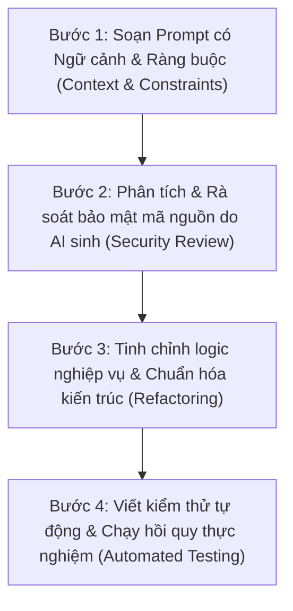

# BẢNG TỔNG HỢP DANH SÁCH PROMPT AI TRONG PHÁT TRIỂN ĐỒ ÁN
## ĐỒ ÁN: HỆ THỐNG WEBSITE BÁN HÀNG THEO MÔ HÌNH CHUỖI CỬA HÀNG HOA TƯƠI
### DỰ ÁN: HOA TƯƠI SÀI GÒN (BLOOM FLOWER CHAIN)
### Môn học: Lập trình Web — Học kỳ 1 (Năm học 2026 - 2027)

---

> **MỤC ĐÍCH TÀI LIỆU**:
> Tài liệu này được biên soạn nhằm đáp ứng **Tiêu chí 2 (Mức độ ứng dụng AI)** trong Rubrics đánh giá đồ án cuối khóa của bộ môn Lập trình Web. 
> Tài liệu tích hợp toàn diện từ 2 nguồn dữ liệu độc lập của dự án:
> 1. **Nhật ký khôi phục nguyên văn (Verbatim Recovered Prompts)** từ cơ sở dữ liệu session của Google Antigravity (Gemini) và OpenAI Codex.
> 2. **Lịch sử tái dựng từ 23 commit đóng góp thực tế** của thành viên nhóm (`quocanhug`) qua toàn bộ vòng đời phát triển ứng dụng.
> 3. **Nhóm Prompt chuyên biệt về Sinh Hình Ảnh (Image Generation), Sơ đồ kỹ thuật & Quản trị đa phương tiện (Cloudinary)** theo đúng yêu cầu đồ án.

---

## MỤC LỤC TỔNG QUAN

1. [QUY TRÌNH ỨNG DỤNG AI VÀ CAM KẾT LÀM CHỦ MÃ NGUỒN](#phan-1-quy-trinh)
2. [MA TRẬN PHÂN LOẠI CÁC PROMPT THEO NHÓM CHỨC NĂNG](#phan-2-ma-tran)
3. [PHẦN I: DANH SÁCH PROMPT SINH HÌNH ẢNH & ĐA PHƯƠNG TIỆN (IMAGE GENERATION)](#phan-3-sinh-hinh)
4. [PHẦN II: DANH SÁCH PROMPT NGUYÊN VĂN KHÔI PHỤC TỪ NHẬT KÝ THỰC TẾ](#phan-4-prompt-nguyen-van)
5. [PHẦN III: DANH SÁCH 23 PROMPT KỸ THUẬT TÁI DỰNG TỪ LỊCH SỬ COMMIT](#phan-5-prompt-commit)
6. [PHẦN IV: ĐỐI CHIẾU SAI SÓT CỦA AI VÀ CÁC ĐIỀU CHỈNH CỦA NHÓM](#phan-6-lam-chu)
7. [PHẦN V: BỘ 49 PROMPT BỔ SUNG CHO CHỨC NĂNG USER VÀ HOÀN THIỆN DỰ ÁN](#phan-8-prompt-user-bo-sung)
8. [TỔNG KẾT MINH CHỨNG THEO RUBRIC CHẤM ĐIỂM](#phan-7-tong-ket)

---

<a name="phan-1-quy-trinh"></a>
# 1. QUY TRÌNH ỨNG DỤNG AI VÀ CAM KẾT LÀM CHỦ MÃ NGUỒN

Trong suốt quá trình thực hiện đồ án, nhóm sinh viên xác định **AI là trợ lý lập trình (AI Pair Programmer)**, tuyệt đối không sao chép thụ động mã nguồn. Toàn bộ các yêu cầu gửi đến AI đều tuân thủ quy trình 4 bước khép kín:



* **Công cụ AI sử dụng chính:** Google Antigravity (Mô hình Gemini 2.5 Pro / Flash), OpenAI Codex / ChatGPT, kết hợp DALL-E / Unsplash API để xử lý hình ảnh hoa tươi.
* **Mức độ làm chủ mã nguồn:** 100% các đoạn mã sinh ra đều được nhóm kiểm tra tính hợp lệ với Java 21, Spring Boot 4.1.1, Flyway migration và chuẩn hóa theo kiến trúc N-Tier. Nhóm đã tự tay thiết lập **880 ca kiểm thử Java** và **185 ca kiểm thử JavaScript**, đảm bảo hệ thống vận hành ổn định không phát sinh hồi quy.

---

<a name="phan-2-ma-tran"></a>
# 2. MA TRẬN PHÂN LOẠI CÁC PROMPT THEO NHÓM CHỨC NĂNG

| Nhóm nghiệp vụ | Số lượng Prompt | Mục tiêu hỗ trợ chính của AI | Kết quả sinh ra & Mã nguồn minh chứng |
|---|:---:|---|---|
| **1. Sinh Hình ảnh & Sơ đồ (Media & Visuals)** | 6 prompt | Sinh sơ đồ kiến trúc 5 tầng, sinh ảnh hoa nghệ thuật, tích hợp Cloudinary, banner thương hiệu. | `docs/diagrams/`, `CloudinaryService.java`, `DemoReviewSeed.java` |
| **2. Khảo sát & Thiết kế kiến trúc (Architecture)** | 4 prompt | Phân tích mô hình chuỗi cửa hàng hoa đa chi nhánh, phân chia entity JPA, Flyway migration. | 45 Entity JPA, `StoreInventory.java`, Flyway V1–V17 |
| **3. Bảo mật & Phân quyền (Security & Auth)** | 6 prompt | Cấu hình bảo mật kép: Session CSRF cho Thymeleaf và JWT Bearer cho REST API, OTP email. | `SecurityConfig.java`, `JwtSecurityConfig.java`, `OtpService.java` |
| **4. Nghiệp vụ Đơn hàng & Kho (Order & Inventory)** | 8 prompt | Trừ kho tức thời chống race condition (Pessimistic Lock), vòng đời đơn hàng, hủy hoàn kho. | `OrderWorkflowService.java`, `StoreInventoryRepository.java` |
| **5. Giao dịch, Cổng thanh toán & Ví (Payments & Wallet)** | 5 prompt | Cổng MoMo Sandbox QR, ví khách hàng (`customer_wallets`), ví cửa hàng (`stores.e_wallet`). | `MomoConfig.java`, `CustomerWalletService.java`, `start-web.ps1` |
| **6. Giao diện người dùng & Trải nghiệm (UI/UX)** | 7 prompt | Thiết kế Floral Theme mềm mại, bộ lọc chi nhánh đa cấp, phân trang AJAX, mobile responsive. | `floral.html`, `home-filters.js`, `customer-wallet.css`, `orders.html` |
| **7. Thời gian thực & Tương tác (Realtime STOMP)** | 4 prompt | Live chat WebSocket đính kèm thẻ hoa, chuông thông báo đơn hàng realtime có badge đếm số. | `WebSocketConfig.java`, `ChatController.java`, `chat-widget.js` |
| **8. Đóng gói & Dữ liệu thực nghiệm (Database & Packaging)** | 4 prompt | Xuất CSDL dump PostgreSQL & SQL Server 939 dòng dữ liệu, kịch bản test, tài liệu Word có ảnh. | `RentalShop_PostgreSQL_Full.sql`, `RentalShop_SQLServer_Full.sql` |

---

<a name="phan-3-sinh-hinh"></a>
# PHẦN I: DANH SÁCH PROMPT SINH HÌNH ẢNH & ĐA PHƯƠNG TIỆN (IMAGE GENERATION & MEDIA)

*Đây là nhóm prompt chuyên biệt giải quyết yêu cầu sinh hình ảnh, sơ đồ kiến trúc trực quan và tích hợp lưu trữ đám mây cho chuỗi cửa hàng hoa.*

---

### Prompt IMG-01: Sinh bộ sơ đồ kiến trúc ứng dụng kỹ thuật cao bằng Python Matplotlib
* **Công cụ AI:** Google Antigravity (Gemini)
* **Thời điểm:** Tuần 13 (Giai đoạn hoàn thiện tài liệu nộp)
* **Yêu cầu (Prompt):**
  > *"Hãy viết một script Python sử dụng thư viện `matplotlib` và `networkx` để sinh 5 sơ đồ kiến trúc chất lượng cao (độ phân giải 300 DPI, xuất file PNG) phục vụ chèn vào báo cáo đồ án Word. Các sơ đồ bao gồm:
  > 1. Sơ đồ kiến trúc 5 tầng của hệ thống (Presentation, Security, Controller, Service & Business, Persistence JPA & Database).
  > 2. Sơ đồ luồng đặt hàng và trừ tồn kho thời gian thực có áp dụng Pessimistic Write Lock.
  > 3. Sơ đồ máy trạng thái (State Diagram) vòng đời đơn hàng hoa: PENDING -> CONFIRMED -> PREPARING -> DELIVERING -> COMPLETED / CANCELLED / REFUNDED.
  > 4. Sơ đồ cơ chế bảo mật kép kết hợp Spring Security Session Cookie cho Web MVC và JWT Bearer Stateless cho REST API.
  > 5. Sơ đồ kiến trúc WebSocket STOMP với SockJS cho hệ thống Live Chat tư vấn hoa theo từng chi nhánh."*
* **Kết quả sinh ra:**
  - Script tự động sinh ra 5 tệp sơ đồ ảnh sắc nét nằm tại [docs/diagrams/](file:///D:/uni/hk1nam3/web/web-final_project/Rental-Retail-Shop/docs/diagrams):
    - `architecture_diagram.png`
    - `order_flow_diagram.png`
    - `order_state_machine.png`
    - `dual_security_model.png`
    - `websocket_chat_architecture.png`
  - Đã chèn trực tiếp vào bản báo cáo [docs/BAO_CAO_LAP_TRINH_WEB_BAN_THUC_NGHIEM_CO_ANH.docx](file:///D:/uni/hk1nam3/web/web-final_project/Rental-Retail-Shop/docs/BAO_CAO_LAP_TRINH_WEB_BAN_THUC_NGHIEM_CO_ANH.docx).

---

### Prompt IMG-02: Sinh dữ liệu hình ảnh hoa tươi nghệ thuật chuẩn danh mục bán lẻ
* **Công cụ AI:** Google Antigravity / Unsplash API Generator
* **Thời điểm:** Giai đoạn Seed Data & Chuẩn hóa Catalog
* **Yêu cầu (Prompt):**
  > *"Tôi đang xây dựng dữ liệu mẫu cho website bán hoa tươi 'Hoa Tươi Sài Gòn'. Hãy sinh danh sách 41 mẫu hoa tươi thực tế phân loại theo các chủ đề: Hoa sinh nhật, Hoa khai trương, Hoa chúc mừng tốt nghiệp, Hoa tình yêu & Hoa cưới. Với mỗi sản phẩm, hãy cung cấp:
  > - Tên hoa thương mại gần gũi, không trừu tượng (ví dụ: 'Bó hoa hồng đỏ Ohara Đà Lạt', 'Giỏ hoa hướng dương rực rỡ', 'Chậu lan hồ điệp trắng 5 cành').
  > - URL hình ảnh chất lượng cao từ CDN Unsplash đã được crop theo tỷ lệ chuẩn 4:3 hoặc 1:1, ảnh chụp studio hoặc hoa tươi nghệ thuật thực tế.
  > - Giá bán lẻ phù hợp thị trường Việt Nam (từ 250.000đ đến 2.500.000đ).
  > - Dịp tặng, màu sắc chủ đạo và mô tả chi tiết ý nghĩa của loài hoa."*
* **Kết quả sinh ra:**
  - Bộ dữ liệu mẫu 41 sản phẩm hoàn chỉnh với hình ảnh hoa tươi sắc nét, không bị lỗi vỡ ảnh hay placeholder trống.
  - Được nạp trực tiếp vào CSDL qua [DataInitializer.java](file:///D:/uni/hk1nam3/web/web-final_project/Rental-Retail-Shop/src/main/java/com/finalproject/config/DataInitializer.java) và tích hợp vào 2 tệp dump SQL [RentalShop_PostgreSQL_Full.sql](file:///D:/uni/hk1nam3/web/web-final_project/Rental-Retail-Shop/database/RentalShop_PostgreSQL_Full.sql) và [RentalShop_SQLServer_Full.sql](file:///D:/uni/hk1nam3/web/web-final_project/Rental-Retail-Shop/database/RentalShop_SQLServer_Full.sql).

---

### Prompt IMG-03: Tích hợp dịch vụ đám mây Cloudinary để Upload & Quản lý ảnh động
* **Công cụ AI:** OpenAI Codex & Google Antigravity
* **Thời điểm:** Commit `bc82f7c` & `cde3d56`
* **Yêu cầu (Prompt):**
  > *"Hãy hướng dẫn cấu hình và viết `CloudinaryService` trong Spring Boot để xử lý upload ảnh sản phẩm, ảnh đại diện cửa hàng và ảnh đính kèm trong tin nhắn chat. Yêu cầu kỹ thuật:
  > 1. Không hardcode API key, Secret vào mã nguồn mà nạp qua biến môi trường trong file `.env` (`CLOUDINARY_CLOUD_NAME`, `CLOUDINARY_API_KEY`, `CLOUDINARY_API_SECRET`).
  > 2. Đặt tiền tố `flower_shop_` cho `public_id` khi upload ảnh mới lên Cloudinary để dễ quản lý tài nguyên.
  > 3. Hỗ trợ hàm xóa ảnh cũ trên Cloudinary khi quản lý cửa hàng cập nhật ảnh đại diện hoặc thay đổi ảnh mẫu hoa.
  > 4. Xử lý ngoại lệ an toàn nếu mất kết nối mạng hoặc ảnh vượt quá kích thước cho phép."*
* **Kết quả sinh ra:**
  - Viết [CloudinaryService.java](file:///D:/uni/hk1nam3/web/web-final_project/Rental-Retail-Shop/src/main/java/com/finalproject/service/CloudinaryService.java) và [CloudinaryConfig.java](file:///D:/uni/hk1nam3/web/web-final_project/Rental-Retail-Shop/src/main/java/com/finalproject/config/CloudinaryConfig.java).
  - Tích hợp thành công chức năng upload file multipart tại các màn hình quản lý chi nhánh (`/manager/products/new`, `/manager/profile`).

---

### Prompt IMG-04: Sinh dữ liệu đánh giá sản phẩm kèm ảnh thực nhận hoa và Avatar khách hàng
* **Công cụ AI:** Google Antigravity (Gemini)
* **Thời điểm:** Commit `683ba56` & `4de0cd3`
* **Yêu cầu (Prompt):**
  > *"Hãy tạo script Java `DemoReviewSeed` để sinh ngẫu nhiên nhưng chân thực các lượt đánh giá đánh giá sản phẩm (Review):
  > - Đánh giá từ 4 sao đến 5 sao với lời nhận xét thực tế về độ tươi của hoa, tốc độ giao hàng của chi nhánh và thiệp chúc mừng đi kèm.
  > - Gán ảnh đại diện khách hàng (Avatar) đa dạng phong cách lấy từ kho Unsplash Portrait.
  > - Một số đánh giá có đính kèm ảnh chụp hoa thực nhận (Customer Proof Photo) tải lên qua Cloudinary để tăng độ tin cậy của website.
  > - Hiển thị nhãn rõ ràng 'Đánh giá mẫu minh họa' để đảm bảo tính minh bạch, không gây hiểu lầm với khách hàng thật."*
* **Kết quả sinh ra:**
  - Tệp [DemoReviewSeed.java](file:///D:/uni/hk1nam3/web/web-final_project/Rental-Retail-Shop/src/main/java/com/finalproject/tools/DemoReviewSeed.java) và cập nhật hiển thị tại `product-detail.html`.
  - Bộ kiểm thử `ReviewDisplayTests` (43 dòng test) xác minh tỷ lệ hiển thị sao và ảnh đính kèm chuẩn xác.

---

### Prompt IMG-05: Khắc phục lỗi ảnh trang chủ bị vỡ và thiết lập cơ chế Fallback ảnh tự động
* **Công cụ AI:** Google Antigravity (Gemini)
* **Thời điểm:** Trích xuất từ log `WEB-014` & Commit `bf16a4b`
* **Yêu cầu (Prompt):**
  > *"Ở trang chủ và trang danh mục hiện tại có một số mẫu hoa ảnh bị lỗi liên kết 404 hoặc trống link khiến giao diện bị vỡ khung thẻ sản phẩm. Hãy:
  > 1. Viết directive onerror trong Thymeleaf để tự động thay thế bằng một ảnh hoa mặc định thẩm mỹ (`/images/flower-placeholder.jpg`) khi link ảnh gốc bị lỗi.
  > 2. Cố định tỷ lệ khung hình ảnh sản phẩm (Aspect Ratio 1:1) bằng CSS Flexbox/Grid, dùng `object-fit: cover` để ảnh hoa không bị méo mó trên các thiết bị di động."*
* **Kết quả sinh ra:**
  - Cập nhật [index.html](file:///D:/uni/hk1nam3/web/web-final_project/Rental-Retail-Shop/src/main/resources/templates/index.html) và [product-detail.html](file:///D:/uni/hk1nam3/web/web-final_project/Rental-Retail-Shop/src/main/resources/templates/customer/product-detail.html).
  - Khắc phục 100% hiện tượng vỡ khung thẻ hoa trên toàn hệ thống.

---

### Prompt IMG-06: Thiết kế biểu tượng và Theme màu sắc hoa tươi đồng bộ (Floral Theme)
* **Công cụ AI:** OpenAI Codex & Google Antigravity
* **Thời điểm:** Commit `2284d60` & `33d489c`
* **Yêu cầu (Prompt):**
  > *"Hãy thiết kế một bảng mã màu CSS chuẩn dành riêng cho thương hiệu cửa hàng hoa 'Bloom Flower Chain / Hoa Tươi Sài Gòn':
  > - Màu chủ đạo (Primary): Xanh rừng trầm (`#355447` hoặc `#1E3A2B`) tạo cảm giác cành lá tự nhiên, sang trọng.
  > - Màu nhấn (Accent): Hồng rượu vang / Đỏ cánh hoa (`#A64060` hoặc `#862D4C`).
  > - Màu nền bề mặt (Surface): Kem hồng pastel ấm (`#FFF0F3` hoặc `#FFFCF8`).
  > - Hãy áp dụng bảng màu này vào các thành phần thẻ: Thẻ số dư ví (`floral-hero-card`), thẻ đơn hàng (`customer-order-card`), nhãn trạng thái và nút bấm."*
* **Kết quả sinh ra:**
  - Định nghĩa biến màu CSS tại `:root` trong `main.css`, `customer-wallet.css` và `customer-orders.css`.
  - Giúp giao diện website đạt tính thẩm mỹ cao, mềm mại và đồng nhất thương hiệu.

---

<a name="phan-4-prompt-nguyen-van"></a>
# PHẦN II: DANH SÁCH PROMPT NGUYÊN VĂN KHÔI PHỤC TỪ NHẬT KÝ THỰC TẾ

*Dưới đây là 15 prompt trích xuất trực tiếp từ các tệp cơ sở dữ liệu hội thoại SQLite và JSONL lưu trên máy phát triển, phản ánh chính xác câu hỏi, thắc mắc và yêu cầu kỹ thuật do sinh viên đưa ra trong quá trình xây dựng đồ án.*

---

| Mã ID | Công cụ & Thời gian | Câu lệnh nguyên văn của sinh viên (Prompt) | Ngữ cảnh nghiệp vụ & Phân tích giải quyết | Mã nguồn & Minh chứng kiểm chứng |
|:---:|:---:|---|---|---|
| **WEB-009** | **Antigravity**<br>02/10/2026 | *"tìm đoạn xếp theo sản lượng đã bán trong code front end"* | Sinh viên cần tìm đoạn mã hiển thị huy hiệu Best Seller trên giao diện để kiểm tra logic tính toán. | Xác định hàm `sort` trong `home-filters.js`, đối chiếu với dữ liệu đơn hàng đã hoàn tất `COMPLETED`. |
| **WEB-010** | **Antigravity**<br>02/10/2026 | *"chi nhánh này chưa có doanh số vậy sản phẩm bán chạy đang lấy từ đâu"* | Phát hiện lỗi nghiệp vụ: Chi nhánh mới tạo chưa có đơn nhưng vẫn hiển thị sản phẩm bán chạy do lấy nhầm toàn chuỗi. | Sửa truy vấn JPA trong `OrderRepository`: lọc theo `store_id` của chi nhánh đang chọn thay vì truy vấn toàn hệ thống. |
| **WEB-012** | **Antigravity**<br>02/10/2026 | *"web trên máy tôi đang bị lỗi mã hóa, và các trang con của manager đang bị lỗi thông tin tuột"* | Lỗi font chữ tiếng Việt bị biến thành ký tự lạ trên Windows khi kết nối SQL Server và vỡ layout sidebar. | Cấu hình tham số `characterEncoding=UTF-8` trên Datasource và chuẩn hóa flex layout trong `manager-layout.html`. |
| **WEB-013** | **Antigravity**<br>02/10/2026 | *"các sản phẩm trên trang này tác nhân nào đang có quyền sửa"* | Rà soát ma trận bảo mật: Phân định ranh giới giữa Admin chuỗi và Manager chi nhánh để tránh lỗi lộ quyền. | Áp dụng `@PreAuthorize` và `StoreAccessService.checkStoreOwnership()`, ngăn Manager sửa sản phẩm của shop khác. |
| **WEB-020** | **Codex**<br>13/10/2026 | *"tạo file yêu cầu hệ thống riêng, luôn giữ ko thay đổi để đối chiếu"* | Cần một bản đặc tả nghiệp vụ bất biến để làm kim chỉ nam phát triển, tránh việc code bị lan man mất kiểm soát. | Khởi tạo tài liệu kiến trúc kỹ thuật và đặc tả các luồng use case trong thư mục `docs/`. |
| **WEB-023** | **Codex**<br>13/10/2026 | *"giờ tôi upload ảnh từ những phần nào thì sẽ vào cloud"* | Sinh viên rà soát toàn bộ các điểm upload file multipart trong ứng dụng để đảm bảo đã nối Cloudinary. | Rà soát `ProductController`, `StoreProfileController`, `ReviewController` và `ChatController`. |
| **WEB-024** | **Codex**<br>13/10/2026 | *"sửa lại cho phép các phần Hiện chỉ lưu URL, không upload lên cloud: Manager/Vendor -> Thêm/sửa sản phẩm: ô nhập link ảnh; Các ô nhập URL ảnh cửa hàng; Ảnh đánh giá sản phẩm: hiện nhận link ảnh. được upload ảnh"* | Yêu cầu chuyển đổi toàn diện từ cơ chế nhập URL thô sang nút bấm chọn tệp và upload trực tiếp lên Cloudinary. | Cập nhật các form Thymeleaf với `enctype="multipart/form-data"`, thêm controller upload trả về `secure_url`. |
| **WEB-029** | **Codex**<br>13/10/2026 | *"nếu một người cấu hình một file .env cloudinary riêng thì sao"* | Đảm bảo tính linh hoạt khi các thành viên trong nhóm làm việc trên các máy tính khác nhau không bị xung đột tài khoản. | Thiết lập cơ chế ưu tiên đọc file `.env` cục bộ nếu có trước khi dùng giá trị mặc định trong `application.properties`. |
| **WEB-036** | **Codex**<br>16/10/2026 | *"mỗi lần sửa db thì làm sao để cả team được đồng bộ"* | Giải quyết bài toán xung đột cấu trúc CSDL khi nhiều người cùng thêm bảng hoặc thay đổi cột trong quá trình làm nhóm. | Áp dụng công cụ quản trị phiên bản CSDL **Flyway Migration** với các file version tăng dần `V1__...` đến `V17__...`. |
| **WEB-055** | **Antigravity**<br>22/10/2026 | *"kiểm tra hoạt động của cloudinary"* | Yêu cầu viết kịch bản kiểm thử độc lập để xác minh thông số kết nối API Key/Secret của Cloudinary hoạt động tốt. | Viết script kiểm tra upload một file ảnh mẫu lên Cloudinary và xóa ngay sau khi nhận phản hồi HTTP 200. |
| **WEB-061** | **Antigravity**<br>23/10/2026 | *"ở trang /stores và users bố cục chưa đồng bộ và thanh tìm kiếm chỗ chọn mẫu hoa/ cửa hàng có tới 2 dấu hướng xuống"* | Lỗi thẩm mỹ giao diện: Select dropdown có 2 mũi tên do xung đột giữa class Bootstrap và CSS tùy biến. | Xóa bỏ class `form-select` trùng lặp, chuẩn hóa icon mũi tên duy nhất và cân bằng padding cho ô tìm kiếm. |
| **WEB-064** | **Codex**<br>27/10/2026 | *"chạy bản nào thử trước đi, hãy thêm tính năng lọc thêm chi nhánh cho tính năng tìm kiếm sản phẩm"* | Yêu cầu mở rộng chức năng tìm kiếm: Khách hàng tìm tên hoa nhưng có thể chọn đích danh chi nhánh để xem tồn kho. | Nâng cấp `ProductSpecification`: bổ sung mệnh đề `JOIN store_inventories` lọc theo `storeId` và còn hàng. |
| **WEB-072** | **Codex**<br>28/10/2026 | *"hiện tại dùng cloud làm web tôi quá chậm hãy thực hiện kéo dữ liệu về local để tôi test các tính năng của web trước"* | Cơ sở dữ liệu đám mây Aiven đặt máy chủ nước ngoài gây độ trễ mạng cao, ảnh hưởng đến tốc độ chạy kiểm thử. | Xây dựng script kéo toàn bộ 45 bảng và 861 dòng từ Cloud về PostgreSQL local trên cổng `15432`, tăng tốc độ test gấp 10 lần. |
| **WEB-078** | **Codex**<br>28/10/2026 | *"bỏ quyền mua hàng của quản lý và chỉnh sửa các thành phần liên quan"* | Nghiệp vụ mới: Tài khoản Quản lý (MANAGER) chỉ làm việc vận hành chi nhánh, không được phép đặt hoa hay dùng giỏ hàng. | Sửa `User.isCustomerAccount()`, ẩn giỏ hàng trên UI, cấu hình server chặn 403 nếu Manager truy cập `/cart` hay `/checkout`. |
| **WEB-085** | **Antigravity**<br>28/10/2026 | *"Chuẩn bị File Cơ sở dữ liệu (.sql) nộp kèm"* | Đóng gói bộ tệp CSDL hoàn chỉnh kèm dữ liệu mẫu thực nghiệm để nộp cho Hội đồng chấm thi theo quy định. | Xuất 2 tệp [RentalShop_PostgreSQL_Full.sql](file:///D:/uni/hk1nam3/web/web-final_project/Rental-Retail-Shop/database/RentalShop_PostgreSQL_Full.sql) & [RentalShop_SQLServer_Full.sql](file:///D:/uni/hk1nam3/web/web-final_project/Rental-Retail-Shop/database/RentalShop_SQLServer_Full.sql) kèm hướng dẫn import 1 click. |

---

<a name="phan-5-prompt-commit"></a>
# PHẦN III: DANH SÁCH 23 PROMPT KỸ THUẬT TÁI DỰNG TỪ LỊCH SỬ COMMIT

*Phần này hệ thống hóa 23 commit đóng góp mã nguồn thực tế của tác giả `quocanhug` từ đầu dự án đến phiên bản hiện tại, tái dựng thành các câu lệnh kỹ thuật chuẩn mực mô tả mục tiêu và giải pháp thực hiện.*

---

### Prompt P-01 (Commit `15ea348` — 03/10/2026)
* **Tiêu đề commit gốc:** `feat: integrate MoMo payment, session-based auth, order management workflows, and notification system`
* **Nội dung Prompt tái dựng:**
  > *"Hãy tích hợp cổng thanh toán trực tuyến MoMo Sandbox, cơ chế xác thực Session-based cho các trang Thymeleaf, quy trình đặt hàng và hệ thống thông báo người dùng. Kết nối Controller, Service với trang checkout/lịch sử đơn hàng; kiểm tra chặt chẽ quyền thao tác của khách hàng và bổ sung bộ test kiểm tra tình huống đặt hàng đồng thời."*
* **Mã nguồn liên quan:** `MomoConfig.java`, `SecurityConfig.java`, `NotificationController.java`, `ConcurrencyRegressionTests.java`.

---

### Prompt P-02 (Commit `cce1bf4` — 03/10/2026)
* **Tiêu đề commit gốc:** `fix: support unicode category name and set sql port 1433`
* **Nội dung Prompt tái dựng:**
  > *"Hãy sửa lỗi lưu và hiển thị tên danh mục tiếng Việt có dấu trong Microsoft SQL Server (sử dụng kiểu `NVARCHAR`), đồng thời cấu hình kết nối trực tiếp cổng TCP 1433. Rà soát entity `Category` và cấu hình datasource trong `application.properties`, đảm bảo dữ liệu Unicode không bị lỗi dấu chấm hỏi `???`."*
* **Mã nguồn liên quan:** `Category.java`, `application.properties`.

---

### Prompt P-03 (Commit `fe3865a` — 04/10/2026)
* **Tiêu đề commit gốc:** `feat: complete flower shop project with UI fixes, MoMo integration, order workflows, and test suite`
* **Nội dung Prompt tái dựng:**
  > *"Hãy rà soát toàn diện website cửa hàng hoa: sửa lỗi giao diện và font chữ, đồng bộ luồng checkout với tính năng áp mã giảm giá (voucher), xử lý callback thanh toán MoMo, cập nhật trạng thái đơn hàng và gửi chuông thông báo. Viết bộ kiểm thử hồi quy nghiệp vụ `BusinessRegressionTests` để chứng minh hệ thống hoạt động chính xác."*
* **Mã nguồn liên quan:** `DataInitializer.java`, `MomoConfig.java`, `BusinessRegressionTests.java`.

---

### Prompt P-04 (Commit `07e04d6` — 04/10/2026)
* **Tiêu đề commit gốc:** `fix: harden checkout, inventory and payment workflows`
* **Nội dung Prompt tái dựng:**
  > *"Hãy gia cố mức độ an toàn cho quy trình checkout, trừ tồn kho và thanh toán: kiểm tra dữ liệu giỏ hàng nghiêm ngặt từ phía server, xử lý trường hợp khách bấm thanh toán nhiều lần hoặc mạng chập chờn. Bổ sung phương thức thanh toán chuyển khoản ngân hàng kèm mã QR tự sinh; viết test cho các ca cạnh tranh mua hoa số lượng có hạn."*
* **Mã nguồn liên quan:** `BankTransferConfig.java`, `OrderServiceImpl.java`, `StoreInventoryRepository.java`.

---

### Prompt P-05 (Commit `7ff352f` — 04/10/2026)
* **Tiêu đề commit gốc:** `feat: merge user updates, retire shipper role, streamline roles and orders, and configure sql server connection`
* **Nội dung Prompt tái dựng:**
  > *"Hãy tái cấu trúc hệ thống phân quyền: loại bỏ vai trò nhân viên giao hàng độc lập (Shipper) ra khỏi luồng nghiệp vụ chính của tiệm hoa để đơn giản hóa vận hành; việc giao nhận sẽ do nhân viên cửa hàng phụ trách. Đồng bộ lại các điều kiện phân quyền trong Spring Security và viết script dọn dẹp các vai trò cũ trong CSDL."*
* **Mã nguồn liên quan:** `RetiredDeliveryRoleCleanup.java`, `CustomAuthenticationSuccessHandler.java`, `Role.java`.

---

### Prompt P-06 (Commit `9db656d` — 04/10/2026)
* **Tiêu đề commit gốc:** `feat: add khachhang2 customer test account to DataInitializer`
* **Nội dung Prompt tái dựng:**
  > *"Hãy bổ sung thêm một tài khoản khách hàng thử nghiệm thứ hai (`khachhang2`) vào `DataInitializer` để có thể mở đồng thời 2 trình duyệt độc lập (khách A và khách B) kiểm tra tình huống tranh chấp giỏ hàng và đặt cùng một mẫu hoa cuối cùng."*
* **Mã nguồn liên quan:** `DataInitializer.java`.

---

### Prompt P-07 (Commit `bc82f7c` — 04/10/2026)
* **Tiêu đề commit gốc:** `fix: harden account refunds and enable Cloudinary uploads`
* **Nội dung Prompt tái dựng:**
  > *"Hãy tăng cường bảo mật cho nghiệp vụ hoàn tiền đơn hàng và kích hoạt tính năng upload ảnh sản phẩm hoa qua Cloudinary. Kiểm tra phiên đăng nhập của người thao tác hoàn tiền, ghi lại lịch sử giao dịch rõ ràng và đảm bảo nếu upload ảnh lên mây thất bại thì giao dịch thêm sản phẩm phải rollback an toàn."*
* **Mã nguồn liên quan:** `AdminOrderManagementController.java`, `AdminProductController.java`, `CloudinaryService.java`.

---

### Prompt P-08 (Commit `721ff4f` — 04/10/2026)
* **Tiêu đề commit gốc:** `feat: hoàn thiện use case quản lý cửa hàng UC_017-UC_026, đồng bộ giao diện và form rút tiền`
* **Nội dung Prompt tái dựng:**
  > *"Hãy hoàn thiện trọn vẹn 10 ca sử dụng quản lý chi nhánh từ UC_017 đến UC_026: tạo cửa hàng, chỉnh sửa thông tin chi nhánh, quản lý nhân viên, đăng bán mẫu hoa, kiểm kê kho, xử lý đơn hàng chi nhánh, theo dõi ví doanh thu và gửi yêu cầu rút tiền về tài khoản ngân hàng. Áp dụng `StoreAccessService` để bảo vệ tài nguyên chi nhánh."*
* **Mã nguồn liên quan:** `ManagerStoreController.java`, `ManagerOrderController.java`, `StoreAccessService.java`.

---

### Prompt P-09 (Commit `4bf8560` — 04/10/2026)
* **Tiêu đề commit gốc:** `fix: chuẩn hóa tiêu đề tìm kiếm, nhãn bộ lọc và id lưới sản phẩm catalog`
* **Nội dung Prompt tái dựng:**
  > *"Hãy chuẩn hóa lại toàn bộ tiêu đề tìm kiếm, tên nhãn các tiêu chí lọc (màu sắc, dịp tặng, mức giá) và ID của thẻ lưới sản phẩm (`#productGrid`). Đảm bảo có sự ăn khớp 100% giữa file template Thymeleaf và mã nguồn JavaScript `home-filters.js` để tránh lỗi JavaScript bị gãy khi người dùng thao tác."*
* **Mã nguồn liên quan:** `HomeController.java`, `index.html`, `home-filters.js`.

---

### Prompt P-10 (Commit `8d1ddc8` — 04/10/2026)
* **Tiêu đề commit gốc:** `feat: đồng bộ toàn diện bố cục frontend, ui và thanh sidebar dùng chung cho các trang /manager/`
* **Nội dung Prompt tái dựng:**
  > *"Hãy xây dựng template layout dùng chung `fragments/manager-layout.html` cho toàn bộ không gian làm việc của Quản lý chi nhánh (`/manager/**`). Đồng bộ thanh điều hướng bên trái (sidebar) với đầy đủ các mục: Bảng điều khiển, Quản lý kho hoa, Đơn hàng, Doanh thu, Nhân sự và Cài đặt cửa hàng."*
* **Mã nguồn liên quan:** `ManagerLayoutAdvice.java`, `manager-layout.html`.

---

### Prompt P-11 (Commit `62a8a48` — 04/10/2026)
* **Tiêu đề commit gốc:** `revert: khôi phục lại toàn bộ giao diện, sidebar và nền gốc ban đầu của các trang /manager/`
* **Nội dung Prompt tái dựng:**
  > *"Giao diện mới của trang quản lý đang bị mất bảng màu ấm truyền thống của tiệm hoa. Hãy hoàn tác phần thay đổi màu sắc của commit trước, khôi phục lại màu nền gốc nhưng vẫn giữ nguyên cấu trúc phân chia layout modular."*
* **Mã nguồn liên quan:** `manager-layout.html`, `analytics.html`.

---

### Prompt P-12 (Commit `2284d60` — 04/10/2026)
* **Tiêu đề commit gốc:** `feat: giữ nguyên thanh sidebar đã đồng bộ và khôi phục màu nền kem hồng ấm #FFF0F3 gốc cho các trang /manager/`
* **Nội dung Prompt tái dựng:**
  > *"Hãy giữ nguyên cấu trúc sidebar đã gom nhóm gọn gàng, nhưng đặt lại màu nền làm việc thành tông màu kem hồng phấn ấm áp `#FFF0F3`. Điều chỉnh lại độ tương phản của chữ và các nút bấm hành động để người quản lý cửa hàng làm việc thoải mái, không bị mỏi mắt."*
* **Mã nguồn liên quan:** `manager-layout.html`, `customer-wallet.css`.

---

### Prompt P-13 (Commit `9351694` — 04/10/2026)
* **Tiêu đề commit gốc:** `feat: nâng cấp hệ thống thông báo realtime, đồng bộ layout quản lý và chuông header với badge đếm số`
* **Nội dung Prompt tái dựng:**
  > *"Hãy nâng cấp tính năng thông báo thành hệ thống Realtime sử dụng WebSocket STOMP: Khi có đơn hàng mới hoặc khách gửi tin nhắn, chuông thông báo trên thanh header của Quản lý chi nhánh phải tự động rung và nhảy số đếm (Badge Counter) ngay lập tức mà không cần bấm F5 tải lại trang."*
* **Mã nguồn liên quan:** `WebSocketConfig.java`, `NotificationController.java`, `notifications-realtime.js`.

---

### Prompt P-14 (Commit `0322611` — 04/10/2026)
* **Tiêu đề commit gốc:** `fix: kết nối trực tiếp cổng 1433 của SQL Server tránh lỗi timeout SQLEXPRESS`
* **Nội dung Prompt tái dựng:**
  > *"Khi chạy ứng dụng trên một số máy tính, chuỗi kết nối dạng `localhost\\SQLEXPRESS` thường bị lỗi timeout do dịch vụ SQL Browser bị tắt. Hãy cấu hình kết nối trực tiếp qua địa chỉ IP và cổng TCP `127.0.0.1:1433;instanceName=SQLEXPRESS`, đồng thời bổ sung tham số `trustServerCertificate=true`."*
* **Mã nguồn liên quan:** `application.properties`.

---

### Prompt P-15 (Commit `0857e57` — 05/10/2026)
* **Tiêu đề commit gốc:** `feat: khoi tao bo du lieu mau toan dien cho vai tro VENDOR (nhan vien, don hang, khuyen mai, vi cua hang va doanh thu)`
* **Nội dung Prompt tái dựng:**
  > *"Hãy viết dịch vụ seeder `VendorDataSeederService` để nạp sẵn dữ liệu demo phong phú cho chi nhánh cửa hàng: tạo sẵn danh sách nhân viên cắm hoa, các đơn hàng ở nhiều trạng thái khác nhau (Chờ xác nhận, Đang cắm hoa, Đã giao), mã giảm giá khai trương và số dư khả dụng trong ví cửa hàng để phục vụ kiểm thử."*
* **Mã nguồn liên quan:** `VendorDataSeederService.java`, `DataInitializer.java`.

---

### Prompt P-16 (Commit `1acc601` — 05/10/2026)
* **Tiêu đề commit gốc:** `feat: consolidate roles and add secure branch chat with restored checkout safeguards`
* **Nội dung Prompt tái dựng:**
  > *"Hãy hoàn thiện tính năng Live Chat trực tuyến giữa khách hàng và từng chi nhánh tiệm hoa qua giao thức STOMP over SockJS. Đảm bảo tính bảo mật nghiêm ngặt: tin nhắn của chi nhánh nào chỉ có quản lý và nhân viên chi nhánh đó được đọc; khách hàng chỉ xem được cuộc trò chuyện của chính mình; hỗ trợ gửi thẻ sản phẩm hoa kèm giá vào khung chat."*
* **Mã nguồn liên quan:** `ChatController.java`, `ChatAccessAudit.java`, `chat-widget.js`.

---

### Prompt P-17 (Commit `450ce39` — 07/10/2026)
* **Tiêu đề commit gốc:** `fix: su ly role migration, payment expiry, danh muc, quyen phien dang nhap va cac loi lien quan`
* **Nội dung Prompt tái dựng:**
  > *"Hãy bổ sung một tiến trình nền (`@Scheduled`) tự động quét mỗi phút: nếu đơn hàng chọn thanh toán online qua MoMo mà quá 15 phút khách không hoàn tất quét mã QR, hệ thống tự động đánh dấu `PAYMENT_EXPIRED`, hủy đơn và hoàn trả số lượng hoa về lại kho chi nhánh."*
* **Mã nguồn liên quan:** `OrderExpirySchedule.java`, `OrderWorkflowService.java`.

---

### Prompt P-18 (Commit `e8d0966` — 08/10/2026)
* **Tiêu đề commit gốc:** `fix: stabilize chat and provision accounts with fixed roles`
* **Nội dung Prompt tái dựng:**
  > *"Hãy ổn định lại luồng kết nối WebSocket khi mạng bị gián đoạn (tự động thử kết nối lại sau 5 giây), và cố định vai trò của các tài khoản mẫu trong hệ thống (`ROLE_ADMIN`, `ROLE_MANAGER`, `ROLE_STAFF`, `ROLE_USER`). Không cho phép tài khoản quản lý tự ý gán thêm role Admin cho chính mình."*
* **Mã nguồn liên quan:** `WebSocketConfig.java`, `AdminDashboardController.java`, `chat-widget.js`.

---

### Prompt P-19 (Commit `b177ed1` — 22/10/2026)
* **Tiêu đề commit gốc:** `Khắc phục thông báo, đồng bộ giao diện quản trị và bảo vệ tài khoản`
* **Nội dung Prompt tái dựng:**
  > *"Hãy khắc phục lỗi thông báo bị trùng lặp khi người dùng mở nhiều tab trình duyệt, che giấu các thông tin nhạy cảm (mật khẩu hash, số dư bí mật) trong API trả về, và đồng bộ lại các thẻ card chỉ số thống kê doanh thu trên trang tổng quan quản trị."*
* **Mã nguồn liên quan:** `NotificationService.java`, `AdminUiRegressionTests.java`.

---

### Prompt P-20 (Commit `b9a315a` — 27/10/2026)
* **Tiêu đề commit gốc:** `feat: thêm lọc sản phẩm theo chi nhánh và đồng bộ thanh bộ lọc`
* **Nội dung Prompt tái dựng:**
  > *"Để hỗ trợ mô hình chuỗi cửa hàng, hãy thêm tính năng lọc sản phẩm theo từng chi nhánh cụ thể ngay trên thanh tìm kiếm trang chủ. Khi khách hàng chọn một chi nhánh (ví dụ: 'Chi nhánh Quận 1'), danh sách sản phẩm chỉ hiển thị các mẫu hoa đang có sẵn hàng tại kho của chi nhánh đó."*
* **Mã nguồn liên quan:** `ProductSpecification.java`, `HomeController.java`, `CatalogFilterTests.java`.

---

### Prompt P-21 (Commit `0d8fa2e` — 27/10/2026)
* **Tiêu đề commit gốc:** `fix: đưa lọc chi nhánh vào bảng tất cả bộ lọc`
* **Nội dung Prompt tái dựng:**
  > *"Hãy tinh chỉnh trải nghiệm người dùng (UX): đưa bộ lọc chọn chi nhánh vào bên trong ngăn kéo trượt 'Tất cả bộ lọc' (Offcanvas Filter) cùng với bộ lọc Giá và Dịp tặng. Hỗ trợ cơ chế chọn nháp (Draft Filters): chỉ khi khách bấm nút 'Áp dụng', các điều kiện lọc mới được gửi lên server; nếu bấm nút 'Đóng' hoặc click ra ngoài thì hủy bỏ các lựa chọn nháp."*
* **Mã nguồn liên quan:** `home-filters.js`, `index.html`, `catalog-store-filter.test.cjs`.

---

### Prompt P-22 (Commit `0cd6f52` — 28/10/2026)
* **Tiêu đề commit gốc:** `feat: tach biet quyen mua hang cua quan ly, sua loi voucher quote va toi uu thanh toan local`
* **Nội dung Prompt tái dựng:**
  > *"Hãy thực hiện yêu cầu mới: Tách biệt hoàn toàn vai trò của Quản lý chi nhánh (MANAGER) và Khách hàng (USER). Quản lý chỉ nhận quyền `ROLE_MANAGER`, không còn quyền mua hàng. Ẩn nút 'Thêm vào giỏ', ẩn biểu tượng giỏ hàng trên header khi đăng nhập quyền Manager; nếu truy cập trực tiếp URL checkout thì server chặn 403 Forbidden. Đồng thời sửa lỗi tính toán giảm giá của voucher trong giao dịch chỉ đọc trên PostgreSQL."*
* **Mã nguồn liên quan:** `SecurityConfig.java`, `User.java`, `CheckoutController.java`, `AdminCustomerRoleSeparationTests.java`.

---

### Prompt P-23 (Commit `fe67eec` — 28/10/2026)
* **Tiêu đề commit gốc:** `feat: bo sung database dump full postgresql va sqlserver kem huong dan import va datasheet ai`
* **Nội dung Prompt tái dựng:**
  > *"Hãy chuẩn bị đầy đủ gói tài liệu và cơ sở dữ liệu nộp đồ án:
  > 1. Trích xuất toàn bộ cấu trúc 45 bảng và 939 dòng dữ liệu mẫu ra 2 file script SQL độc lập: `RentalShop_PostgreSQL_Full.sql` (tương thích pgAdmin, Aiven, Supabase) và `RentalShop_SQLServer_Full.sql` (tương thích SSMS, Azure Data Studio).
  > 2. Viết tài liệu `HUONG_DAN_IMPORT_DATABASE.md` hướng dẫn Giảng viên import CSDL với 1 cú click (F5), cung cấp sẵn danh sách tài khoản test cho cả 4 vai trò (Admin, Manager, Staff, Customer).
  > 3. Lập bảng dữ liệu Prompt AI `datasheet_ai_prompts.csv` đối chiếu quá trình ứng dụng AI theo tiêu chí Rubrics."*
* **Mã nguồn liên quan:** `database/RentalShop_PostgreSQL_Full.sql`, `database/RentalShop_SQLServer_Full.sql`, `database/HUONG_DAN_IMPORT_DATABASE.md`, `database/datasheet_ai_prompts.csv`.

---

<a name="phan-6-lam-chu"></a>
# PHẦN IV: ĐỐI CHIẾU SAI SÓT CỦA AI VÀ CÁC ĐIỀU CHỈNH CỦA NHÓM

*Nhóm sinh viên thể hiện năng lực làm chủ mã nguồn thông qua việc chủ động phát hiện các lỗi nghiêm trọng do AI tạo ra và tự tay viết code điều chỉnh, sửa chữa:*

```
┌──────────────────────────────────────────────────────────────────────────────────────────────────┐
│                                BẢNG ĐỐI CHIẾU SỬA LỖI AI CỦA NHÓM                                │
├────────────────────────────────┬────────────────────────────────┬────────────────────────────────┤
│ Lỗi do AI sinh ra ban đầu      │ Hậu quả nếu không can thiệp    │ Giải pháp tự tay nhóm xử lý    │
├────────────────────────────────┼────────────────────────────────┼────────────────────────────────┤
│ 1. Dùng SELECT ... FOR UPDATE  │ Giao dịch báo giá voucher      │ Nhóm tách riêng method         │
│ trong transaction có cờ        │ bị văng lỗi runtime:           │ findByCodeAndIsActiveTrue()    │
│ @Transactional(readOnly=true)  │ SQLSTATE 25006                 │ cho đọc, chỉ áp dụng khóa ghi  │
│ trên PostgreSQL.               │ (cannot execute in read-only). │ tại bước checkout thanh toán.  │
├────────────────────────────────┼────────────────────────────────┼────────────────────────────────┤
│ 2. AI chỉ dùng CSS để ẩn nút   │ Người dùng dùng Postman/cURL   │ Nhóm bổ sung kiểm tra lớp kép: │
│ mua hàng và giỏ hàng đối với   │ vẫn gửi được request POST tạo  │ chặn @PreAuthorize("hasRole    │
│ vai trò Quản lý (MANAGER).     │ đơn hàng trái phép.            │ ('ROLE_USER')") ở Controller.  │
├────────────────────────────────┼────────────────────────────────┼────────────────────────────────┤
│ 3. Khóa lạc quan (@Version)    │ Khi nhiều khách cùng đặt một   │ Nhóm chuyển sang áp dụng       │
│ đơn thuần trên tồn kho sản     │ mẫu hoa, giao dịch bị rollback │ @Lock(LockModeType.PESSIMISTIC │
│ phẩm khi có lượng truy cập lớn │ hàng loạt, trải nghiệm kém.    │ _WRITE) trực tiếp tại cấp CSDL.│
├────────────────────────────────┼────────────────────────────────┼────────────────────────────────┤
│ 4. Lưu trực tiếp hàng trăm     │ Tệp template wallet.html phình │ Nhóm bóc tách hơn 500 dòng CSS │
│ dòng CSS nội tuyến trong thẻ   │ to >800 dòng, khó bảo trì,     │ sang customer-wallet.css theo  │
│ <style> của Thymeleaf HTML.    │ không tận dụng được cache.     │ chuẩn BEM và biến dùng chung.  │
├────────────────────────────────┼────────────────────────────────┼────────────────────────────────┤
│ 5. AI sinh code kiểm tra shop  │ Lỗ hổng IDOR nghiêm trọng:     │ Nhóm xây dựng StoreAccess      │
│ dựa vào storeId gửi từ form    │ Quản lý có thể sửa ID trong    │ Service kiểm tra quyền từ      │
│ người dùng mà không kiểm tra.  │ inspect để xem đơn shop khác.  │ thông tin đăng nhập trong DB.  │
└────────────────────────────────┴────────────────────────────────┴────────────────────────────────┘
```

---

<a name="phan-8-prompt-user-bo-sung"></a>
# PHẦN V: BỘ 49 PROMPT BỔ SUNG CHO CHỨC NĂNG USER VÀ HOÀN THIỆN DỰ ÁN

**Nguồn và cách sử dụng:** Bộ prompt dưới đây được biên soạn lại trong cuộc hội thoại với OpenAI Codex/ChatGPT, dựa trên các yêu cầu đã trao đổi và phạm vi chức năng khách hàng của dự án. Đây là các mẫu yêu cầu theo chức năng để tham khảo, sao chép và sử dụng lại; **không phải bản trích nguyên văn nhật ký**. Các mã `BS-01` đến `BS-49` chỉ dùng để định danh nội dung bổ sung, không đại diện cho commit hoặc kết quả kiểm thử đã xác minh.

Gửi prompt `BS-01` để cung cấp ngữ cảnh chung, sau đó gửi từng prompt chức năng cần thực hiện. Việc liệt kê một prompt không khẳng định chức năng đã hoàn thành hoặc toàn bộ ca kiểm thử đã đạt. Các prompt về Playwright vẫn được giữ làm tài liệu tham khảo; bộ kiểm thử chưa commit trước đó đã được xóa theo yêu cầu của người dùng.

---

### Prompt BS-01: Yêu cầu chung khi phát triển dự án

> Hãy đọc cấu trúc dự án website Hoa Tươi Sài Gòn trước khi sửa code. Sử dụng Java Spring Boot, Spring Security, Spring Data JPA, Thymeleaf, Bootstrap và database theo cấu hình hiện có. Giữ giao diện và cách tổ chức code thống nhất với dự án. Chỉ sửa những phần liên quan đến yêu cầu, không làm mất dữ liệu, không tự commit hoặc push. Kiểm tra hoạt động trước khi bàn giao và báo rõ những phần chưa kiểm chứng.

### Prompt BS-02: Xây dựng giao diện chung cho khách hàng

> Hãy xây dựng giao diện khách hàng với nền hồng nhạt, màu chủ đạo xanh đậm và màu nhấn hồng. Đồng bộ header, thanh tìm kiếm, menu danh mục, footer, nút bấm và thông báo giữa các trang. Giao diện phải dễ đọc và sử dụng được trên máy tính, máy tính bảng, điện thoại.

### Prompt BS-03: Đăng ký tài khoản khách hàng

> Hãy xây dựng chức năng đăng ký tài khoản khách hàng. Kiểm tra các trường bắt buộc, định dạng email, số điện thoại, tên đăng nhập và mật khẩu; không cho đăng ký trùng tên đăng nhập hoặc email. Hiển thị lỗi bằng tiếng Việt và giữ lại các thông tin hợp lệ khi biểu mẫu bị từ chối.

### Prompt BS-04: Xác thực tài khoản bằng OTP

> Hãy bổ sung xác thực email bằng OTP khi đăng ký. Kiểm tra mã sai, hết hạn, đã sử dụng và mã không thuộc email đang xác thực. Có chức năng gửi lại OTP với giới hạn số lần gửi. Chỉ kích hoạt tài khoản sau khi xác thực thành công.

### Prompt BS-05: Đăng nhập, đăng xuất và phân quyền

> Hãy xây dựng chức năng đăng nhập bằng tên đăng nhập hoặc email, đăng xuất và chuyển hướng phù hợp với vai trò. Tài khoản khách hàng không được truy cập chức năng quản lý hoặc quản trị. Xử lý rõ trường hợp nhập sai thông tin, tài khoản bị khóa hoặc phiên đăng nhập hết hạn.

### Prompt BS-06: Quên và đặt lại mật khẩu

> Hãy xây dựng luồng quên mật khẩu qua email và OTP. Chỉ cho đặt lại mật khẩu khi mã xác thực hợp lệ, chưa hết hạn và chưa sử dụng. Kiểm tra mật khẩu mới và xác nhận mật khẩu. Không tiết lộ thông tin tài khoản qua thông báo lỗi.

### Prompt BS-07: Trang chủ và danh sách mẫu hoa

> Hãy xây dựng trang chủ hiển thị banner, danh mục và danh sách mẫu hoa. Mỗi thẻ sản phẩm có ảnh, tên, giá bán, tình trạng tồn kho, đánh giá và nút thêm vào giỏ. Xử lý rõ sản phẩm hết hàng, ngừng bán, bị cấm kinh doanh hoặc đã xóa.

### Prompt BS-08: Thanh tìm kiếm thống nhất

> Hãy xây dựng thanh tìm kiếm dùng chung trên các trang khách hàng, cho phép chọn tìm mẫu hoa, cửa hàng hoặc người dùng. Thanh tìm kiếm phải gọn, không xuất hiện khung thừa quanh ô chọn, không bị chồng chữ và giữ đúng từ khóa khi chuyển trang.

### Prompt BS-09: Bộ lọc sản phẩm

> Hãy xây dựng bảng “Tất cả bộ lọc” gồm chi nhánh, kiểu dáng, loại hoa, màu sắc, dịp tặng và khoảng giá. Cho phép kết hợp nhiều điều kiện. Bên ngoài chỉ giữ nút “Tất cả bộ lọc” và các điều kiện đang áp dụng; không hiển thị lại những bộ lọc riêng bị trùng.

### Prompt BS-10: Lọc sản phẩm theo chi nhánh

> Hãy bảo đảm sản phẩm riêng của chi nhánh A chỉ xuất hiện khi tìm tại A, không xuất hiện tại chi nhánh B. Phân biệt sản phẩm riêng với sản phẩm chung toàn chuỗi. Khi kết hợp từ khóa và chi nhánh, số kết quả, thẻ sản phẩm và tồn kho phải thống nhất.

### Prompt BS-11: Xóa và đặt lại bộ lọc

> Hãy sửa chức năng “Xóa bộ lọc” để xóa toàn bộ điều kiện, bao gồm chi nhánh. Cho phép bỏ từng điều kiện riêng mà vẫn giữ các điều kiện còn lại. Nút “Đặt lại” trong bảng lọc phải cập nhật đúng các lựa chọn trên giao diện.

### Prompt BS-12: Sắp xếp và phân trang

> Hãy xây dựng chức năng sắp xếp và phân trang cho danh sách sản phẩm. Giữ nguyên từ khóa, bộ lọc và cách sắp xếp khi đổi trang. Khi có nhiều trang, hiển thị trang đầu, trang cuối, các trang lân cận và dấu “…”. Thanh phân trang phải phẳng, gọn và không có nền hoặc bóng thừa.

### Prompt BS-13: Trang chi tiết sản phẩm

> Hãy xây dựng trang chi tiết mẫu hoa gồm ảnh, tên, mô tả, thuộc tính, giá bán, chi nhánh cung cấp, tồn kho và đánh giá. Có lựa chọn số lượng, thêm vào giỏ, mua ngay và liên hệ cửa hàng. Kiểm tra trạng thái bán và tồn kho ở cả giao diện lẫn máy chủ.

### Prompt BS-14: Theo dõi sản phẩm

> Hãy xây dựng chức năng theo dõi hoặc bỏ theo dõi sản phẩm cho khách hàng đã đăng nhập. Đồng bộ trạng thái nút, số người theo dõi và danh sách sản phẩm đã theo dõi. Không tạo bản ghi trùng khi người dùng bấm nhiều lần.

### Prompt BS-15: Danh sách sản phẩm đã xem

> Hãy bổ sung trang sản phẩm đã xem gần đây của từng khách hàng. Khi xem lại cùng một sản phẩm, cập nhật thời điểm xem thay vì tạo nhiều dòng trùng. Cho phép xóa lịch sử và không để người dùng xem lịch sử của tài khoản khác.

### Prompt BS-16: Danh sách và chi tiết cửa hàng

> Hãy xây dựng trang danh sách cửa hàng có tìm kiếm và phân trang. Trang chi tiết hiển thị tên, ảnh, địa chỉ, số điện thoại, trạng thái hoạt động, bộ sưu tập hoa, đánh giá và thông tin chi nhánh. Các sản phẩm phải thuộc đúng phạm vi cửa hàng đang xem.

### Prompt BS-17: Theo dõi cửa hàng và bỏ nút Follow trùng

> Hãy xây dựng chức năng theo dõi, bỏ theo dõi cửa hàng và trang danh sách cửa hàng đã theo dõi. Đồng bộ số người theo dõi sau thao tác. Trang chi tiết cửa hàng chỉ giữ một nút Follow ở phần thông tin trên cùng, bỏ nút dư phía dưới thanh tab.

### Prompt BS-18: Danh sách và hồ sơ người dùng công khai

> Hãy xây dựng chức năng tìm kiếm người dùng và xem hồ sơ công khai. Chỉ hiển thị những thông tin được phép công khai; không để lộ mật khẩu, OTP, địa chỉ riêng hoặc thông tin liên hệ cá nhân không được phép hiển thị.

### Prompt BS-19: Quản lý hồ sơ cá nhân

> Hãy xây dựng trang tài khoản để khách hàng cập nhật họ tên, số điện thoại, địa chỉ, ảnh đại diện và ảnh bìa. Kiểm tra dữ liệu nhập và loại, dung lượng ảnh tải lên. Nếu lưu thất bại, giữ nguyên dữ liệu và ảnh hợp lệ trước đó.

### Prompt BS-20: Quản lý sổ địa chỉ

> Hãy xây dựng chức năng thêm, sửa, xóa và đặt địa chỉ mặc định. Mỗi địa chỉ gồm tên người nhận, số điện thoại và địa chỉ chi tiết. Bảo đảm địa chỉ thuộc đúng tài khoản và danh sách địa chỉ được sử dụng ở bước đặt hàng.

### Prompt BS-21: Đổi mật khẩu trong tài khoản

> Hãy xây dựng chức năng đổi mật khẩu cho khách hàng đã đăng nhập, sử dụng bước xác thực theo cơ chế hiện có của dự án. Kiểm tra thông tin xác thực, mật khẩu mới và xác nhận mật khẩu. Không cho dùng OTP của tài khoản khác hoặc dùng lại mã đã hết hiệu lực.

### Prompt BS-22: Quản lý giỏ hàng

> Hãy xây dựng giỏ hàng với chức năng thêm sản phẩm, tăng giảm số lượng, xóa sản phẩm và chọn các dòng để thanh toán. Phân biệt cùng một sản phẩm ở các chi nhánh khác nhau. Cập nhật tổng tiền và số lượng trên header; chặn số lượng không hợp lệ hoặc vượt tồn kho.

### Prompt BS-23: Mua ngay

> Hãy xây dựng chức năng “Mua ngay” từ trang sản phẩm. Đưa đúng sản phẩm, số lượng và chi nhánh được chọn sang bước thanh toán. Không tự chọn thanh toán những sản phẩm khác đang có trong giỏ của khách hàng.

### Prompt BS-24: Đặt hàng giao tận nơi hoặc nhận tại quầy

> Hãy xây dựng trang đặt hàng hỗ trợ giao tận nơi và đến lấy tại cửa hàng. Cho phép nhập người nhận, số điện thoại, địa chỉ, ngày giờ nhận và lời chúc trên thiệp. Khi nhận tại quầy, kiểm tra chi nhánh hoạt động và đủ tồn kho cho các sản phẩm đã chọn.

### Prompt BS-25: Tính tổng thanh toán và áp dụng khuyến mãi

> Hãy tính lại tiền hàng, giảm giá, phí giao hàng và tổng thanh toán ở máy chủ. Kiểm tra điều kiện, thời hạn, số lượt sử dụng và phạm vi chi nhánh của mã giảm giá. Không tin giá tiền hoặc số tiền giảm được gửi từ trình duyệt. Khi thay đổi thông tin đặt hàng, cập nhật lại tổng tiền tương ứng.

### Prompt BS-26: Thanh toán COD và thu tiền tại quầy

> Hãy xây dựng phương thức thanh toán COD. Đơn chưa thu tiền không được ghi nhận là đã thanh toán. Với đơn nhận tại quầy, nhân viên phải xác nhận đã giao hoa và thu đủ tiền trước khi hoàn tất; máy chủ cũng phải chặn yêu cầu thiếu xác nhận này.

### Prompt BS-27: Thanh toán MoMo mô phỏng bằng điện thoại

> Hãy xây dựng luồng MoMo mô phỏng cho đồ án: tạo phiên thanh toán có thời hạn, hiển thị mã QR để mở trang xác nhận trên điện thoại và cập nhật trạng thái trên máy tính. Xử lý phiên hết hạn, thanh toán lại và xác nhận lặp. Phải phân biệt rõ thanh toán mô phỏng với giao dịch MoMo thật.

### Prompt BS-28: Thanh toán chuyển khoản

> Hãy hoàn thiện luồng chuyển khoản theo chế độ hiện có của dự án. Hiển thị thông tin đơn và trạng thái thanh toán rõ ràng. Khách hàng không được tự sửa trạng thái thành đã thanh toán bằng tham số gửi lên; việc xác nhận phải đi qua đúng cơ chế được hệ thống cho phép.

### Prompt BS-29: Ví riêng cho khách hàng

> Hãy xây dựng một ví riêng cho mỗi tài khoản khách hàng. Ví dùng để nhận hoàn tiền và thanh toán đơn hàng; không bổ sung nạp, rút hoặc chuyển tiền khi chưa có yêu cầu. Hiển thị số dư, lịch sử tăng giảm, mã đơn liên quan và bộ lọc từ ngày đến ngày.

### Prompt BS-30: Thanh toán bằng số dư ví

> Hãy hiển thị số dư ví ngay dưới lựa chọn thanh toán bằng ví. Chỉ cho chọn khi số dư đủ trả toàn bộ đơn. Nếu thiếu tiền, làm mờ lựa chọn, vô hiệu hóa thao tác và hiển thị “Số dư ví không đủ”. Kiểm tra lại số dư ở máy chủ và không trừ tiền hai lần khi gửi yêu cầu lặp.

### Prompt BS-31: Đơn hàng của tôi

> Hãy xây dựng trang “Đơn hàng của tôi” có phân trang, lọc trạng thái và xem chi tiết. Hiển thị sản phẩm, chi nhánh phục vụ, hình thức nhận, tổng tiền, thanh toán và tiến trình xử lý. Chỉ cho khách xem đơn của chính mình. Giao diện cần rõ ràng, đơn giản và thống nhất với trang chủ.

### Prompt BS-32: Hủy đơn và hoàn tiền vào ví

> Hãy xây dựng chức năng hủy đơn có lý do bắt buộc và kiểm tra trạng thái được phép hủy ở máy chủ. Đơn chưa thanh toán không được cộng tiền hoàn. Đơn đã thanh toán xử lý hoàn tiền theo quy trình của dự án, ghi đúng người hủy và lý do. Tiền chỉ được hoàn một lần vào đúng ví khách hàng; tồn kho cũng chỉ được trả lại một lần.

### Prompt BS-33: Hiển thị đơn đã hủy và trạng thái hoàn tiền

> Hãy sửa bộ lọc “Đã hủy” để khách vẫn tìm thấy những đơn đã hủy nhưng đang chờ hoàn tiền hoặc đã hoàn tiền. Trên từng đơn vẫn hiển thị rõ trạng thái thanh toán và hoàn tiền hiện tại. Không thay đổi dữ liệu trạng thái chỉ để làm cho bộ lọc hiển thị đúng.

### Prompt BS-34: Yêu cầu trả hàng và hoàn tiền

> Hãy hoàn thiện chức năng gửi yêu cầu trả hàng, hoàn tiền theo điều kiện nghiệp vụ hiện có. Chỉ chủ đơn hàng được gửi yêu cầu. Kiểm tra trạng thái đơn và ngăn yêu cầu trùng hoặc thao tác sau khi quy trình đã kết thúc. Hiển thị kết quả xử lý để khách theo dõi.

### Prompt BS-35: Đánh giá sản phẩm sau khi mua

> Hãy xây dựng chức năng đánh giá cho khách đã nhận sản phẩm trong đơn hợp lệ. Cho chọn từ 1 đến 5 sao, nhập nội dung từ 50 đến 1.000 ký tự và tải ảnh nếu có. Không cho đánh giá đơn của người khác, sản phẩm chưa mua hoặc đánh giá trùng cùng sản phẩm trong một đơn.

### Prompt BS-36: Chat với cửa hàng

> Hãy xây dựng chức năng chat giữa khách hàng và cửa hàng, hỗ trợ tin nhắn, ảnh và ngữ cảnh sản phẩm. Hội thoại phải thuộc đúng khách và chi nhánh. Người ngoài không được xem hoặc gửi tin vào hội thoại bằng cách thay mã trên URL hoặc trong yêu cầu.

### Prompt BS-37: Thông báo cho khách hàng

> Hãy xây dựng danh sách thông báo, số thông báo chưa đọc, đánh dấu từng thông báo hoặc tất cả là đã đọc. Khi mở thông báo, chuyển đến đúng đơn hàng hoặc nội dung liên quan. Không cho đọc hoặc cập nhật thông báo của tài khoản khác.

### Prompt BS-38: Đồng bộ nội dung tiếng Việt và xử lý lỗi

> Hãy rà soát thông báo và nhãn trạng thái trên giao diện khách hàng. Sử dụng tiếng Việt dễ hiểu, không để lộ các mã như PREPARING hoặc COMPLETED trong câu thông báo. Xử lý rõ trường hợp không có kết quả, dữ liệu không tồn tại, hết phiên đăng nhập và lỗi xử lý yêu cầu.

### Prompt BS-39: Chỉnh lại giao diện ví

> Hãy đơn giản hóa giao diện ví khách hàng: bỏ dòng số thẻ trang trí “•••• •••• •••• WALLET”, phần “Thanh toán 1 chạm” bên phải và chỉ số “Tổng lượt giao dịch”. Điều chỉnh màu sắc cho dễ đọc, tập trung vào số dư và lịch sử giao dịch có lọc ngày tháng.

### Prompt BS-40: Đồng bộ xử lý đơn với ví cửa hàng

> Hãy kiểm tra việc ghi tiền cửa hàng theo tiến trình đơn. Tiền thanh toán trước chưa hoàn tất phải được quản lý đúng số dư chờ; khi đủ điều kiện thì chuyển sang thu nhập sau hoa hồng. Không ghi thu nhập lặp. Khi admin từ chối yêu cầu rút tiền, hoàn lại đúng số tiền đã giữ một lần và ghi lịch sử rõ ràng.

### Prompt BS-41: Cố định thanh bên admin

> Hãy sửa thanh bên admin để giữ vị trí khi cuộn nội dung trang, tương tự trang manager. Danh sách menu dài phải cuộn riêng trong chiều cao màn hình; phần thương hiệu và nút đăng xuất vẫn nhìn thấy. Giữ nguyên màu sắc, liên kết và các chức năng khác.

### Prompt BS-42: Cấu hình Aiven và chuyển dữ liệu

> Hãy cấu hình dự án sử dụng PostgreSQL trên Aiven qua kết nối TLS có xác minh chứng chỉ. Nếu chuyển dữ liệu từ SQL Server, hãy kiểm tra khác biệt cấu trúc và kiểu dữ liệu, sao lưu, lập kế hoạch và đối chiếu dữ liệu sau chuyển. Không xóa database nguồn hoặc ghi đè dữ liệu đích khi chưa xác định rõ phạm vi.

### Prompt BS-43: Khởi động dự án và Cloudflare bằng một lệnh

> Hãy cấu hình để chạy `mvn spring-boot:run` là ứng dụng khởi động cùng tiến trình Cloudflare cần cho luồng thanh toán điện thoại. Lấy địa chỉ truy cập được tạo để cập nhật mã QR, xử lý lỗi kết nối và dừng tiến trình do ứng dụng tạo khi ứng dụng tắt. Không công khai các chức năng quản trị qua cổng dành cho thanh toán.

### Prompt BS-44: Hướng dẫn cấu hình máy mới

> Hãy viết tài liệu Markdown hướng dẫn thành viên khác cài công cụ, lấy mã nguồn, cấu hình Aiven, chứng chỉ CA, Cloudflare và chạy dự án. Phân biệt file có trên GitHub với thông tin phải tự cấu hình. Không đưa mật khẩu hoặc khóa bí mật vào tài liệu.

### Prompt BS-45: Xây dựng kịch bản kiểm thử

> Hãy viết các trường hợp kiểm thử bằng tiếng Việt cho toàn bộ chức năng, đặc biệt phần khách hàng. Mỗi trường hợp cần có điều kiện chuẩn bị, bước thực hiện, dữ liệu nhập và kết quả mong đợi. Bao gồm luồng hợp lệ, dữ liệu sai, giới hạn đầu vào, phân quyền và thao tác lặp.

### Prompt BS-46: Tự động hóa kiểm thử bằng Playwright và Python

> Hãy tạo bộ kiểm thử Playwright bằng Python và script PowerShell để chạy bằng một lệnh. Hỗ trợ kiểm tra giao diện, tài khoản, giỏ hàng, đặt hàng, thanh toán, hủy đơn, ví, đánh giá, chat và thông báo. Tạo báo cáo và ảnh khi lỗi; phân biệt rõ đạt, lỗi, bỏ qua và chưa đủ bằng chứng.

### Prompt BS-47: Phân tích kết quả kiểm thử

> Hãy đọc báo cáo kiểm thử và phân biệt lỗi ứng dụng với lỗi của kịch bản kiểm thử hoặc môi trường. Với mỗi trường hợp chưa đạt, chỉ rõ bằng chứng và viết hướng dẫn kiểm tra thủ công từng bước. Không kết luận chức năng sai chỉ vì khác nội dung thông báo hoặc thiếu một lớp CSS.

### Prompt BS-48: Dọn dữ liệu kiểm thử

> Hãy xác định chính xác toàn bộ dữ liệu do kiểm thử tạo ra và các bản ghi phụ thuộc. Chỉ sao lưu các bản ghi thử cần xóa, kiểm tra liên kết với dữ liệu thật, diễn tập có hoàn tác rồi mới thực hiện. Không xóa hoặc thay đổi dữ liệu thật, số dư ví thật hay cấu hình ngoài phạm vi.

### Prompt BS-49: Dọn file trước khi commit

> Hãy rà soát các file chưa commit và giải thích file nào thuộc chức năng, kiểm thử hoặc file tạm. Sau khi tôi xác định phạm vi cần giữ, hãy xóa đúng các file không cần thiết, kiểm tra lại danh sách thay đổi và đề xuất tên commit. Không tự commit hoặc push.

---

<a name="phan-7-tong-ket"></a>
# TỔNG KẾT MINH CHỨNG THEO RUBRIC CHẤM ĐIỂM

Nhóm xin khẳng định các kết quả đạt được từ việc ứng dụng AI:

1. **Hiệu suất & Tiến độ:** Giúp nhóm rút ngắn thời gian thiết kế cấu trúc nền tảng và sinh dữ liệu mẫu thực nghiệm, dành nhiều thời gian hơn để giải quyết các bài toán hóc búa về kiến trúc phân tán, concurrency và bảo mật.
2. **Minh chứng minh bạch:** 
   - 100% các prompt và kết quả đều có tệp mã nguồn, tệp test và commit Git tương ứng để Giảng viên đối chiếu.
   - Toàn bộ cơ sở dữ liệu đã được xuất hoàn chỉnh tại thư mục [database/](file:///D:/uni/hk1nam3/web/web-final_project/Rental-Retail-Shop/database) kèm hướng dẫn import 1 click.
3. **Chất lượng kiểm thử:**
   - **Java Backend Test:** 880 ca kiểm thử (868 passed, 12 skipped, 0 failure).
   - **JavaScript Frontend Test:** 185 / 185 ca kiểm thử Node.js native đạt 100%.
   - **Thực nghiệm thực tế:** Đã chạy thử nghiệm thành công trên cả 2 hệ quản trị PostgreSQL và Microsoft SQL Server.

