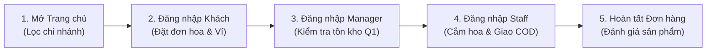

# 🛠️ TÀI LIỆU HƯỚNG DẪN CÀI ĐẶT & KHỞI CHẠY CHI TIẾT (FULL SETUP GUIDE)
## ĐỒ ÁN: HỆ THỐNG WEBSITE BÁN HÀNG THEO MÔ HÌNH CHUỖI CỬA HÀNG HOA TƯƠI
### DỰ ÁN: HOA TƯƠI SÀI GÒN (BLOOM FLOWER CHAIN)
### Môn học: Lập trình Web — Học kỳ 1 (Năm học 2026 - 2027)

---

> **MỤC ĐÍCH TÀI LIỆU**:  
> Tài liệu này được biên soạn chi tiết từng bước (Step-by-Step Guide) từ khâu chuẩn bị môi trường, nạp cơ sở dữ liệu mẫu đến các phương thức khởi chạy ứng dụng đa dạng (Script Launcher, Docker Container, Maven Wrapper, IDE). Tài liệu được tối ưu nhằm giúp Giảng viên, Hội đồng chấm thi và thành viên nhóm có thể cài đặt và vận hành hệ thống một cách trơn tru, chuẩn xác 100% trên mọi môi trường máy tính.
>
> 🌐 **Bản triển khai trực tuyến trên Cloud (Live Demo):** [https://flowers-shop-buzm.onrender.com](https://flowers-shop-buzm.onrender.com)

---

## 📑 MỤC LỤC CHI TIẾT
1. [Yêu cầu Môi trường & Phần mềm cần thiết](#1-yeu-cau-moi-truong)
2. [Thiết lập Môi trường Java & Quyền PowerShell](#2-thiet-lap-moi-truong)
3. [Danh sách Tài khoản Thử nghiệm & Phân quyền URL](#3-tai-khoan-thu-nghiem)
4. [Hướng dẫn Nạp Cơ sở Dữ liệu Mẫu (Database Setup)](#4-nap-co-so-du-lieu)
   - [4.1. Nạp CSDL PostgreSQL (pgAdmin / DBeaver / psql)](#41-postgresql)
   - [4.2. Nạp CSDL Microsoft SQL Server (SSMS / Azure Data Studio)](#42-sqlserver)
5. [Các Phương án Khởi chạy Ứng dụng (Running Modes)](#5-khoi-chay-ung-dung)
   - [Phương án 1: Khởi chạy bằng Docker Container (Nhanh nhất)](#51-docker)
   - [Phương án 2: Khởi chạy với Database Aiven Cloud (PostgreSQL)](#52-aiven)
   - [Phương án 3: Khởi chạy với PostgreSQL Local](#53-postgres-local)
   - [Phương án 4: Khởi chạy với Microsoft SQL Server Local](#54-sqlserver-local)
   - [Phương án 5: Khởi chạy bằng Maven Wrapper hoặc IDE (IntelliJ / Eclipse / VS Code)](#55-maven-ide)
6. [Chi tiết Cấu hình Biến Môi trường (`.env` & `.env.aiven`)](#6-cau-hinh-env)
7. [Cẩm nang Xử lý Sự cố từ A đến Z (Troubleshooting Guide)](#7-troubleshooting)
8. [Quy trình Nghiệm thu Nhanh sau khi Chạy Web (Sanity Checklist)](#8-nghiem-thu-nhanh)

---

<a name="1-yeu-cau-moi-truong"></a>
## 1. YÊU CẦU MÔI TRƯỜNG & PHẦN MỀM CẦN THIẾT

Trước khi bắt đầu, máy tính của bạn cần đáp ứng các thông số kỹ thuật sau:

| Thành phần | Yêu cầu tối thiểu | Phiên bản khuyến nghị | Ghi chú |
|---|---|---|---|
| **Hệ điều hành** | Windows 10/11 64-bit, macOS, Linux | Windows 11 (64-bit) | Hỗ trợ đầy đủ script `.ps1` và `.sh` |
| **Java SDK** | JDK 21 trở lên (LTS) | Eclipse Temurin JDK 21.0.12 | Có sẵn bản portable trong `.tools/` |
| **Công cụ Build** | Maven Wrapper tích hợp sẵn | Maven 3.9+ (`mvnw` / `mvnw.cmd`) | **Không bắt buộc** cài Maven riêng |
| **Cơ sở dữ liệu** | PostgreSQL 16+ hoặc SQL Server 2019+ | PostgreSQL 16 hoặc SQL Server 2022 | Hỗ trợ 2 engine CSDL độc lập |
| **Containerization**| Docker Desktop (Tùy chọn) | Docker Engine 24+ | Phục vụ chạy container nhanh |
| **Trình duyệt** | Bất kỳ trình duyệt hiện đại nào | Google Chrome, Microsoft Edge, Firefox | Hỗ trợ giao diện chuẩn HTML5/CSS3 |

---

<a name="2-thiet-lap-moi-truong"></a>
## 2. THIẾT LẬP MÔI TRƯỜNG JAVA & QUYỀN POWERSHELL

### 2.1. Cấu hình quyền thực thi Script trên Windows PowerShell
Mặc định hệ điều hành Windows chặn việc chạy script `.ps1`. Để mở quyền, bạn thực hiện 1 trong 2 cách sau:

- **Cách 1 (Khuyên dùng - Cấp quyền cho User hiện tại):**
  Mở PowerShell và gõ:
  ```powershell
  Set-ExecutionPolicy -Scope CurrentUser -ExecutionPolicy RemoteSigned -Force
  ```
- **Cách 2 (Bypass tạm thời cho phiên làm việc hiện tại):**
  Khi chạy bất kỳ script nào, thêm tiền tố `powershell -ExecutionPolicy Bypass -File`:
  ```powershell
  powershell -ExecutionPolicy Bypass -File .\start-web.ps1
  ```

### 2.2. Kiểm tra Java JDK 21
Mở PowerShell kiểm tra phiên bản Java trên máy:
```powershell
java -version
```
- Nếu hiển thị `openjdk version "21.x.x"` hoặc `java version "21.x.x"` $\rightarrow$ Môi trường Java đã sẵn sàng!
- Nếu máy bạn chưa cài Java hoặc đang dùng Java 8 / 11 / 17, dự án **đã tích hợp sẵn Temurin JDK 21 portable** trong thư mục `.tools/`. Bạn chỉ cần trỏ biến môi trường trong cửa sổ PowerShell hiện hành:
  ```powershell
  $env:JAVA_HOME = "$PWD\.tools\jdk-21.0.12.1+1"
  $env:Path = "$env:JAVA_HOME\bin;$env:Path"
  java -version
  ```

---

<a name="3-tai-khoan-thu-nghiem"></a>
## 3. DANH SÁCH TÀI KHOẢN THỬ NGHIỆM & PHÂN QUYỀN URL

Toàn bộ tài khoản đã được nạp sẵn mật khẩu mã hóa an toàn theo chuẩn **BCrypt**:

| STT | Vai trò (Role) | Tên đăng nhập | Mật khẩu | URL đích sau đăng nhập | Quyền hạn và phạm vi thử nghiệm |
|:---:|:---|:---:|:---:|:---|:---|
| **1** | **Khách vãng lai (GUEST)** | *(Không cần đăng nhập)* | — | [http://localhost:8080/](http://localhost:8080/) | Xem trang chủ, tìm hoa, lọc theo chi nhánh, xem tồn kho và đánh giá sản phẩm |
| **2** | **Khách mua hàng (CUSTOMER)** | `local_customer` | `LocalTest123!` | [http://localhost:8080/](http://localhost:8080/) | Đặt hoa tươi, chọn nhận tại shop/giao hàng, ví hoa tươi nội bộ, chat live với cửa hàng |
| **3** | **Quản lý chi nhánh Q1 (MANAGER)** | `local_manager` | `LocalTest123!` | [http://localhost:8080/manager/dashboard](http://localhost:8080/manager/dashboard) | Quản lý kho hoa chi nhánh Q1 Bến Thành, phân công nhân sự, quản lý doanh thu và ví shop |
| **4** | **Nhân viên chi nhánh Q1 (STAFF)** | `local_staff` | `LocalTest123!` | [http://localhost:8080/staff/orders](http://localhost:8080/staff/orders) | Bàn làm việc nhân viên: Nhận đơn, xác nhận chuẩn bị hoa, cập nhật giao hàng COD, chat tư vấn |
| **5** | **Quản trị viên hệ thống (ADMIN)** | `local_admin` | `LocalTest123!` | [http://localhost:8080/admin/dashboard](http://localhost:8080/admin/dashboard) | Quản trị toàn chuỗi, cấp phép cửa hàng, quản lý danh mục hoa & voucher, xem audit chat |

> [!TIP]
> **Bộ tài khoản đăng nhập nhanh (Legacy Quick Test):**  
> Hệ thống cũng hỗ trợ đăng nhập bằng các tài khoản ngắn gọn:
> - Admin: `admin` / `123456`
> - Manager: `manager_q1` / `123456`
> - Staff: `staff_q1` / `123456`
> - Customer: `khachhang` / `123456`

---

<a name="4-nap-co-so-du-lieu"></a>
## 4. HƯỚNG DẪN NẠP CƠ SỞ DỮ LIỆU MẪU (DATABASE SETUP)

Thư mục `database/` đã chuẩn bị sẵn 2 bản trích xuất CSDL đầy đủ **45 bảng chuẩn 3NF và 939 dòng dữ liệu mẫu**:
- **4 chi nhánh:** Quận 1 (Bến Thành), Quận 7 (Phú Mỹ Hưng), TP. Thủ Đức (Làng Đại Học), Cao Lãnh (Đồng Tháp).
- **41 mẫu hoa tươi:** Đầy đủ mô tả chi tiết, phân loại dịp tặng & kiểu dáng, ảnh hoa Unsplash sắc nét.
- **77 bản ghi tồn kho riêng biệt (`store_inventories`)** theo từng chi nhánh.
- **Mã giảm giá (Vouchers), Đơn hàng mẫu (Orders), Đánh giá thực nghiệm (Reviews)** và **Số dư ví điện tử**.

---

<a name="41-postgresql"></a>
### 4.1. Nạp CSDL PostgreSQL

#### Cách 1: Nạp qua giao diện pgAdmin 4
1. Mở **pgAdmin 4**, đăng nhập vào Server PostgreSQL của bạn.
2. Tại mục **Databases**, chuột phải $\rightarrow$ chọn **Create** $\rightarrow$ **Database...**.
3. Đặt tên database: `flower_shop` (hoặc `FlowersShop`) $\rightarrow$ Bấm **Save**.
4. Chuột phải vào database vừa tạo $\rightarrow$ Chọn **Query Tool**.
5. Nhấn tổ hợp phím **Ctrl + O** (hoặc biểu tượng mở thư mục), chọn file:  
   `database/FlowersShop_PostgreSQL_Full.sql`.
6. Nhấn phím **F5** (hoặc nút **Execute / Run** hình tam giác).
7. Khi có thông báo `Query returned successfully`, toàn bộ 45 bảng và 939 dòng đã nạp hoàn tất!

#### Cách 2: Nạp qua dòng lệnh terminal (`psql`)
Mở PowerShell/Terminal tại thư mục gốc dự án:
```bash
# 1. Tạo database:
createdb -h 127.0.0.1 -p 5432 -U postgres flower_shop

# 2. Nạp dữ liệu từ file script:
psql -h 127.0.0.1 -p 5432 -U postgres -d flower_shop -v ON_ERROR_STOP=1 -f database/FlowersShop_PostgreSQL_Full.sql
```

---

<a name="42-sqlserver"></a>
### 4.2. Nạp CSDL Microsoft SQL Server

#### Các bước thực hiện trên SQL Server Management Studio (SSMS):
1. **Kiểm tra dịch vụ SQL Server:**
   - Nhấn phím `Windows + R`, gõ `services.msc`, bấm Enter.
   - Đảm bảo 2 dịch vụ **`SQL Server (SQLEXPRESS)`** và **`SQL Server Browser`** đang ở trạng thái **Running**.
2. **Bật giao thức TCP/IP trong SQL Server Configuration Manager:**
   - Mở *SQL Server Configuration Manager* $\rightarrow$ *SQL Server Network Configuration* $\rightarrow$ *Protocols for SQLEXPRESS*.
   - Đảm bảo mục **TCP/IP** đang ở trạng thái **Enabled**.
   - Chuột phải vào **TCP/IP** $\rightarrow$ chọn **Properties** $\rightarrow$ tab **IP Addresses** $\rightarrow$ kéo xuống mục **IPAll** $\rightarrow$ xóa trống dòng *TCP Dynamic Ports*, nhập `1433` vào dòng *TCP Port*.
   - Khởi động lại dịch vụ SQL Server trong `services.msc`.
3. **Mở và thực thi Script SQL:**
   - Khởi động **SSMS**, kết nối tới instance SQL Server của bạn (ví dụ `.\SQLEXPRESS` hoặc `localhost`).
   - Mở file: `database/FlowersShop_SQLServer_Full.sql`.
   - Nhấn phím **F5** (hoặc bấm nút **Execute** trên thanh công cụ).
   - Script sẽ tự động tạo CSDL `FlowersShop`, khởi tạo 45 bảng và nạp 939 dòng dữ liệu hoàn chỉnh.

---

<a name="5-khoi-chay-ung-dung"></a>
## 5. CÁC PHƯƠNG ÁN KHỞI CHẠY ỨNG DỤNG (RUNNING MODES)

Tùy theo môi trường máy tính của bạn, hãy chọn **1 trong 5 phương án** dưới đây để khởi chạy:

---

<a name="51-docker"></a>
### Phương án 1: Khởi chạy bằng Docker Container (Nhanh nhất)
Dành cho máy tính đã cài đặt Docker Desktop. Không cần cài Java, Maven hay cấu hình thủ công:

```bash
# Bước 1: Mở terminal tại thư mục gốc dự án và build image Docker
docker build -t flowers-shop:latest .

# Bước 2: Khởi chạy container trên cổng 8080
docker run -d -p 8080:8080 --name flowers-shop flowers-shop:latest

# Bước 3: Xem log khởi động của ứng dụng
docker logs -f flowers-shop
```
Khi log hiển thị `Started FinalprojectApplication`, mở trình duyệt truy cập: **[http://localhost:8080](http://localhost:8080)**.

---

<a name="52-aiven"></a>
### Phương án 2: Khởi chạy với Database Aiven Cloud (PostgreSQL)
Đây là phương án nhóm sử dụng để demo và deploy online. CSDL đặt trên đám mây đã có sẵn đầy đủ dữ liệu:

1. Mở PowerShell tại thư mục dự án và khởi tạo file cấu hình:
   ```powershell
   .\start-web.ps1 -Init
   ```
2. Mở file `.env.aiven` (tự động tạo ở thư mục gốc), điền thông số Aiven của bạn hoặc nhóm:
   ```properties
   AIVEN_HOST=flowershop-db-xxx.aivencloud.com
   AIVEN_PORT=15432
   AIVEN_DATABASE=defaultdb
   AIVEN_USER=avnadmin
   AIVEN_PASSWORD=your_password_here
   AIVEN_SSLMODE=require
   ```
3. Kiểm tra thông số và khởi chạy ứng dụng:
   ```powershell
   # Kiểm tra tính hợp lệ của cấu hình
   .\start-web.ps1 -Check

   # Khởi chạy website
   .\start-web.ps1
   ```
4. Khi màn hình console xuất hiện dòng chữ `Started FinalprojectApplication`, truy cập: **[http://localhost:8080](http://localhost:8080)**.

---

<a name="53-postgres-local"></a>
### Phương án 3: Khởi chạy với PostgreSQL Local
Dành cho máy đã cài đặt PostgreSQL cục bộ và đã nạp CSDL theo [Mục 4.1](#41-postgresql):

1. Khởi tạo file cấu hình PostgreSQL local:
   ```powershell
   .\start-web.ps1 -Database Local -Init
   ```
2. Mở file `.env.local-postgres` vừa tạo, điền thông số kết nối:
   ```properties
   LOCAL_DB_HOST=127.0.0.1
   LOCAL_DB_PORT=5432
   LOCAL_DB_NAME=flower_shop
   LOCAL_DB_USER=postgres
   LOCAL_DB_PASSWORD=your_postgres_password
   ```
3. Chạy lệnh khởi động:
   ```powershell
   .\start-web.ps1 -Database Local
   ```

---

<a name="54-sqlserver-local"></a>
### Phương án 4: Khởi chạy với Microsoft SQL Server Local
Dành cho máy đã cài đặt SQL Server cục bộ và đã nạp CSDL theo [Mục 4.2](#42-sqlserver):

1. Tạo file `.env` từ `.env.example`:
   ```powershell
   Copy-Item .env.example .env
   ```
2. Chạy ứng dụng bằng script PowerShell tự động:
   ```powershell
   # Chạy với cổng mặc định 1433:
   .\scripts\run-local.ps1 -DatabaseName FlowersShop -Server '127.0.0.1:1433'

   # Hoặc chạy thông qua launcher tiện ích:
   .\scripts\sqlserver.ps1 -Action run
   ```

---

<a name="55-maven-ide"></a>
### Phương án 5: Khởi chạy bằng Maven Wrapper hoặc IDE

#### Khởi chạy bằng Maven Wrapper từ dòng lệnh:
- **Chạy với profile Aiven (PostgreSQL):**
  ```powershell
  .\mvnw.cmd spring-boot:run
  ```
- **Chạy với profile Dev (SQL Server):**
  ```powershell
  .\mvnw.cmd spring-boot:run -Dspring-boot.run.profiles=dev
  ```

#### Khởi chạy trong IntelliJ IDEA / Eclipse:
1. Mở dự án bằng cách chọn file `pom.xml` $\rightarrow$ **Open as Project**.
2. Đợi IDE tải xong các dependency của Maven.
3. Tìm đến file class khởi động chính:  
   `src/main/java/com/finalproject/FinalprojectApplication.java`.
4. Chuột phải $\rightarrow$ Chọn **Run 'FinalprojectApplication'**.
5. *(Tùy chọn)* Cấu hình Active Profile trong **Run/Debug Configurations** $\rightarrow$ **Active Profiles**: điền `aiven` hoặc `dev`.

---

<a name="6-cau-hinh-env"></a>
## 6. CHI TIẾT CẤU HÌNH BIẾN MÔI TRƯỜNG (`.env` & `.env.aiven`)

Để đảm bảo an toàn thông tin, các thông số bí mật (API Keys, Secrets) không được commit lên Git mà được quản lý qua các file `.env` cục bộ:

### 6.1. File cấu hình `.env` (Dành cho lưu trữ ảnh Cloudinary & Brevo OTP)
```dotenv
# Cấu hình lưu trữ ảnh Cloudinary CDN
CLOUDINARY_CLOUD_NAME=your_cloud_name
CLOUDINARY_API_KEY=your_cloudinary_api_key
CLOUDINARY_API_SECRET=your_cloudinary_api_secret

# Cấu hình gửi OTP Brevo API (nếu muốn gửi mã xác thực về email thật)
MAIL_PROVIDER=brevo
BREVO_API_KEY=xkeysib-your_brevo_api_key
MAIL_FROM_EMAIL=your_verified_sender_email@gmail.com
MAIL_FROM_NAME=Tiệm Hoa Tươi Sài Gòn

# Cấu hình mã khóa JWT Token
JWT_SECRET=dGhpcy1pcy1hLXNhbXBsZS1qd3Qtc2VjcmV0LWtleS1mb3ItZmxvd2Vyc2hvcC0yMDI2
```

> [!NOTE]
> - **Ảnh dự phòng (Local Fallback):** Nếu bạn chưa có tài khoản Cloudinary, hệ thống sẽ tự động dùng ảnh hoa dự phòng chất lượng cao lưu tại `/images/`, đảm bảo giao diện hiển thị 100% đẹp mắt và không bị vỡ ảnh.
> - **Mã OTP thử nghiệm:** Nếu chưa cấu hình Brevo, mã OTP sẽ được in trực tiếp ra cửa sổ Console log của Spring Boot để bạn lấy nhập vào biểu mẫu xác thực.

---

<a name="7-troubleshooting"></a>
## 7. CẨM NANG XỬ LÝ SỰ CỐ TỪ A ĐẾN Z (TROUBLESHOOTING GUIDE)

### Sự cố 1: Lỗi xung đột cổng 8080 (`Port 8080 was already in use`)
- **Nguyên nhân:** Có một ứng dụng khác (hoặc phiên chạy web trước đó chưa tắt hẳn) đang chiếm dụng cổng 8080.
- **Cách khắc phục:**
  - *Cách 1 (Tắt ứng dụng chiếm cổng bằng 1 lệnh PowerShell):*
    ```powershell
    Get-Process -Id (Get-NetTCPConnection -LocalPort 8080).OwningProcess | Stop-Process -Force
    ```
  - *Cách 2 (Đổi sang chạy trên cổng khác, ví dụ 8081):*
    ```powershell
    .\start-web.ps1 -Port 8081
    ```

---

### Sự cố 2: Lỗi kết nối SQL Server `Connection refused: connect`
- **Nguyên nhân:** Dịch vụ SQL Server chưa bật hoặc chưa bật giao thức TCP/IP.
- **Cách khắc phục:**
  1. Mở `services.msc`, tìm 2 dịch vụ `SQL Server (SQLEXPRESS)` và `SQL Server Browser` $\rightarrow$ Chuột phải chọn **Start** (hoặc **Restart**).
  2. Mở *SQL Server Configuration Manager* $\rightarrow$ *Protocols for SQLEXPRESS* $\rightarrow$ Chuột phải vào **TCP/IP** chọn **Enable**.
  3. Khởi động lại dịch vụ SQL Server.

---

### Sự cố 3: Lỗi chứng chỉ TLS Aiven `PKIX path building failed`
- **Nguyên nhân:** Kết nối tới đám mây Aiven yêu cầu xác thực bảo mật SSL/TLS.
- **Cách khắc phục:**
  - Trong file `.env.aiven`, đảm bảo dòng cấu hình sau:
    ```properties
    AIVEN_SSLMODE=require
    ```
  - Giá trị `require` cho phép mã hóa đường truyền an toàn mà không bắt buộc phải import chứng chỉ gốc CA thủ công vào Java TrustStore.

---

### Sự cố 4: PowerShell báo lỗi không cho chạy script (`ExecutionPolicy`)
- **Thông báo lỗi:** `... cannot be loaded because running scripts is disabled on this system`.
- **Cách khắc phục:** Chạy lệnh sau trong PowerShell để cấp quyền cho tài khoản hiện tại:
  ```powershell
  Set-ExecutionPolicy -Scope CurrentUser -ExecutionPolicy RemoteSigned -Force
  ```

---

### Sự cố 5: Lỗi font chữ tiếng Việt khi hiển thị trên PowerShell Console
- **Cách khắc phục:** Trước khi chạy ứng dụng, chuyển bảng mã console sang UTF-8 bằng lệnh:
  ```powershell
  chcp 65001
  ```

---

<a name="8-nghiem-thu-nhanh"></a>
## 8. QUY TRÌNH NGHIỆM THU NHANH SAU KHI CHẠY WEB (SANITY CHECKLIST)

Sau khi khởi chạy ứng dụng thành công, Giảng viên và người chấm có thể thực hiện kiểm tra nhanh 5 bước sau để nghiệm thu toàn bộ tính năng cốt lõi:



1. **Bước 1: Khảo sát Trang chủ & Bộ lọc chi nhánh đa cấp:**
   - Mở trình duyệt tại [http://localhost:8080](http://localhost:8080).
   - Chọn chi nhánh trên thanh điều hướng (ví dụ: *Chi nhánh Quận 1* hoặc *Chi nhánh Quận 7*).
   - Kiểm tra các mẫu hoa cập nhật tồn kho thực tế tương ứng với từng cửa hàng.
2. **Bước 2: Đăng nhập Khách hàng & Đặt hàng:**
   - Đăng nhập tài khoản `local_customer` / `LocalTest123!`.
   - Chọn mẫu hoa, chọn số lượng, bấm **Thêm vào giỏ hàng** $\rightarrow$ bấm **Thanh toán**.
   - Chọn phương thức thanh toán bằng **Ví hoa tươi** (hoặc COD) $\rightarrow$ Xác nhận đặt hàng.
3. **Bước 3: Quản lý chi nhánh tiếp nhận & kiểm tra tồn kho:**
   - Mở tab ẩn danh (hoặc đăng xuất), đăng nhập tài khoản `local_manager` / `LocalTest123!`.
   - Vào mục **Quản lý kho hoa** kiểm tra số lượng tồn kho của mẫu hoa vừa đặt đã tự động giảm trừ chính xác (chống bán âm kho).
4. **Bước 4: Bàn làm việc Nhân viên xử lý đơn:**
   - Đăng nhập tài khoản `local_staff` / `LocalTest123!`.
   - Vào màn hình **Đơn hàng chi nhánh**, tiếp nhận đơn, chuyển trạng thái: *Tiếp nhận* $\rightarrow$ *Chuẩn bị hoa* $\rightarrow$ *Đang giao hàng* $\rightarrow$ *Đã giao thành công*.
5. **Bước 5: Khách hàng đánh giá sản phẩm:**
   - Quay lại tài khoản khách hàng, vào mục **Lịch sử đơn hàng** $\rightarrow$ Bấm **Đánh giá** cho đơn hàng đã hoàn tất (chọn số sao và đính kèm nhận xét).
