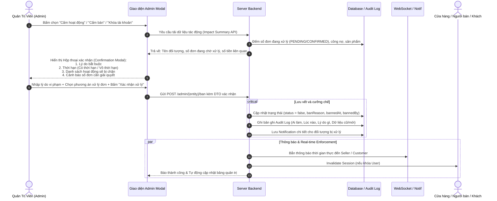
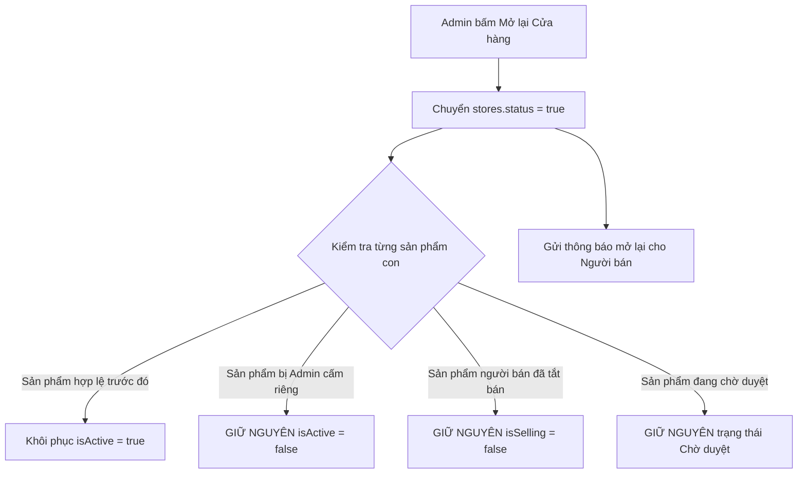

# ĐẶC TẢ NGHIỆP VỤ & KIẾN TRÚC HỆ THỐNG: QUY TRÌNH XỬ LÝ CẤM, KHÓA VÀ MỞ LẠI HOẠT ĐỘNG (STORES, PRODUCTS, ACCOUNTS)

---

## 1. NGUYÊN TẮC CỐT LÕI (CORE PRINCIPLES)

1. **Bảo toàn dữ liệu tuyệt đối (Zero Hard-Delete)**:
   - Tuyệt đối không xóa vật lý (hard delete) bất kỳ dòng dữ liệu nào liên quan đến Cửa hàng (`stores`), Sản phẩm (`products`), Người dùng (`users`), hay Đơn hàng (`orders`).
   - Việc cấm / khóa chỉ là thay đổi trạng thái logic (`status`, `isActive`, `accountDisabledByAdmin`, `isSelling`) kèm lưu vết kiểm toán (Audit Trail).
2. **Chặn đúng phạm vi (Correct Scoping)**:
   - Tác vụ cấm ở cấp độ nào thì chỉ ngăn chặn đúng các nghiệp vụ liên quan đến cấp độ đó.
   - Không làm mất quyền theo dõi đơn, khiếu nại, hỗ trợ hoặc hoàn tiền của khách hàng và người bán.
3. **Kiểm tra đa tầng phía Máy chủ (Server-side Enforced Re-validation)**:
   - Không chỉ dựa vào việc ẩn/khóa nút ở giao diện Client (Front-end).
   - Mọi API tạo giỏ, thanh toán, đặt đơn, chỉnh sửa sản phẩm đều phải tái kiểm tra trạng thái thời gian thực ngay tại thời điểm thực thi giao dịch.
4. **Phân định rõ ràng các trạng thái vận hành**:
   - Tránh gộp chung khiến người dùng hoặc người bán hoang mang:
     - **Bị cấm bởi Admin (Banned / Suspended by Admin)**: Do vi phạm chính sách hoặc lệnh cưỡng chế; người bán không có quyền tự kích hoạt lại.
     - **Tạm đóng cửa (Temporarily Closed by Seller)**: Do người bán tự bật/tắt (nghỉ lễ, sửa chữa gian hàng); người bán được quyền tự mở lại.
     - **Hết hàng (Out of Stock)**: Tồn kho bằng 0; có thể nhận thông báo khi có hàng lại.
     - **Chờ duyệt (Pending Approval)**: Sản phẩm/cửa hàng mới đăng ký, chưa được phép công khai lên sàn.

---

## 2. MA TRẬN PHÂN BIỆT THAO TÁC ADMIN & PHẠM VI ẢNH HƯỞNG

| Thao tác Admin | Đối tượng | Phạm vi ảnh hưởng trực tiếp | Quyền còn lại của người liên quan | Trạng thái kỹ thuật |
| :--- | :--- | :--- | :--- | :--- |
| **Khóa tài khoản** | Khách hàng / Người dùng | Vô hiệu hóa phiên hiện tại (`session.invalidate()`). Chặn đăng nhập, mua hàng, thêm giỏ, đánh giá, nộp đơn vai trò. | Được gửi yêu cầu trợ giúp qua kênh hỗ trợ khách hàng để xử lý đơn đang giao, tiền cần hoàn. Lịch sử giao dịch được bảo toàn nguyên vẹn. | `accountDisabledByAdmin = true`, `isActive = false` |
| **Thu hồi quyền Người bán** | Tài khoản có vai trò Seller/Staff | Tước bỏ quyền truy cập trang Quản lý bán hàng (`/seller/**`, `/staff/**`). Không được tạo sản phẩm, không được xác nhận đơn. | **Vẫn giữ quyền Khách hàng**: Được đăng nhập, mua hoa từ các cửa hàng khác bình thường nếu tài khoản không bị khóa. | Xóa vai trò trong `users_roles`, lưu log vào `role_audit_logs`. |
| **Cấm một cửa hàng** | Cửa hàng cụ thể | Tạm ngừng nhận đơn mới tại chi nhánh đó. Ẩn khỏi danh sách cửa hàng công khai. Toàn bộ sản phẩm của cửa hàng dừng nhận đơn mới. | Người bán vẫn truy cập trang quản lý cửa hàng để xem đơn cũ, lịch sử tồn kho, gửi khiếu nại/hỗ trợ. **Các cửa hàng khác (nếu chủ sở hữu có chuỗi) hoạt động bình thường.** | `stores.status = false`. (Giữ nguyên cờ `isOpen` nội bộ của người bán). |
| **Cấm sản phẩm** | Mặt hàng cụ thể | Loại khỏi tìm kiếm, danh mục, gợi ý. Không cho thêm vào giỏ. Sản phẩm đã có trong giỏ bị gắn nhãn ngừng bán và không tính tiền. | Khách đã mua trước đó vẫn xem được thông tin trong lịch sử đơn. Người bán được sửa thông tin và gửi yêu cầu thẩm định lại. | `products.isActive = false`. (Người bán bị khóa cờ `isSelling = false`). |

---

## 3. ĐẶC TẢ CHI TIẾT CÁC TRƯỜNG HỢP XỬ LÝ

### 3.1. Cửa hàng bị cấm hoạt động (Store Ban)

#### Phía Khách hàng (Buyer):
- **Trang danh mục & Tìm kiếm**: Cửa hàng bị loại khỏi bộ lọc chi nhánh và bản đồ cửa hàng hoạt động.
- **Truy cập đường dẫn cũ (`/store/{id}` hoặc qua bookmark)**: Không trả về lỗi 404/500 máy móc, hiển thị trang thông tin trang nhã kèm thông báo rõ ràng:
  > *"Cửa hàng hiện tạm ngừng hoạt động theo quyết định của Ban Quản Trị."*
- **Sản phẩm trong giỏ hàng (Cart Items)**:
  - Nếu khách đã thêm hoa của cửa hàng này từ trước: Sản phẩm **vẫn được giữ lại trong giỏ** (không tự ý xóa giỏ của khách).
  - Tự động bỏ chọn (uncheck) checkbox thanh toán của sản phẩm này.
  - Hiển thị badge cảnh báo: `[Cửa hàng tạm ngừng hoạt động]`.
  - Disable nút chọn mua, không tính tiền vào tổng thanh toán.
- **Đơn hàng đã đặt trước thời điểm cấm (Active Orders)**:
  - **Không tự động hủy hàng loạt**: Tránh gây sốc luồng tiền và quyền lợi đôi bên.
  - Đơn đang giao (`SHIPPING`), đang cắm hoa (`PREPARING`) sẽ do Admin xem xét trong Modal cấm:
    - *Lựa chọn A*: Cho phép cửa hàng tiếp tục giao nốt các đơn đã xác nhận.
    - *Lựa chọn B*: Chuyển giao đơn sang chi nhánh gần nhất có đủ hoa tương đương.
    - *Lựa chọn C*: Hủy đơn và hoàn tiền tự động 100% về ví/tài khoản khách hàng.
  - Khách hàng vẫn tra cứu trạng thái đơn, gọi hotline hỗ trợ và yêu cầu hoàn tiền như bình thường.

#### Phía Người bán (Seller):
- Nhận thông báo hệ thống (Notification/Email): Nêu rõ **Lý do cấm**, **Thời điểm vi phạm**, và **Thời hạn áp dụng** (nếu có).
- Bị khóa nút bật lại trạng thái kinh doanh (`isOpen`, `status`).
- Vẫn có quyền đăng nhập trang Seller Portal để:
  - Tra cứu đối soát doanh thu, tài chính các đơn đã hoàn tất.
  - Xử lý các đơn đang dang dở được Admin ủy quyền hoàn tất.
  - Sử dụng nút *"Gửi yêu cầu khiếu nại / hỗ trợ Ban Quản Trị"* kèm giải trình bằng chứng.

---

### 3.2. Sản phẩm bị cấm bán (Product Ban)

#### Phía Khách hàng (Buyer):
- **Khám phá sản phẩm**: Biến mất khỏi Danh sách sản phẩm, Trang tìm kiếm, Khối bán chạy (Best Seller), Khối gợi ý (Recommendations).
- **Trang chi tiết sản phẩm (`/product/{id}`)**:
  - Không ném ngoại lệ hệ thống (`500 Internal Server Error`).
  - Hiển thị giao diện thông báo thân thiện:
    > *"Sản phẩm này hiện không còn khả dụng hoặc đã tạm ngừng kinh doanh."*
  - Ẩn hoàn toàn nút *"Thêm vào giỏ hàng"* và nút *"Mua ngay"*.
  - Gợi ý các sản phẩm hoa tươi tương tự từ các gian hàng khác.
- **Giỏ hàng của khách (Shopping Cart)**:
  - Sản phẩm giữ nguyên trong giỏ, gắn nhãn: `[Sản phẩm đã ngừng bán]`.
  - Trạng thái dòng: Bị disabled, tự động tách khỏi tổng tiền cần thanh toán (`totalAmount`).
- **Đơn hàng cũ chứa sản phẩm này (Historical Orders)**:
  - Dữ liệu chi tiết đơn (`order_details`) lưu giữ trọn vẹn: Tên sản phẩm, Ảnh chụp (snapshot image URL), Đơn giá mua (`unit_price`), Số lượng (`quantity`).
  - Khách hàng và người bán luôn đối soát được đúng mặt hàng tại thời điểm phát sinh giao dịch.

#### Phía Người bán (Seller):
- Trạng thái sản phẩm hiển thị trên bảng quản lý kho: `[Bị cấm bởi Admin]` (Badge đỏ đậm, kèm tooltip hiển thị nguyên nhân do Admin nhập).
- Nút công tắc *"Đang bán (isSelling)"* bị khóa (disabled). Người bán không thể tự gạt sang Bật.
- Người bán được phép bấm *"Chỉnh sửa"* để khắc phục sai phạm (sửa lại mô tả vi phạm, thay ảnh không hợp lệ) &rarr; Nhấn *"Gửi yêu cầu xét duyệt lại"*.

---

### 3.3. Tài khoản khách hàng bị khóa (Account Lock)

#### Nhãn giao diện:
- Sử dụng chuẩn từ ngữ: **"Khóa tài khoản"** (thay vì dùng "Cấm khách hàng" để tránh cảm giác quy chụp tiêu cực).

#### Cơ chế kỹ thuật tức thời:
- **Hủy phiên đăng nhập hiện tại (Immediate Session Invalidation)**:
  - Bộ lọc `AccountStatusFilter` kiểm tra cờ `accountDisabledByAdmin` trên mỗi request.
  - Ngay khi Admin kích hoạt khóa, nếu người dùng đang lướt web hoặc thao tác đặt hàng, request tiếp theo sẽ lập tức bị hủy phiên (`request.getSession().invalidate()`, `SecurityContextHolder.clearContext()`).
  - Chuyển hướng người dùng về trang thông báo:
    > *"Tài khoản của bạn đã bị tạm khóa. Vui lòng liên hệ bộ phận hỗ trợ khách hàng (Hotline: 1900 xxxx hoặc cskh@flowershop.vn) để được giải quyết."*
- **Chặn các thao tác**:
  - Chặn đăng nhập mới (`AuthServiceImpl`).
  - Chặn thêm sản phẩm vào giỏ, chặn checkout.
  - Chặn gửi đánh giá (review), chặn bấm follow/wishlist.
  - Chặn nộp hồ sơ xin cấp vai trò (Seller/Staff).
- **Bảo lưu tài sản & Lịch sử**:
  - Không xóa giỏ hàng (`cart_items`), không xóa đơn hàng (`orders`), không xóa giao dịch thanh toán (`payments`).
  - Bộ phận Chăm sóc khách hàng (CSKH) có thể tra cứu hồ sơ tài khoản bằng ID hoặc SĐT để giải quyết khiếu nại, hỗ trợ khách nhận nốt hoa đã mua hoặc thực hiện hoàn tiền theo quy định bảo vệ người tiêu dùng.

---

## 4. QUY TRÌNH THAO TÁC CỦA ADMIN (6 BƯỚC CHUẨN HÓA)



### Chi tiết Hộp thoại xác nhận của Admin (Confirmation Modal Design):
1. **Đối tượng bị xử lý**: Hiển thị rõ Tên, Mã định danh, Email/SĐT của Cửa hàng / Sản phẩm / Tài khoản.
2. **Lý do bắt buộc (Mandatory Reason)**: Textarea bắt buộc nhập tối thiểu 10 ký tự (ví dụ: *"Bán hoa không đúng nguồn gốc mô tả"*, *"Gian lận đánh giá"*, *"Giao hàng chậm trễ nhiều lần"*). Không được để trống.
3. **Thời hạn (Duration)**:
   - *Tùy chọn 1*: Tạm ngừng có thời hạn (ví dụ: 7 ngày, 30 ngày) kèm trường chọn ngày mở lại dự kiến (`banExpiresAt`).
   - *Tùy chọn 2*: Vô thời hạn (cho đến khi có quyết định xem xét lại từ Admin).
4. **Cảnh báo hoạt động bị chặn**: Danh sách checklist rõ ràng cho Admin thấy hậu quả của lệnh cấm.
5. **Số đơn đang xử lý cần giải quyết**:
   - Thống kê: *"Cửa hàng hiện có 05 đơn hàng đang chờ xác nhận/đang giao với tổng giá trị 3.250.000đ"*.
   - Cho Admin lựa chọn phương án giải quyết: `[Cho phép hoàn tất các đơn đang giao]` hoặc `[Hủy toàn bộ đơn chưa giao và hoàn tiền cho khách]`.

### Cơ chế chống Race-condition khi Khách đang Checkout:
- Nếu khách hàng mở trang thanh toán tại phút thứ `10:00:00`, và Admin bấm cấm cửa hàng lúc `10:00:05`:
- Khi khách nhấn nút *"Đặt hàng ngay"* lúc `10:00:10`:
  - `OrderServiceImpl.createOrderFromCart()` thực hiện câu truy vấn kiểm tra trực tiếp trong DB:
    ```java
    if (!Boolean.TRUE.equals(assignedStore.getStatus()) || !Boolean.TRUE.equals(assignedStore.getIsOpen())) {
        throw new IllegalStateException("Chi nhánh hiện không thể nhận đơn do đang tạm ngừng hoạt động.");
    }
    for (CartItem item : items) {
        if (!Boolean.TRUE.equals(item.getProduct().getIsActive()) || !Boolean.TRUE.equals(item.getProduct().getIsSelling())) {
            throw new IllegalStateException("Sản phẩm [" + item.getProduct().getName() + "] hiện đã ngừng bán.");
        }
    }
    ```
  - Giao dịch bị rollback, không tạo đơn rác, hiển thị thông báo lỗi rõ ràng cho khách hàng tại màn hình thanh toán.

---

## 5. QUY TRÌNH MỞ LẠI AN TOÀN (SAFE RE-ACTIVATION RULES)

Khi nguyên nhân vi phạm đã được khắc phục hoặc hết hạn kỷ luật, Admin thực hiện lệnh **"Mở lại hoạt động" (Unban / Unlock)**. Quy trình phải tuân thủ nghiêm ngặt nguyên tắc **Không kích hoạt chéo ngoài ý muốn**:



### Các quy tắc cụ thể:
1. **Mở lại Cửa hàng**:
   - `stores.status = true`.
   - **Không tự động bật lại các sản phẩm bị Admin cấm riêng vi phạm trước đó**.
   - **Không tự động ghi đè cờ `isSelling = false` của người bán** (nếu người bán chủ động tắt một số sản phẩm hết hàng hoặc ngừng kinh doanh trước khi cửa hàng bị cấm).
   - Sản phẩm chưa được duyệt vẫn giữ nguyên cờ chờ duyệt.
2. **Mở lại Sản phẩm**:
   - Admin chỉ được mở lại sản phẩm (`isActive = true`) khi **Cửa hàng chủ quản của sản phẩm đó cũng đang ở trạng thái Hoạt động** (`stores.status == true`).
   - Nếu cửa hàng vẫn đang bị cấm, hệ thống cảnh báo Admin phải giải quyết trạng thái của cửa hàng trước.
3. **Mở khóa Tài khoản**:
   - Gỡ cờ `accountDisabledByAdmin = false`, cho phép đăng nhập lại bình thường.
   - **Không tự động khôi phục những vai trò đã bị thu hồi** (ví dụ: Nếu trước đó người này từng bị thu hồi quyền `SELLER` do vi phạm gian lận, việc mở khóa tài khoản chỉ cho phép họ dùng quyền `CUSTOMER`, không tự cấp lại quyền `SELLER` trừ khi có lệnh phân quyền riêng).
   - **Không khôi phục lại các đơn hàng đã hủy và hoàn tiền** trong thời gian tài khoản bị khóa.

---

## 6. THIẾT KẾ CƠ SỞ DỮ LIỆU & AUDIT LOG

### 6.1. Bổ sung trường Audit & Reason vào các bảng thực thể

#### Bảng `stores`:
- `status`: `BOOLEAN DEFAULT TRUE` (Trạng thái cấp phép hoạt động của Admin: true = Hoạt động, false = Bị Admin cấm).
- `is_open`: `BOOLEAN DEFAULT TRUE` (Công tắc bán hàng do Người bán tự chủ động).
- `ban_reason`: `VARCHAR(500)` (Lý do cấm hiển thị cho đối tác).
- `banned_at`: `DATETIME` (Thời điểm cấm).
- `ban_expires_at`: `DATETIME NULL` (Thời điểm hết hạn cấm nếu có hạn).
- `banned_by_id`: `BIGINT NULL` (Khóa ngoại trỏ đến tài khoản Admin thực hiện).

#### Bảng `products`:
- `is_active`: `BOOLEAN DEFAULT TRUE` (Cờ kiểm duyệt/cấm của Admin: true = Hợp lệ, false = Bị cấm hoặc bị đình chỉ bởi Admin).
- `is_selling`: `BOOLEAN DEFAULT TRUE` (Công tắc kinh doanh của Người bán).
- `is_deleted`: `BOOLEAN DEFAULT FALSE` (Soft delete).
- `ban_reason`: `VARCHAR(500)` (Lý do bị cấm bán).
- `banned_at`: `DATETIME NULL`.

#### Bảng `users`:
- `is_active`: `BOOLEAN DEFAULT TRUE`.
- `account_disabled_by_admin`: `BOOLEAN DEFAULT FALSE`.
- `lock_reason`: `VARCHAR(500)`.
- `locked_at`: `DATETIME NULL`.

### 6.2. Bảng Lịch sử Kiểm toán Tổng hợp (`admin_action_logs`)
Lưu lại toàn bộ hành động can thiệp của Quản trị viên để đối soát trách nhiệm:
```sql
CREATE TABLE admin_action_logs (
    id BIGINT AUTO_INCREMENT PRIMARY KEY,
    admin_id BIGINT NOT NULL,
    target_type VARCHAR(50) NOT NULL, -- 'STORE', 'PRODUCT', 'USER_ACCOUNT', 'SELLER_ROLE'
    target_id BIGINT NOT NULL,
    action_type VARCHAR(50) NOT NULL, -- 'BAN', 'UNBAN', 'LOCK', 'UNLOCK', 'REVOKE_ROLE'
    reason VARCHAR(500) NOT NULL,
    duration_days INT NULL,
    metadata JSON NULL, -- Lưu snapshot số đơn đang xử lý, trạng thái trước khi cấm
    ip_address VARCHAR(45) NULL,
    created_at DATETIME NOT NULL DEFAULT CURRENT_TIMESTAMP,
    CONSTRAINT fk_action_admin FOREIGN KEY (admin_id) REFERENCES users(id)
);
```

---

## 7. KẾ HỢP GIAO DIỆN & TRẢI NGHIỆM NGƯỜI DÙNG (UI/UX GUIDELINES)

1. **Badge trạng thái phân màu trực quan**:
   - `Bị cấm bởi Admin`: Màu đỏ mận đậm (`#D32F2F`), icon Khiên cấm (`bi-shield-x`), có tooltip xem lý do cấm.
   - `Tạm đóng cửa`: Màu cam hổ phách (`#F57C00`), icon Tạm dừng (`bi-pause-circle`).
   - `Hết hàng`: Màu xám chì (`#757575`), icon Kho trống (`bi-box-seam`).
   - `Chờ duyệt`: Màu xanh dương tím (`#1976D2`), icon Đồng hồ cát (`bi-hourglass-split`).
2. **Trang thông báo lỗi trang nhã**:
   - Khi truy cập sản phẩm hoặc cửa hàng bị cấm, khách hàng nhận giao diện đồ họa đẹp mắt (vector minh họa hoa, lời thông báo ân cần, kèm thanh tìm kiếm và nút "Quay lại trang chủ" hoặc "Xem hoa tươi khác"), không bao giờ để lộ màn hình Whitelabel Error Page.

---

## 8. TỔNG KẾT & TIÊU CHÍ NGHIỆM THU (ACCEPTANCE CRITERIA)

| STT | Kịch bản kiểm thử | Kết quả mong đợi |
| :---: | :--- | :--- |
| **AC-1** | Admin cấm Store X | Store X ẩn khỏi danh sách cửa hàng. Khách vào link cũ thấy thông báo tạm ngừng, không lỗi 500. Giỏ hàng có hoa của Store X bị mờ và không cho tick chọn mua. |
| **AC-2** | Đơn hàng cũ của Store X | Đơn đang giao vẫn xem được tiến độ. Khách vẫn gửi được yêu cầu hoàn tiền nếu hoa chưa được giao. |
| **AC-3** | Admin cấm Sản phẩm Y | Sản phẩm Y biến mất khỏi tìm kiếm, gợi ý. Giỏ hàng hiển thị nhãn "Sản phẩm đã ngừng bán". Đơn cũ trước đó vẫn lưu đúng tên, ảnh, giá mua lúc chốt. |
| **AC-4** | Khóa tài khoản Khách hàng Z | Khách Z bị logout ngay lập tức tại request kế tiếp. Đăng nhập lại báo tài khoản bị khóa kèm liên hệ hỗ trợ. Toàn bộ đơn hàng cũ và lịch sử thanh toán còn nguyên vẹn. |
| **AC-5** | Thu hồi quyền Người bán của User W | User W bị chặn vào `/seller/**`. User W vẫn đăng nhập và mua hoa bình thường với tư cách Khách hàng. |
| **AC-6** | Chặn mua tại bước cuối (Race condition) | Khách treo màn hình Checkout &rarr; Admin cấm sản phẩm/store &rarr; Khách bấm "Đặt hàng" &rarr; Hệ thống báo lỗi từ server, không cho tạo đơn, không trừ tồn kho sai. |
| **AC-7** | Mở lại Store | Store mở lại hoạt động nhưng không kích hoạt các sản phẩm bị Admin cấm riêng vi phạm hoặc sản phẩm người bán đang chủ động tắt bán. |
