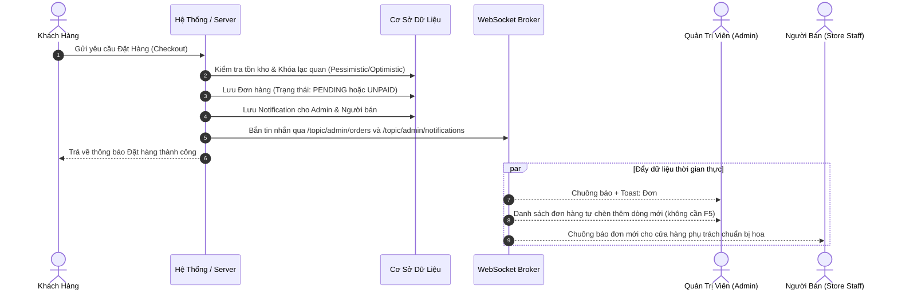

# ĐẶC TẢ CHỨC NĂNG: THÔNG BÁO VÀ CẬP NHẬT HOẠT ĐỘNG HỆ THỐNG CHO QUẢN TRỊ VIÊN (ADMIN)

---

## 1. MỤC TIÊU & TỔNG QUAN

Chức năng **"Thông báo và cập nhật hoạt động hệ thống cho quản trị viên"** nhằm cung cấp cho Ban Quản Trị (Admin) khả năng giám sát toàn diện, kịp thời mọi diễn biến phát sinh trên hệ thống (đơn hàng mới, thanh toán, chỉnh sửa/thêm sản phẩm từ người bán, yêu cầu cấp quyền người dùng, xét duyệt cửa hàng...) theo thời gian thực mà **không phải liên tục tải lại trang (F5)**.

### Nguyên tắc phân tách 3 cấp độ tương tác:
1. **Cập nhật dữ liệu ngầm (Live Data Sync)**: Dữ liệu (tồn kho, giá, lịch sử) tự đồng bộ trên màn hình quản trị khi có thay đổi từ người bán, không cần chuông làm phiền.
2. **Gửi thông báo theo dõi (Informative / Monitoring)**: Admin nhận thông báo và chuông để nắm tình hình kinh doanh (đơn mới phát sinh, thanh toán thành công); khâu xử lý giao hàng do người bán/chi nhánh phụ trách.
3. **Yêu cầu phê duyệt (Action Required / Pending Approval)**: Admin bắt buộc phải thực hiện hành động (Duyệt/Từ chối) để dữ liệu có hiệu lực chính thức (Sản phẩm mới đưa lên sàn, cấp vai trò Quản lý/Người bán, duyệt hoàn tiền/hủy đơn).

---

## 2. MA TRẬN SỰ KIỆN VÀ PHẢN HỒI QUẢN TRỊ

| STT | Sự kiện phát sinh | Hành vi người dùng / Người bán | Admin nhận được gì? | Phân loại | Hành động tiếp theo của Admin |
| :---: | :--- | :--- | :--- | :---: | :--- |
| **1** | **Khách đặt đơn thành công** | Khách hoàn tất checkout tại giỏ hàng | Thông báo chuông + Popup: Mã đơn `#DH...`, tên khách, chi nhánh phụ trách, tổng tiền. Danh sách đơn tự nạp hàng mới. | *Theo dõi* | Không cần duyệt. Chi nhánh/Người bán phụ trách xác nhận đóng gói và giao hàng. |
| **2** | **Đơn chuyển khoản chưa thanh toán** | Khách chọn thanh toán Chuyển khoản ngân hàng / MoMo | Đơn ở trạng thái `"Chờ thanh toán"`. Chuông báo tạo đơn nhưng **chưa** ghi nhận vào doanh thu. | *Theo dõi* | Chờ webhook thanh toán tự động hoặc xác nhận từ cổng thanh toán. |
| **3** | **Thanh toán thành công** | Hệ thống xác minh giao dịch (Webhook/IPN) | Thông báo: Đơn `#DH...` đã thanh toán đủ số tiền. Chuyển trạng thái sang `"Đã thanh toán"`, cộng doanh thu. | *Theo dõi* | Theo dõi dòng tiền và đối soát giao dịch. |
| **4** | **Khách yêu cầu hủy đơn / hoàn tiền** | Khách gửi yêu cầu hủy đơn đã thanh toán hoặc gặp sự cố | Thông báo khẩn: Yêu cầu hủy đơn, lý do khách nhập, số tiền hoàn dự kiến. | *Cần xử lý* | Admin vào xét duyệt: Chấp nhận hoàn tiền (hoàn lại ví/tài khoản) hoặc Từ chối kèm lý do. |
| **5** | **Người bán thêm sản phẩm mới** | Người bán tạo mẫu hoa mới tại cửa hàng | Thông báo: *"Chi nhánh X gửi sản phẩm Y chờ duyệt"*. Bộ đếm `Chờ duyệt` tăng +1. Khách hàng chưa thấy sản phẩm. | *Cần duyệt* | Admin vào thẩm định nội dung, hình ảnh, giá bán &rarr; Bấm **Duyệt** (hiển thị lên sàn) hoặc **Từ chối**. |
| **6** | **Người bán sửa sản phẩm** | Người bán cập nhật tên, mô tả, ảnh của sản phẩm | **Không cần Admin duyệt lại**; hệ thống cập nhật trực tiếp nhưng tự động log và thông báo Admin để giám sát. | *Ghi nhận* | Admin theo dõi thay đổi để đảm bảo không vi phạm chính sách kinh doanh. |
| **7** | **Người bán cập nhật tồn kho** | Người bán tăng/giảm số lượng bó hoa sẵn có | Cập nhật số tồn tức thì trên màn hình quản trị và giỏ hàng; lưu vào lịch sử kho. Không bắn chuông. | *Cập nhật ngầm* | Admin xem lịch sử kho khi cần đối soát; không làm phiền chuông. |
| **8** | **Người dùng đăng ký vai trò** | Khách hàng nộp hồ sơ xin làm Người bán/Quản lý | Thông báo: *"Yêu cầu cấp vai trò mới từ @username"*. Tăng số lượng chờ duyệt tại tab Yêu Cầu. | *Cần duyệt* | Admin xem xét hồ sơ & bấm Phê duyệt / Từ chối (chưa duyệt thì quyền của user không đổi). |
| **9** | **Cửa hàng đăng ký hoạt động** | Đối tác gửi hồ sơ mở chi nhánh/gian hàng mới | Thông báo hồ sơ cửa hàng mới gửi tới; thêm vào danh sách cửa hàng chờ duyệt. | *Cần duyệt* | Admin kiểm tra thông tin pháp lý/địa chỉ và cấp phép hoạt động. |

---

## 3. CHI TIẾT CÁC LUỒNG NGHIỆP VỤ TIÊU BIỂU

### 3.1. Luồng Khách hàng đặt đơn hàng

### 3.2. Luồng Người bán thêm sản phẩm mới (Có kiểm duyệt)
1. **Người bán**: Soạn thông tin sản phẩm (Tên hoa, giá bán, chi nhánh, hình ảnh) và nhấn **"Gửi duyệt"**.
2. **Hệ thống**: Lưu sản phẩm vào DB với cờ `isActive = false` hoặc `approvalStatus = PENDING`. Sản phẩm chưa xuất hiện ngoài trang chủ/khách hàng.
3. **Bắn thông báo Admin**:
   - Đẩy WebSocket đến Admin: *"Chi nhánh Cao Lãnh gửi duyệt sản phẩm: Bó hoa hướng dương rực rỡ"*.
   - Badge số lượng sản phẩm chờ duyệt trên Sidebar và Khối "Cần xử lý" tự động tăng +1.
4. **Admin xử lý**:
   - Bấm trực tiếp vào thông báo để mở màn hình chi tiết sản phẩm.
   - Nhấn **Phê duyệt**: `isActive` đổi thành `true`, sản phẩm lập tức công khai ngoài trang chủ.
   - Nhấn **Từ chối**: Nhập lý do (ví dụ: *"Ảnh mờ hoặc giá không đúng quy định"*), gửi thông báo phản hồi lại cho người bán.

### 3.3. Luồng Người bán sửa sản phẩm (Không cần duyệt, có log giám sát)
- Theo yêu cầu: **Người bán được toàn quyền sửa thông tin sản phẩm** để phản ứng nhanh với thị trường hoa mà không bị nghẽn quy trình.
- **Hệ thống**:
  - Cho phép lưu thay đổi ngay lập tức ra gian hàng.
  - Tự động phát sinh một bản ghi kiểm toán (Audit Log) ghi nhận: Người sửa, thời gian, các trường đã thay đổi (giá cũ &rarr; giá mới).
  - Gửi thông báo thông tin dạng `INFO` đến Admin: *"Người bán @vendor_flower đã cập nhật giá mẫu 'Lan Hồ Điệp' từ 500.000₫ &rarr; 550.000₫"*.

---

## 4. BỔ SUNG GIAO DIỆN ADMIN (UI/UX)

1. **Chuông thông báo (Notification Bell)**:
   - Đặt trên góc phải thanh Header Admin.
   - Huy hiệu (Badge) số màu đỏ hiển thị số lượng thông báo **chưa đọc**.
   - Bấm vào mở dropdown xem nhanh 5 thông báo mới nhất kèm thời gian tương đối (`vừa xong`, `5 phút trước`).

2. **Trang trung tâm thông báo (`/admin/notifications`)**:
   - Bộ lọc theo danh mục: **Tất cả / Đơn hàng / Sản phẩm / Yêu cầu vai trò / Cửa hàng**.
   - Phân loại rõ màu sắc:
     - 🔴 Đỏ: Yêu cầu hủy đơn, hoàn tiền, báo cáo sự cố.
     - 🟡 Vàng/Cam: Chờ duyệt (sản phẩm mới, xin cấp vai trò).
     - 🟢 Xanh lá: Đơn hàng mới, thanh toán thành công.
     - 🔵 Xanh dương: Người bán cập nhật thông tin sản phẩm.
   - Nút hành động nhanh: *"Đánh dấu đã đọc"*, *"Xem chi tiết"*.

3. **Khối "Cần Xử Lý" (Action Center Widget) trên Dashboard**:
   - Tích hợp ngay đầu trang tổng quan `Admin Dashboard`:
     - ⏳ **Sản phẩm chờ duyệt**: [ X ] sản phẩm.
     - 👤 **Yêu cầu cấp vai trò**: [ Y ] người dùng.
     - 🔄 **Yêu cầu hủy/hoàn tiền**: [ Z ] đơn hàng.
   - Giúp Admin nhìn vào là thấy ngay công việc tồn đọng cần phê duyệt trong ngày.

---

## 5. QUY TẮC HOẠT ĐỘNG & BẢO TOÀN DỮ LIỆU

1. **Cam kết sau Transaction (Post-commit Guarantee)**:
   - Thông báo chỉ được phát đi khi Transaction trong cơ sở dữ liệu đã `COMMIT` thành công. Nếu thêm giỏ hàng, đặt đơn bị lỗi (Rollback), tuyệt đối không gửi thông báo giả hay tăng bộ đếm.
2. **Chống gửi trùng lặp (Idempotency)**:
   - Nếu khách hàng hoặc webhook bấm gửi nhiều lần, hệ thống sử dụng khóa idempotency (`orderId` + `event`) để đảm bảo Admin chỉ nhận đúng 1 thông báo.
3. **Bảo vệ nội dung Admin đang soạn thảo (Form Protection)**:
   - Nếu Admin đang mở form sửa hoặc nhập liệu, khi có sự kiện mới từ khách/người bán, hệ thống hiển thị thông báo nhẹ dạng Toast góc màn hình: *"Có 1 đơn hàng mới vừa phát sinh. Nhấn vào đây để xem"*, **tuyệt đối không tự ý reload trang** làm mất dữ liệu Admin đang gõ dở.
4. **Quy tắc tính doanh thu chuẩn xác**:
   - Đơn COD hoặc đơn chuyển khoản chưa xác nhận thanh toán **chưa được cộng vào doanh thu**; chỉ đơn hàng có `paymentStatus == 'PAID'` hoặc hoàn tất mới được tổng hợp vào biểu đồ doanh thu.
5. **Lưu trữ bền vững (Persistent Notification)**:
   - Mọi thông báo đều được lưu trữ trong bảng `notifications` của SQL Server. Admin dù offline, khi đăng nhập lại vẫn đọc được đầy đủ danh sách thông báo chưa đọc.

---
*Tài liệu được lập cho phân hệ Quản trị hệ thống Tiệm Hoa Tươi Sài Gòn (FlowerShop).*
